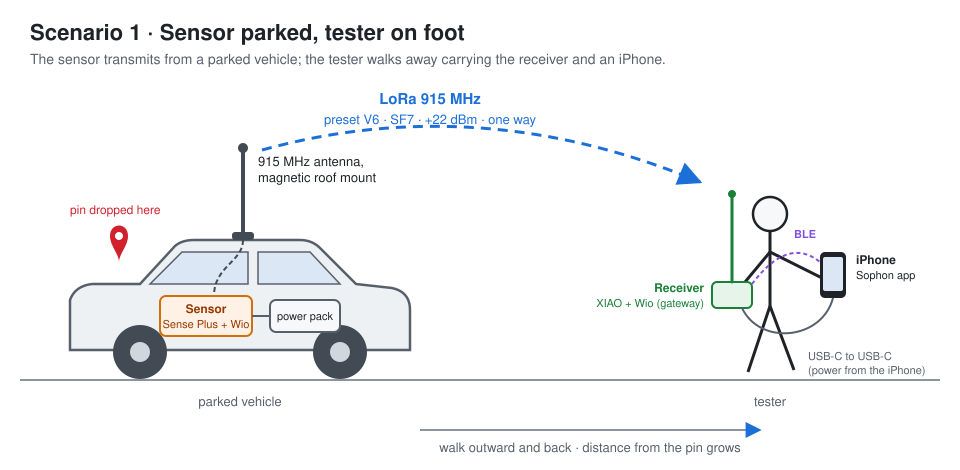
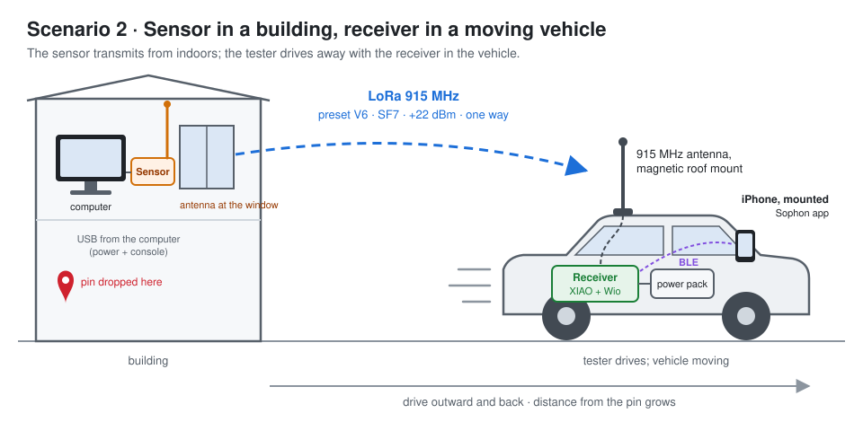

# Sophon LoRa field tests

Two field scenarios for the LoRa relay: a **sensor** (Sense Plus + Wio-SX1262,
transmitting) sends motion over 915 MHz to a **receiver** (base XIAO nRF52840 +
Wio-SX1262, the gateway), which serves the Sophon iPhone app over Bluetooth.
Both run the normal firmware at its default preset, **V6** (SF7, 500 kHz,
4 samples per packet, +22 dBm). For the role detection and the presets, see
README.md § Roles and LORA-PROTOCOL.md § Presets.

These complement the walk test planned in LORA-UPDATED-PLAN.md, which compares
presets side by side in a special walk-test firmware mode. Here the question is
simpler: **how far, and how well, does the link carry in two realistic
set-ups**, with the default preset, as deployed?

## Scenario 1: sensor parked, tester on foot



| | Sensor (transmitter) | Receiver (gateway) |
|---|---|---|
| Where | inside a **parked vehicle**, stationary | **carried** by the tester, on foot |
| Power | a **USB power pack**, with a **LiPo** on the board as backup | the **iPhone**, over a USB-C to USB-C cable |
| Antenna | **outside** the vehicle: 915 MHz antenna on a magnetic roof mount, cable into the cabin | the kit's antenna on the module, held **vertical** |
| App | — | the iPhone, connected to the receiver over Bluetooth |

**What it tests:** range from a fixed, elevated, well-placed transmitter to a
receiver at hand height, as the tester walks away. The roof gives the sensor's
antenna height and a metal ground plane; the receiver's antenna is at its worst
height and close to a body.

## Scenario 2: sensor in a building, receiver in a moving vehicle



| | Sensor (transmitter) | Receiver (gateway) |
|---|---|---|
| Where | **inside a building**, stationary | inside a **moving vehicle** |
| Power | the **computer** it's connected to, over USB, which also gives its console | a **USB power pack**, with a **LiPo** on the board as backup |
| Antenna | **indoors**, on the module, vertical, **at a window** and as high as practical | **outside** the vehicle: 915 MHz antenna on a magnetic roof mount, cable into the cabin |
| App | — | the iPhone, **mounted** in the vehicle, connected over Bluetooth |

**What it tests:** range from an indoor transmitter, paying building
penetration loss, to a mobile receiver with a good antenna. The vehicle moves,
so the link fades faster than on foot, and each 10 s record covers more ground.

## Equipment

| Item | Scenario 1 | Scenario 2 |
|---|---|---|
| Sensor: XIAO nRF52840 Sense Plus + Wio-SX1262 carrier, e.g. `Sophon-86F0` | ✓ | ✓ |
| Receiver: base XIAO nRF52840 + Wio-SX1262 carrier, e.g. `Sophon-0FAA` | ✓ | ✓ |
| iPhone with USB-C (iPhone 15 or later) and the Sophon app | ✓ | ✓ |
| 915 MHz antenna on a magnetic roof mount, with a U.FL-to-SMA pigtail long enough to pass the door seal | for the sensor | for the receiver |
| The kit's own antenna, on the U.FL connector | for the receiver | for the sensor |
| USB power pack and a USB-C cable | for the sensor | for the receiver |
| Single-cell LiPo (e.g. 200 mAh) on the board's battery pads, as backup to the power pack | for the sensor | for the receiver |
| USB-C to USB-C cable, iPhone to receiver | ✓ | — |
| Computer with a USB-C port (and its console, if wanted) | — | ✓ |
| Phone mount for the vehicle | — | ✓ |

**Antennas:**

- **Never power a board without an antenna on its U.FL connector.** At +22 dBm
  an unterminated output reflects its power back into the transmitter
  (HARDWARE.md § Antenna and RF exposure).
- Keep **both antennas vertical**: crossed polarisation costs up to about
  20 dB.
- Keep the roof-mount cable as short as practical. Thin coax loses roughly
  1 dB per metre at 915 MHz, which counts against the link.
- A magnetic mount needs a steel roof. On aluminium, fibreglass or a panoramic
  glass roof, tape it down and expect a weaker ground plane.
- The sensor is capped at **14 dBi** antenna gain at +22 dBm by the FCC limit
  (HARDWARE.md § Antenna and RF exposure); a typical roof whip is 2–5 dBi.

**Power packs, backed by a LiPo:** many USB power packs **switch themselves
off** when the load drops below some tens of milliamps, because they read a
small draw as "nothing connected". The receiver (listening, with one Bluetooth
connection) draws little, and the sensor's draw is bursty.

So fit a **LiPo on the board's battery pads as well**, on whichever board runs
from a power pack:

- **If the pack shuts off, the board carries on from the LiPo.** The XIAO
  switches its supply from USB to the battery automatically, with no reset
  (HARDWARE.md § Power path).
- **While the pack is on, it charges the LiPo**, at about 50 mA until full
  (HARDWARE.md § The charger). That current also helps keep the pack from
  shutting off; once the LiPo is full it stops, and the draw falls back.
- **The LiPo alone lasts hours, not a day.** At +22 dBm a 200 mAh pack runs
  the sensor for very roughly 3–4 hours; the receiver, which only listens,
  for longer. Start with it charged.

Still bench-test the pack: leave it powering the board, LiPo fitted, for
15 minutes, and check it's still supplying power at the end. Use a pack with a
low-current or "always on" mode if it has one.

## Configuring the units for each scenario

Each unit's role can be set from the app (#329; README.md § Configuring a
board), so one set of hardware covers both scenarios without swapping boards or
reflashing:

| Scenario | Vehicle unit (Sense Plus + Wio) | Other unit |
|---|---|---|
| 1 | **Auto**, which is a sensor | **Auto** on a base XIAO + Wio (a gateway), or **Gateway** on a Sense Plus + Wio |
| 2 | **Gateway**: its IMU is left unused | **Sensor**: needs a **Sense Plus + Wio**; a base XIAO can't be a sensor |

So switching between both scenarios from the app alone takes **two Sense Plus +
Wio units**. With one Sense Plus and one base XIAO, scenario 2 needs the boards
swapped on their carriers.

To change a unit:

1. Open it in the app: a gateway or direct board under its name, a sensor under
   **Sensors** (tap it, then **Connect**).
2. **Configuration › Edit…**, pick the role, then **Save and restart**.
3. A unit that becomes a sensor reappears under **Sensors**; one that stops
   being a sensor reconnects in the main list.

Leave the preset and frequency at their defaults on both units, or change them
on **both**: the link needs the same spreading factor and frequency at each end.

## Before going out

1. **Firmware:** both boards on the same release, with V6 as the default, and
   2.28.0 or later to set roles from the app. Check in the app's Device
   section, or with `smpmgr`.
2. **Bench check:** power both, open the app, and connect to the receiver.
   Check each unit's **Configuration** shows the role this scenario needs.
   The LoRa link section should show:
   - **Sensor:** the sensor's `Sophon-XXXX`;
   - **Preset:** `V6 · SF7 · 500 kHz`;
   - **Link quality:** 100%.
   Motion should arrive at about 54 Hz.
3. **Location:** allow Sophon location access (Settings › Sophon), or the
   recording has no positions. Recording continues with the phone locked.
4. **Only one phone:** a board accepts one Bluetooth connection. Close Sophon on
   any other iPhone or iPad, or it may take the receiver first.
5. **Batteries:** charge the iPhone, the power packs and the LiPos fully. A
   board with its LiPo on USB shows its green charge LED while charging; it
   goes out when the LiPo is full.

## Procedure

### Scenario 1: on foot

1. Park in the open if possible, away from large metal structures. Mount the
   antenna on the roof, connect it to the sensor, then power the sensor from
   the pack inside the vehicle.
2. Stand by the vehicle. Connect the app to the receiver and wait for
   **Link quality** 100%.
3. **Start walk-test recording**, then **Drop pin here (at the sensor)**: every
   row's distance is measured from this pin.
4. Walk outward along the route. At each waypoint (e.g. 25, 50, 100, 200, 400,
   800 m), **stop and hold still for at least 30 s**: three 10 s records.
   Note the time and anything visible between you and the vehicle.
5. Keep going until **Link quality** falls below about 50%, or the app shows
   no new records, then walk back the same way. The return leg checks the
   outward one.
6. **Stop recording.**

### Scenario 2: by car

**Safety first: the driver does not operate the phone.** Set everything up
before moving, mount the phone where it can be glanced at, and read it only
when parked, or have a passenger watch it. The recording needs no attention
while driving.

1. Place the sensor indoors at a window, as high as practical, antenna
   vertical. Power it from the computer. Optionally open its console to log
   its `lora tx` lines: send errors would show there.
2. Mount the antenna on the vehicle roof, connect it to the receiver, and power
   the receiver from the pack inside the vehicle.
3. Before leaving, with the vehicle **next to the building**, connect the app
   to the receiver and wait for **Link quality** 100%.
4. **Start walk-test recording**, then **Drop pin here (at the sensor)** while
   still beside the building.
5. Drive outward along the planned route. Where it's safe and legal, **stop for
   at least 30 s** at intervals, so some records are taken with the vehicle
   still. At 50 km/h a single 10 s record spans about 140 m, so moving records
   are coarse.
6. Continue until the link drops out, then return by the same route.
7. When parked, **stop recording**.

## What to watch

The app's **LoRa link** section, which updates every 10 s:

| Row | Meaning | What it tells you |
|---|---|---|
| **Link quality** | packets received out of packets sent in the window | the verdict: 100% is a clean link |
| **Margin** | SNR above the demodulation floor (SF7: −7.5 dB), average and worst packet | the early warning. Watch the **worst-packet** margin: it nears 0 dB before Link quality drops (PROTOCOL.md § Margin) |
| **LoRa RSSI / SNR** | signal strength and signal-to-noise, average and minimum | how the signal falls with distance and obstruction |
| **Last packet** | time since the last packet arrived | a stalled link shows here first |
| **This session** | samples, missing, bad | cumulative totals for the run |
| **Distance** | from the dropped pin, while recording | the x-axis of the results |

Motion arriving at about 54 Hz in the Motion section is the end-to-end check:
the frames the iPhone shows are the sensor's, relayed.

**Spotting a power-pack shut-off.** The app's battery and Charger rows describe
the **sensor**, relayed by the receiver:

- On USB the row reads **VBAT net**, with a **Charger** row below it.
- If the sensor's pack switches off, within a minute the row changes to
  **Battery** and the Charger row disappears: the sensor is now on its LiPo.

That covers scenario 1, where the sensor is on the pack. In scenario 2 the
receiver is on the pack, and the app doesn't show the receiver's own power
source. Check its charge LED, or its pack, at a stop.

## Results

Each recording is a CSV in the Files app (On My iPhone › Sophon), one row per
10 s record: time, position, distance from the pin, `lq_pct`, `margin_db`,
`margin_min_db`, `rssi_avg`, `rssi_min`, `snr_avg`, `snr_min`, `samples`,
`missing`, `bad`, and more. Copy it to the Mac and summarise it by distance:

```bash
zephyr/sophon/scripts/walktest-report.py <recording>.csv
```

Record each run:

| Field | Scenario 1 | Scenario 2 |
|---|---|---|
| Date, place, weather | … | … |
| Firmware, preset | … | … |
| Sensor antenna (type, height, position) | … | … |
| Receiver antenna (type, height, position) | … | … |
| Route (line of sight, obstructed, mixed) | … | … |
| Farthest distance at Link quality ≥ 99% | … | … |
| Farthest distance with any records | … | … |
| Worst-packet margin at that distance | … | … |
| Notes (obstructions, interference, power-pack shut-offs) | … | … |

To compare the scenarios fairly, keep the boards, antennas and preset the
same, and note what differs: antenna heights, indoor against outdoor, standing
against moving.
