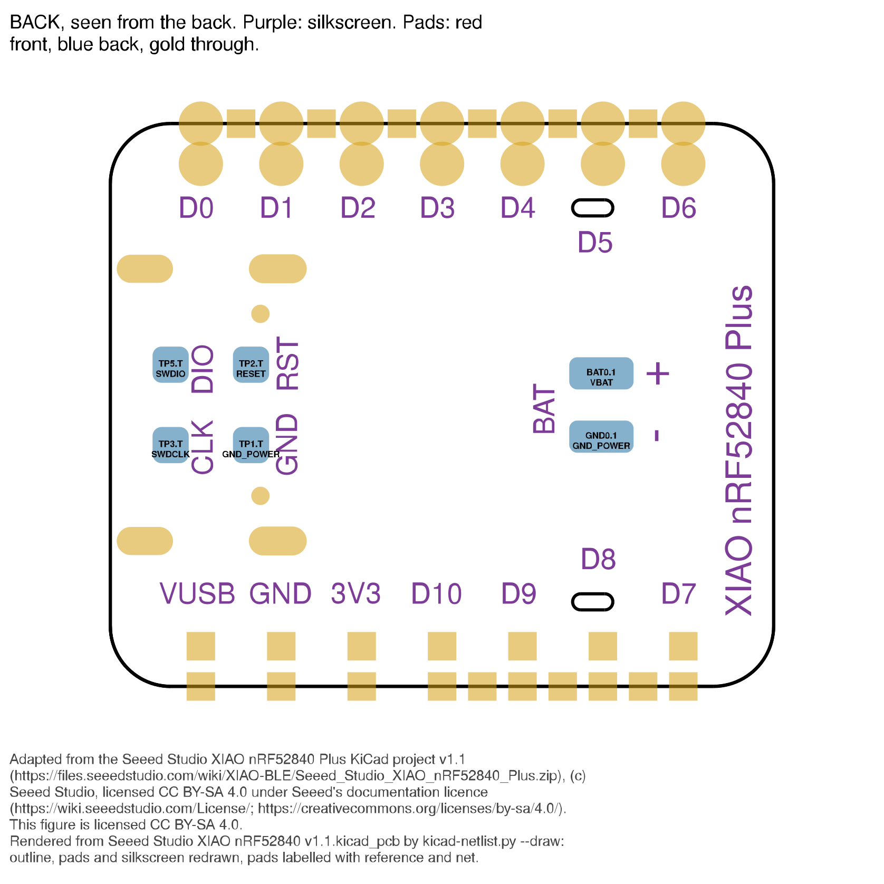
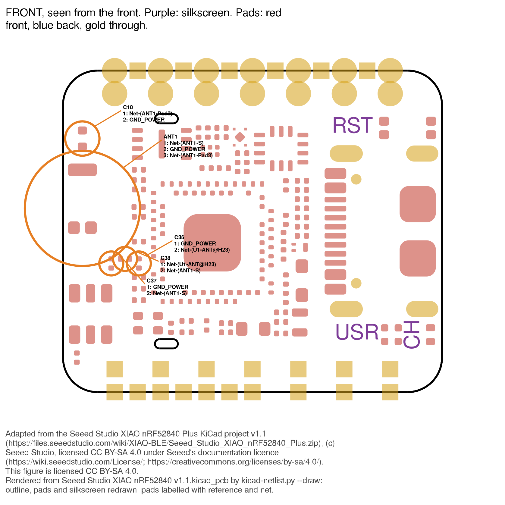
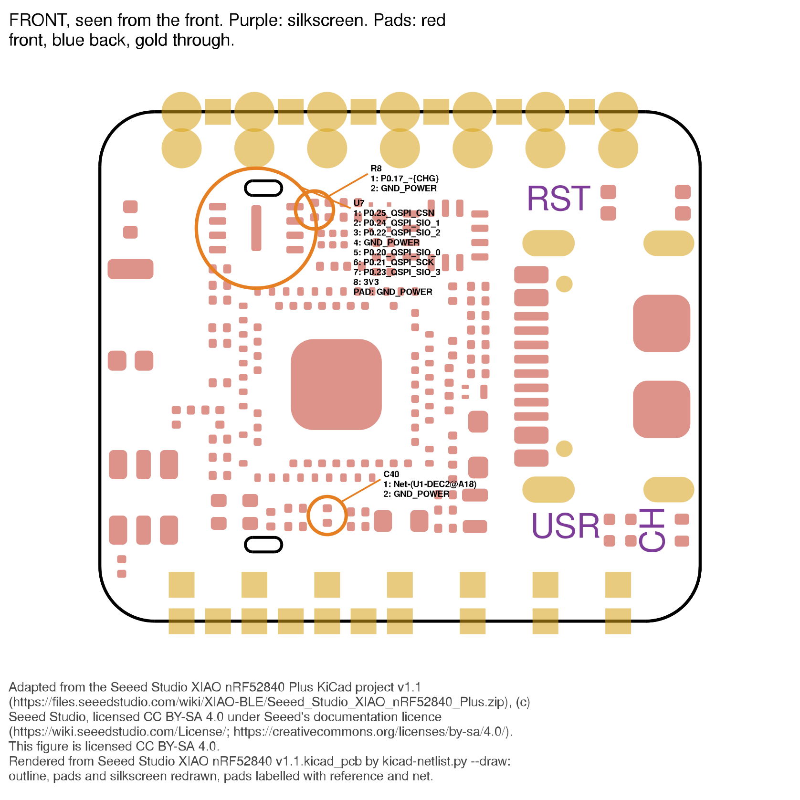

# Design review: Seeed Studio XIAO nRF52840 Sense Plus, design "v1.1" (2026-11-12)

> **Frozen record, committed in #391. It is not edited after the fact.** The
> live record of this board is [../HARDWARE.md](../HARDWARE.md); where the two
> disagree, HARDWARE.md is right. Its findings were checked and merged there in
> #391. Follow-up: #393 (the gateway's battery divider).

A full review of the Seeed Studio XIAO nRF52840 Plus KiCad project, which draws
the Sense Plus (IMU and microphone included), for Sophon (`zephyr/sophon/`):
battery-powered, Zephyr, BLE IMU streaming, battery voltage and charge status,
and optionally a Wio-SX1262 on the XIAO header. Run with the
`kicad-design-review` and `kicad-netlist` skills.

## Credits and licence for figures

The figures marked † are adapted from the **Seeed Studio XIAO nRF52840 Plus
KiCad project, v1.1** by **Seeed Studio**,
<https://files.seeedstudio.com/wiki/XIAO-BLE/Seeed_Studio_XIAO_nRF52840_Plus.zip>,
(c) Seeed Studio.

**The design files carry no licence mark of their own.** The archive holds no
licence file, neither sheet nor PCB carries licence text, and the PCB's only
logo is Seeed's own (`Logo:LOGO-SEEED-NEW-1X9.6MM`), with no `LOGO_CC_BY-SA_4.0`
footprint. The
licence is therefore taken from **Seeed's wiki licence page**
(<https://wiki.seeedstudio.com/License/>), which puts Seeed's documentation
under **CC BY-SA 4.0** (<https://creativecommons.org/licenses/by-sa/4.0/>).

**What was changed:** each figure was rendered from the design's `.kicad_pcb` by
`kicad-netlist.py --draw`. The board outline, pads and silkscreen are redrawn,
and the selected pads are labelled with their reference and net. Each SVG
carries the same credit, and a change note, in its footer and metadata.

**Scope:** only the figures marked † are licensed CC BY-SA 4.0. The rest of this
document is not covered by that licence. This is a reading of the licence, not
legal advice.

## 1. Where the authoritative data is

**Design**

| | |
|---|---|
| Archive | `Seeed_Studio_XIAO_nRF52840_Plus.zip`, fetched from the URL above on 2026-11-12 |
| SHA-256 | `f5e4e0e9c7d1725a89be2677549734f6ad96a8e00a16cb1742e0b3abfa99bdd9` (matches the expected hash) |
| Extracted folder | `202004149, PCBA; Seeed Studio XIAO nRF52840 Plus v1.0_原理图/` |
| Root files | `Seeed Studio XIAO nRF52840 v1.1.kicad_sch` / `.kicad_pcb` / `.kicad_pro`, one sheet, an Eagle import (`…v1.1-eagle-import:` symbols) |
| Also in the archive | Gerbers (`…v1.1_gerber/`), the schematic PDF `202004149;PCBA;Seeed Studio XIAO nRF52840 Plus v1.1_PDF.pdf` |

**Revision: unconfirmed.** The evidence disagrees:

| Source | Says |
|---|---|
| `.kicad_sch` title block | none (no `title_block` on the sheet) |
| `.kicad_pcb` title block | none |
| file names | `… v1.1` |
| extracted folder name | `… Plus v1.0_原理图` ("schematic") |
| bundled PDF, revision block (*PDF text*) | `V1.0  Initail Version  2024.10.29  Wenkang.Liu`, the only row |
| Gerber job file | `"Revision": "rev?"`, created 2025-02-11 |

This review calls the design "v1.1" after its file names, as the brief does. The
revision rests on those names only.

**Datasheets** (all held in `zephyr/sophon/datasheets/`; every file checked to
start with `%PDF`)

| Part | Ref | File | Source URL | SHA-256 | Proxy |
|---|---|---|---|---|---|
| nRF52840 Product Specification v1.1 (4413_417 v1.1) | U1 | `Nordic_nRF52840_PS_v1.1.pdf` | held; origin URL not recorded in the repo | `c619e336b9c0610663273041f057f2537a65fd408ce0c5b8214a26de2aa88422` | no |
| BQ2510x, SLUSBV8C (covers BQ25100 and BQ25101) | U2 | `TI_BQ25101_SLUSBV8C.pdf` | <https://www.ti.com/lit/ds/symlink/bq25101.pdf>, re-fetched 2026-11-12, byte-identical | `085f9e461632bcbaf70cc94a6863728e6797f63877c9c939961e450dce9edba7` | no |
| LSM6DS3TR-C, DocID030071 Rev 3 | U3 | `ST_LSM6DS3TR-C.pdf` | <https://www.st.com/resource/en/datasheet/lsm6ds3tr-c.pdf> (as recorded in `hw/nrf54lm20a/HARDWARE.md`) | `251737db70e3b6cdc217a5681dd4634a05faffd5288aff6a576078a6464a1b2b` | no |
| TLV733P, SBVS235C | U6 | `TI_TLV733P.pdf` | <https://www.ti.com/lit/ds/symlink/tlv733p.pdf>, re-fetched 2026-11-12, byte-identical | `5af1ef361f574c01de9c5fa6d890a2f191894ab3cecd9183d2000d97df4ea77c` | no |
| MSM261D3526H1CPM, Ver. 1.2, DS-042 | MIC1 | `MEMSensing_MSM261D3526H1CPM.pdf` | held; origin URL not recorded in the repo | `bf8f9f07ba6a2748f0235c2bcc4d1c11f36f05f2b845427fd6584786a11b9050` | no |

No datasheet is held for Q1 (P-MOSFET), D1 (diode), ANT1 (chip antenna), X1/X2,
U7 (DNP flash), USB1 or the LEDs. See § Not established.

## 2. How each fact was established

| Tag | Meaning |
|---|---|
| *netlist* | `kicad-netlist.py` on the root `.kicad_sch`, a design that passed `--check-pcb` |
| *PCB* | the `.kicad_pcb`: a pad's net, a footprint, its side, silkscreen near a pad, copper (`--copper`) |
| *datasheet* | the part's datasheet, with page (PDF page number) or table |
| *PDF text* | the bundled schematic PDF's text layer: weakest, never a conclusion on its own |
| *Zephyr* | a file under `~/zephyrproject/zephyr/` (board files, drivers) or Sophon's overlay and built `.config` |

A sentence without a tag is an inference, and says so.

**`--check-pcb` passed:**

```
pads compared: 266  (PCB pads with a net: 266, not found in schematic: 0)
PCB nets: 74  split across schematic nets: 0  schematic nets spanning several PCB nets: 0
```

Exit 0. The counts equal the reference figures in `kicad-netlist` § Changing the
script (266 / 74), so every net below may be reported.

## 3. This board

Roles are named from footprint and part number, not reference (*netlist*,
`--values`; *PCB*).

| Ref | Value / part | Footprint | Role |
|---|---|---|---|
| U1 | nRF52840 (QIAA) | `AQFN50P700X700X85_HS-74N` | MCU, aQFN73 |
| U2 | Value `BQ25100`; symbol and footprint `BQ25101_DSBGA_6` | DSBGA-6 | Li-ion linear charger (variant: § 3 below) |
| U6 | Value `3.3V`; symbol `TLV733P` | `X2SON-4` | 3.3 V LDO, the 3V3 rail |
| Q1 | `PMOS_1.00.60.35MM` | `PMOS_1.0*0.6*0.35MM` | P-MOSFET, battery switch in the load path |
| D1 | `DIODE'0603'` | `SOD-523` | diode, VBUS → VIN |
| U3 | LSM6DS3TR-C | `LGA14-0.5-2.5X3X0.86MM` | 6-axis IMU |
| MIC1 | MSM261D3526H1CPM | `MIC6P-3.5X2.65X0.94MM` | PDM microphone |
| U7 **(DNP)** | Value `DNP`; symbol `W25XXC` | `USON2X3_8` | QSPI NOR flash footprint, **not fitted** |
| ANT1 | ANTENNA-AN3216 | `ANT-SMD3P-3.2X1.6X1.04MM` | 2.4 GHz chip antenna, 3 pads |
| X1 | 32.768 kHz | `X2-SMD-L1.6X1.0X0.5MM` | LF crystal |
| X2 | 32 MHz | `4P1612` | HF crystal |
| USB1 | USB2.0-TYPE-C | `USB2.0-TYPE-C` | USB-C receptacle |
| U4 | XIAO-HALF-HOLE-23P | `Module:MOUDLE23P-XIAO-HALF-HOLE` | the XIAO castellated header, 23 pads |
| K1 | BUTTON-4P | `SW4-SMD-2.8-2.6X1.6X0.53MM` | reset button |
| RGB6 | RGB | `4P1010` | RGB user LED, common anode |
| CHG0 | `RED` | `LED-0402` | charge LED (green on hardware: § Corrections) |
| L3 | 10 µH | `L0603` | nRF52840 DC/DC (REG1) inductor |
| C38 | `4.7nH` | **`L0201`** | RF series inductor, despite its `C` reference |
| TP1–TP3, TP5 | test point | `TP-D45MIL`, back | SWD and reset pads |
| BAT0, GND0 | test point | `TP-80X40MIL`, back | battery pads |

All parts except the six test pads are on the front (*PCB*).

## 4. Parts and datasheets: pins checked

- **U1, aQFN73 ball map.** All **74** of U1's balls in the netlist agree with
  the PS's Table 142 (*datasheet* pp. 576–578). 72 agree by exact name. The two
  others agree in function: AC13 is `P0.18/RESET` in the symbol and
  `P0.18`/`nRESET` in the PS; G74 is `VSS_PAD` in the symbol and "Die pad, VSS"
  in the PS.
- **U2.** The symbol's pins A1 OUT, A2 IN, B1 TS, B2 ISET, C2 VSS match both
  variants (*datasheet* p. 3). Ball C1, named `PRETERM` in the symbol, is
  PRE-TERM on the BQ25100 and **/CHG on the BQ25101** (*datasheet* p. 3, Device
  Comparison Table and Pin Configuration). See § 6.
- **U6.** The netlist's 1 OUT, 2 GND, 3 EN, 4 IN, plus thermal pad T on GND,
  match the TLV733P's DQN (X2SON-4) pinout (*datasheet* p. 4).
- **U3.** All 14 pins match Table 2 (*datasheet* p. 20).
- **MIC1.** Pins 1 VDD, 2 CLK, 3 DATA, 4/6 GND, 5 L/R match (*datasheet* p. 10).

## 5. Power

**Rails and what feeds them** (*netlist*; *PCB* for the same pad sets)

| Net | Members |
|---|---|
| `VBUS` | USB1 A4/B9, B4/A9; U2.A2 IN; D1 anode; **Q1 gate**; R9 100k to GND; U1.AD2 VBUS; U4.14 (silkscreen `VUSB`); C9, C25 2.2 µF |
| `VIN` | D1 cathode; **Q1 source**; U6.4 IN; **U6.3 EN**; C4 2.2 µF |
| `VBAT` | U2.A1 OUT; BAT0 (back pad, `+`); **Q1 drain**; R16 (divider top); C30 2.2 µF |
| `3V3` | U6.1 OUT; U1 VDD (A22, AD14, AD23, B1, W1) and **VDDH (Y2)**; U4.12 (header 3V3); RGB6 anode; R13 (reset pull-up); R5 (charge LED); C3, C6, C29, C39, C41; U7.8 VCC (DNP) |
| `6D_PWR` | U1.P2 = **P1.08**; U3 VDD, VDDIO, CS; R14, R15 (I²C pull-ups); C1 100 nF |
| `P1.10_MIC_PWR` | U1.A20 = **P1.10**; MIC1 VDD; C8 100 nF |
| `DEC4-6` | U1 DEC4 (B5), DEC6 (E24); L3 pin 2; C34 100 nF; C42 2.2 µF |

**Load path** (*netlist*; inference for the transistor's state):

- **USB present:** VBUS feeds VIN through D1. Q1's gate is at VBUS, so Q1 is
  off and the pack is not on the load path. The charger U2 runs from VBUS and
  charges VBAT.
- **USB absent:** R9 pulls VBUS, and so Q1's gate, to GND. Q1 conducts and the
  pack feeds VIN. D1 is reverse-biased by the full pack voltage (VIN at VBAT,
  VBUS at 0 V).

**Always-on rails.** U6's EN is tied to its IN (`VIN`), not to a GPIO
(*netlist*). TI: "If shutdown capability is not required, connect EN to IN"
(*datasheet* TLV733P p. 14). So **3V3 is always on whenever a pack or USB is
present**. It feeds the header 3V3 pad (U4.12), so **anything plugged into the
header, a Wio-SX1262 included, is powered from the pack continuously**.

**Switchable rails:** only `6D_PWR` (from P1.08) and `P1.10_MIC_PWR` (from
P1.10), both GPIO-driven (*netlist*).

**MCU supply mode.** VDDH (Y2) is tied to VDD (*netlist*), so the nRF52840 is
in normal voltage mode. In that mode "only the REG1 regulator stage is used and
the REG0 stage is automatically disabled" (*datasheet* PS p. 61). DCCH (AB2) is
unconnected, with pad net `unconnected-(U1-DCCH@AB2-PadAB2)` (*PCB*). REG1's
DC/DC has its inductor: DCC (B3) → L3 10 µH → `DEC4-6` (*netlist*). Nordic's
closest reference, Config. 5 (VDD from an external regulator, DCDCEN1, USB),
puts a further 15 nH (L3 in their BOM) in series (*datasheet* PS p. 594,
Table 157). This board has only the 10 µH.

## 6. Regulator and charger strapping

| Strap | Netlist | Effect (datasheet) |
|---|---|---|
| U6 EN | tied to VIN | always enabled (TLV733P p. 14) |
| U2 TS (B1) | R20 10k to GND, net named `/CE` | the datasheet's "no NTC" connection: "If NTC sensing is not needed, connect this pin to VSS through an external 10-kΩ resistor" (p. 3). The 50.5 µA NTC bias (p. 7) puts TS at ≈0.5 V, inside the normal-charge window (between V_TS-45°C 0.268 V and V_TS-10°C 0.80 V, p. 7), so **charging is never temperature-limited**. Despite its name, the net is not a chip-enable. |
| U2 ISET (B2) | R18 2.7k to GND; R12 2.7k from ISET to **P0.13** (`P0.13_HICHG` = {R12.2, U1.AD8} only) | I_OUT = K_ISET / R_ISET, K_ISET 135 AΩ typ (p. 6). P0.13 high-impedance → 2.7 kΩ → **50 mA**. P0.13 driven low → 1.35 kΩ → **100 mA**. Both are inside the 0.54–13.5 kΩ range (p. 4). P0.13 driven high is not a datasheet configuration (inference: it injects current into ISET). |
| U2 C1 | net `P0.17_~{CHG}` = U2.C1, CHG0 cathode, R8 (**DNP**) to GND, U1.AD12 = P0.17; CHG0 anode → R5 2.2k → 3V3 | on a BQ25101, /CHG, open drain, low while charging (p. 3), with CHG0 as the indicator. On a BQ25100 this ball is PRE-TERM, programmed by a resistor to VSS (p. 3). R8 sits exactly there, from C1 to GND, so the board appears laid out for either variant (inference). |
| U2 VO(REG) | | 4.20 V on both the BQ25100 and the BQ25101 (p. 3, Device Comparison Table), so the charge voltage does not depend on which variant is fitted. |

**Which charger is fitted is not settled by the design.** The Value field says
BQ25100. The symbol library, the footprint, the net name `~{CHG}` and the LED
wiring all say BQ25101. `hw/nrf52840/HARDWARE.md` settles it on hardware (§
Corrections).

**What firmware overrides.** Nothing in the Zephyr board files touches P0.13 or
U2 (*Zephyr* `xiao_ble_common.dtsi`, `xiao_ble_nrf52840_sense.dts`). Sophon
doesn't drive P0.13 (no reference in `src/`), so it charges at the reset
default, 50 mA. Sophon's overlay reads P0.17 as `charge_status`
(`GPIO_ACTIVE_LOW | GPIO_PULL_UP`) (*Zephyr* Sophon overlay, `src/battery.c`).

**nRF52840 regulators in Zephyr.** `&reg1 { regulator-initial-mode =
<NRF5X_REG_MODE_DCDC>; }` enables the DC/DC, whose LC filter is fitted (L3).
`&reg0 { status = "okay"; }` makes `soc_early_init_hook()` set DCDCEN0 (*Zephyr*
`xiao_ble_common.dtsi`; `soc/nordic/nrf52/soc.c`). Per PS p. 61, REG0 is
automatically disabled in normal voltage mode, so this should have no effect
(inference). Note PS p. 62: "Do not enable DC/DC regulator without an external
LC filter", and this board has none on DCCH. `&uicr { gpio-as-nreset; }` maps
P0.18 to reset, which matches the `RESET` net (*netlist*).

## 7. Debug access

There is no onboard probe. The SWD nets reach only the MCU and a test pad
(*netlist*):

| Silkscreen label | Pad | Net | Other members |
|---|---|---|---|
| `DIO` | TP5 | `SWDIO` | U1.AC24 SWDIO only |
| `CLK` | TP3 | `SWDCLK` | U1.AA24 SWDCLK only |
| `RST` | TP2 | `RESET` | U1.AC13 P0.18/nRESET, K1, R13 10k to 3V3, C5 100 nF to GND |
| `GND` | TP1 | `GND_POWER` | |
| `BAT +` | BAT0 | `VBAT` | |
| `BAT -` | GND0 | `GND_POWER` | |

**Pattern:** each SWD label sits **to the right of its pad, reading upward**,
seen from the back (figure below). The four SWD pads form a 2 × 2 grid at
2.54 mm pitch on the back (*PCB*: TP2 (154.53, 103.73), TP5 (157.07, 103.73),
TP1 (154.53, 106.27), TP3 (157.07, 106.27)). The board outline spans x
138.02–158.98 and y 96.11–113.89 mm. So TP2/TP1 are 16.51 mm and TP5/TP3
19.05 mm from the left edge, as drawn from the front. TP2/TP5 are 7.62 mm and
TP1/TP3 10.16 mm from the D0–D6 edge.



*Figure 1 † — Back of the board, drawn as seen from the back (the way it is held
to probe). The SWD pads TP5 (SWDIO), TP2 (RESET), TP3 (SWDCLK) and TP1 (GND) sit
in a 2 × 2 grid at the left, each with its silkscreen label (`DIO`, `RST`,
`CLK`, `GND`) to its right. The battery pads BAT0 (VBAT, `+`) and GND0
(`-`) are at the right. The header's castellated pads and the silkscreen D0–D10,
`VUSB`, `GND`, `3V3` labels run along the top and bottom edges.*

**RESET:** the reset net carries 100 nF (C5) and a 10 kΩ pull-up to 3V3 (R13)
(*netlist*). A probe driving reset works against both.

## 8. USB

| Connector pin | Net | Reaches |
|---|---|---|
| A6/B6 DP | `USB_D+` | R11 33 Ω → U1.AD6 D+ |
| A7/B7 DN | `USB_D-` | R10 33 Ω → U1.AD4 D− |
| A5 CC1 / B5 CC2 | own nets | R1 / R2 5.1 kΩ to GND each (a sink) |
| A8/B8 SBU | | unconnected (`unconnected-(USB1-…SBU…)` on the PCB) |
| VBUS | `VBUS` | U1.AD2 VBUS, U2 IN, D1, Q1 gate, R9, U4.14 |
| shell S1–S6 | GND | |

The **MCU's own USB is wired** (*netlist*, *PCB*), with DECUSB (AC5) decoupled
by C22 2.2 µF. No DNP part is on the path. Zephyr enables it as
`zephyr_udc0: &usbd` with the CDC ACM console (*Zephyr*
`xiao_ble_common.dtsi`). On USB, the header's `VUSB` pad is VBUS itself.

## 9. Header and connector pin map

U4 is the castellated XIAO header, 23 pads (*netlist*, *PCB*). Pads 1–14 are
the standard XIAO pins. Pads 15–23 are the **Plus's extra pads**: small square
castellations interleaved between the standard ones on both long edges,
1.27 mm from their neighbours (*PCB* pad coordinates). They show as the square
pads between the round ones in Figure 1.

| Pad | Silkscreen | Net | MCU pin | Else on the net | Zephyr (`seeed_xiao_connector.dtsi`, pinctrl) |
|---|---|---|---|---|---|
| 1 | D0 | `P0.02_AIN0_LOW_A0_D0` | P0.02 / AIN0 | — | D0 → gpio0 2 ✓ |
| 2 | D1 | `P0.03_AIN1_LOW_A1_D1` | P0.03 / AIN1 | — | D1 → gpio0 3 ✓; Wio DIO1 |
| 3 | D2 | `P0.28_AIN4_LOW_A2_D2` | P0.28 / AIN4 | — | D2 → gpio0 28 ✓; Wio RESET |
| 4 | D3 | `P0.29_AIN5_LOW_A3_D3` | P0.29 / AIN5 | — | D3 → gpio0 29 ✓; Wio BUSY |
| 5 | D4 | `P0.04_AIN2_A4_D4` | P0.04 / AIN2 | — | D4 → gpio0 4 ✓; i2c1 SDA; Wio NSS |
| 6 | D5 | `P0.05_AIN3_A5_D5` | P0.05 / AIN3 | — | D5 → gpio0 5 ✓; i2c1 SCL; Wio RXEN |
| 7 | D6 | `P1.11_TX_D6` | P1.11 | — | D6 → gpio1 11 ✓; uart0 TX |
| 8 | D7 | `P1.12_RX_D7` | P1.12 | — | D7 → gpio1 12 ✓; uart0 RX (`bias-pull-up`) |
| 9 | D8 | `P1.13_SCK_D8` | P1.13 | — | D8 → gpio1 13 ✓; spi2 SCK |
| 10 | D9 | `P1.14_MISO_D9` | P1.14 | — | D9 → gpio1 14 ✓; spi2 MISO |
| 11 | D10 | `P1.15_MOSI_D10` | P1.15 | — | D10 → gpio1 15 ✓; spi2 MOSI |
| 12 | 3V3 | `3V3` | — | always-on LDO output | |
| 13 | GND | GND | — | | |
| 14 | VUSB | `VBUS` | U1 VBUS | USB VBUS | |
| 15 | (none) | `P0.15_I2S_SD` | P0.15 | — | **not mapped** |
| 16 | (none) | `P0.19_I2S_SCK` | P0.19 | — | **not mapped** |
| 17 | (none) | `P1.01_I2S_WS` | P1.01 | — | **not mapped** |
| 18 | (none) | `P0.09/NFC1/RX1` | P0.09 / NFC1 | — | **not mapped**; NFC mode (§ 13) |
| 19 | (none) | `P0.10/NFC2/TX1` | P0.10 / NFC2 | — | **not mapped**; NFC mode (§ 13) |
| 20 | (none) | **`P0.31_AIN7_BAT`** | P0.31 / AIN7 | **R16 (from VBAT), R17 (to P0.14)**: the battery divider's midpoint | Sophon's `vbatt` ADC channel 7 |
| 21 | (none) | `P1.03_SCK1` | P1.03 | — | **not mapped** |
| 22 | (none) | `P1.05_MISO1` | P1.05 | — | **not mapped** |
| 23 | (none) | `P1.07_MOSI1` | P1.07 | — | **not mapped** |

Along the D0–D6 edge, pads 15–20 sit between D0|D1, D1|D2, D2|D3, D3|D4, D4|D5
and D5|D6. Along the D7–D10 edge, pads 21, 22, 23 sit between D7|D8, D8|D9 and
D9|D10 (*PCB*). The extra pads carry no silkscreen label of their own on either
side (*PCB*, Figure 1).

**Differences from Zephyr (findings):**

- D0–D10 match `seeed_xiao_connector.dtsi`'s `gpio-map` exactly, and the
  pinctrl's uart0, i2c1 and spi2 land on the right D pins.
- **Pads 15–23 have no Zephyr mapping.** The connector binding stops at D10, and
  no board node names P0.15, P0.19, P1.01, P1.03, P1.05, P1.07, P0.09 or P0.10.
- **Pad 20 is the battery divider's midpoint.** It is not a free GPIO (§ 13).
- **The D-pin nets carry nothing else on the board** (two members each,
  *netlist*). So the Wio-SX1262's pins (Sophon `boards/common/wio-sx1262.dtsi`:
  D1–D5, D8–D10) meet no on-board load.

## 10. Peripherals

**LSM6DS3TR-C (U3)** (*netlist*; *datasheet* ST)

| | |
|---|---|
| Bus | I²C. SDA = P0.07 (`INTERNAL_I2C_SDA`), SCL = P0.27 (`INTERNAL_I2C_SCL`). R15 / R14 10 kΩ pull-ups to **`6D_PWR`**, the switchable rail. |
| Mode | CS (pin 12) tied to `6D_PWR` → I²C enabled whenever powered (p. 20) |
| Address | SDO/SA0 (pin 1) to GND → **0x6A** (p. 39) |
| SDx / SCx (pins 2, 3) | to GND, as Table 2 allows in mode 1 (p. 20) |
| INT1 | P0.11 (`6D_INT1`), **no pull-up**. Default push-pull, active high (CTRL3_C `PP_OD` = 0, `H_LACTIVE` = 0, p. 63); "Output forced to ground" by default (p. 47). **No idle current.** |
| INT2 | unconnected (`unconnected-(U3-INT2-Pad9)`, *PCB*) |
| Supply | VDD and VDDIO on `6D_PWR` = P1.08 at 3.3 V, within 1.71–3.6 V (p. 24), C1 100 nF. No filter. |
| Zephyr | `lsm6ds3tr-c@6a` on `&i2c0`, `irq-gpios = <&gpio0 11 GPIO_ACTIVE_HIGH>`; rail `lsm6ds3tr-c-en` on gpio1 8, `regulator-boot-on`, 3 ms startup. All match. |

**MSM261D3526H1CPM (MIC1)** (*netlist*; *datasheet* MEMSensing)

| | |
|---|---|
| Bus | PDM CLK = P1.00, DATA = P0.16. Zephyr pinctrl `pdm0` matches. |
| Channel | L/R (pin 5) to GND → data on the CLK falling edge (p. 7) |
| Supply | VDD from **P1.10** (`P1.10_MIC_PWR`), C8 100 nF. 1.6–3.6 V (p. 3). |
| Zephyr | `msm261d3526hicpm-c-en` on gpio1 10, **not** boot-on. `regulator_fixed_init()` drives it `GPIO_OUTPUT_INACTIVE` (*Zephyr* `drivers/regulator/regulator_fixed.c`), so the mic is unpowered unless firmware enables it. `pdm0` is `disabled` and `CONFIG_AUDIO` is not set in either Sophon build. |

**RGB LED (RGB6) and charge LED (CHG0)** (*netlist*)

- RGB6: common anode on 3V3. Red through R7 2.2k to P0.26, green through R4 10k
  to P0.30, blue through R3 2.2k to P0.06. All active low, matching Zephyr's
  `led0..2`.
- CHG0: 3V3 → R5 2.2k → CHG0 → `P0.17_~{CHG}` (§ 6).
- **`PWR_LED`** is a net label on P1.06 alone: one pad, no tracks (*PCB*). No
  power LED is fitted.

**QSPI flash (U7): not fitted** (§ 12). Zephyr's `&qspi` still declares a
`p25q16h` (`jedec-id = [85 60 15]`, `has-dpd`) on P0.20–P0.25 (*Zephyr*
`xiao_ble_common.dtsi`). Its driver is built in both MCUboot-mode images
(`CONFIG_NORDIC_QSPI_NOR=y` in `build-mcuboot/sophon/zephyr/.config` and
`build-mcuboot/mcuboot/zephyr/.config`), and not in the UF2 build. No Sophon
partition uses it: all of `hw/nrf52840/mcuboot-partitions.overlay` is in
`&flash0`.

## 11. RF

The chain from the radio pin, walked part by part (*netlist*, values from
`--values`):

```
U1.H23 ANT ──┬── C38 4.7 nH (series; L0201 footprint) ──┬── ANT1.1 (S, feed)
             │                                          │
          C36 0.8 pF                                 C37 0.5 pF
           to GND                                     to GND
                                ANT1.3 ── C10 1 nF to GND;  ANT1.2 = GND
```

- **Shunt 0.8 pF, series 4.7 nH, shunt 0.5 pF.** These are exactly Nordic's
  "v1.1" RF match values (C3 0.8 pF, L1 4.7 nH, C4 0.5 pF; *datasheet* PS
  p. 594, Table 157). Nordic's optional C22 (N.C.) has no footprint here.
- **The last part is ANT1**, footprint `ANT-SMD3P-3.2X1.6X1.04MM`: a 3.2 × 1.6 mm
  three-pad **chip antenna** (*PCB*). No connector is on the RF path, so the
  radio needs nothing fitted.
- **Copper** (`--copper`, *PCB*): `Net-(U1-ANT@H23)` = C36.2, C38.1, U1.H23, with
  no zones. `Net-(ANT1-S)` = ANT1.1, C37.2, C38.2, with no zones.
  `Net-(ANT1-Pad3)` = ANT1.3, C10.1, joined by one **1.60 × 1.32 mm F.Cu zone**
  and no tracks. That is a small pour between two pads, not a printed antenna.
  The board has no copper graphics on any copper layer, no footprint copper
  graphics, and no keepouts. **There is no PCB antenna; the chip antenna is the
  radiator.**



*Figure 2 † — Front of the board, showing the RF chain. C36, C38 and C37 sit
just left of the nRF52840 (the large central pad), and lead to ANT1, the
three-pad chip antenna at the left edge, with C10 above it. Each ringed part is
labelled with its pads' nets. The drawing rings ANT1 with a single large circle,
and C10's label crosses a silkscreen outline: read the labels, not the ring
sizes.*

## 12. DNP parts

Not-fitted parts are marked only by Value `DNP`; every KiCad DNP attribute is
`no`, as `kicad-netlist` § 3 warns for this vendor. Three are not test points
(*netlist*):

| Part | Pin 1 | Pin 2 | Fitted, it would | As built |
|---|---|---|---|---|
| **U7** QSPI NOR flash (`W25XXC`, USON-8 2 × 3 mm) | 1 ~CS P0.25, 2 DO P0.24, 3 ~WP P0.22, 5 DI P0.20, 6 CLK P0.21, 7 ~HOLD P0.23 | 4 GND, PAD GND, 8 VCC 3V3 | add an external flash on the QSPI bus, powered from the always-on 3V3 | **no external flash.** P0.20–P0.25 reach only U7's empty pads (two-member nets, *PCB*), so they float as built. |
| **R8** | `P0.17_~{CHG}` (U2.C1, CHG0 cathode, P0.17) | GND | tie C1 to GND: on a BQ25100, the PRE-TERM programming resistor; on a BQ25101, it would hold /CHG low (charge LED always on, P0.17 always low) | nothing loads C1 but the LED/R5 and P0.17 |
| **C40** | U1.A18 **DEC2** | GND | decouple DEC2 | DEC2 undecoupled, **as Nordic's reference does**: C13 on DEC2 is "N.C., Not mounted" in Config. 5 (*datasheet* PS p. 593 Figure 214, p. 594 Table 157) |

R8 and C40 are shunts to GND. Their GND side is noted, not printed.



*Figure 3 † — Front of the board, showing where the three not-fitted parts' pads
are. U7, the 8-pad USON flash footprint with its centre pad, is at the upper
left, between the D0 edge and the nRF52840. Its label lists all nine pads' nets
(the QSPI lines, 3V3, GND). R8 is the small 0201 just right of U7, on
`P0.17_~{CHG}` and GND. C40 is the 0201 below the nRF52840, on DEC2 and GND.*

## 13. Hazards

1. **Battery divider on a GPIO: hold P0.14 low.**
   - The chain is VBAT – R16 1 MΩ – `P0.31_AIN7_BAT` – R17 499 kΩ – P0.14
     (*netlist*).
   - The nRF52840's absolute maximum on an I/O is VDD + 0.3 V = 3.6 V
     (*datasheet* PS p. 612, Table 173).

   | P0.14 | AIN7 at a 4.2 V pack |
   |---|---|
   | driven low | 4.2 × 499/1499 = **1.40 V** (safe) |
   | driven high (3.3 V) | 3.3 + 0.9 × 499/1499 = **3.60 V**, the limit |
   | high-impedance (reset state, bootloaders, System OFF unless latched) | pulled toward 4.2 V through 1 MΩ, past the limit, into the pin's clamp |

   The clamp current is limited by R16 to under 1 µA (inference).
   - **Sophon** drives P0.14 low once in `sophon_battery_init()` and never
     releases it (*Zephyr* Sophon `src/battery.c`, overlay `vbatt_enable`).
   - **Before that point**, and throughout MCUboot, the pin is at its
     high-impedance reset state, so AIN7 sits above its absolute maximum on any
     charged pack (inference from the netlist and the PS).
   - **Pad 20 exposes the same node.** Anything wired to it shares the divider
     and sees up to VBAT.
2. **P0.13 (`HICHG`): leave it high-impedance, or drive it low.**
   High-impedance gives 50 mA, low gives 100 mA (§ 6). Driving it high is
   outside the datasheet's configurations (inference).
3. **P0.17 carries the charger's /CHG and the charge LED, yet the board files
   put `pwm0` (`pwm_led0`) on it** (*Zephyr* `xiao_ble-pinctrl.dtsi`
   `pwm0_default`, `xiao_ble_common.dtsi`).
   - With PWM built, the pin would be driven against an open-drain output, and
     would light CHG0 with no charge. /CHG sinks up to 15 mA (absolute maximum,
     *datasheet* BQ2510x p. 4).
   - **Not a hazard for Sophon:** `# CONFIG_PWM is not set` in all three
     configs (`build/zephyr/.config`, `build-mcuboot/sophon/zephyr/.config`,
     `build-mcuboot/mcuboot/zephyr/.config`). It applies only to builds that
     enable PWM.
4. **Back-feed into the IMU.**
   - R14/R15 pull SDA/SCL up to `6D_PWR`, and CS is on that rail (*netlist*).
   - If P1.08 is turned off while P0.07/P0.27 are driven or pulled high, the
     IMU is fed through its I/O (inference).
   - Sophon never turns the rail off (`regulator-boot-on`, no `regulator_*`
     calls in `src/`), and i2c0's sleep pinctrl is `low-power-enable`. So no
     current case exists.
   - The microphone is the same pattern on P1.10 with PDM CLK on P1.00. PDM is
     not built.
5. **NFC pins on pads 18/19 (labelled RX1/TX1 by the net names).**
   - Neither Sophon build sets `&uicr { nfct-pins-as-gpios; }` (*Zephyr*
     `zephyr.dts`, both builds).
   - So P0.09/P0.10 stay NFC pins: "The GPIO function on those pins will also be
     disabled", and the protection circuit shorts the two pins together above
     about 2 V difference (*datasheet* PS p. 209).
   - Using pads 18/19 as UART1 needs that property.
   - In GPIO mode, driving the two to different levels leaks 1 µA typ, 10 µA max
     between them (I_NFC_LEAK, *datasheet* PS p. 157).
6. **Pins with fitted loads:**
   - P0.00/P0.01 carry X1 (32.768 kHz, C2/C7 10 pF).
   - P0.18 is reset (K1, C5 100 nF, R13 10 kΩ).
   - P0.17 carries the charge LED.
   - The RGB LED sits on P0.26/P0.30/P0.06.
   - VBUS carries R9 100k, so the 5 V pad sinks 50 µA when USB is present.
7. **Unconnected GPIOs** (not hazards):
   - unconnected pads (*PCB*): P0.08, P0.12, P1.02, P1.04, P1.09;
   - P1.06 (`PWR_LED`, one pad);
   - as built, P0.20–P0.25, which go only to DNP U7.

No other hazard found.

## 14. Battery quiescent budget

On battery: USB absent, Q1 on, U6 regulating 3V3 from the pack. The MCU's own
figure is excluded.

| Part | State on battery | Current | Source |
|---|---|---|---|
| **U6 TLV733P** (always on) | regulating, I_OUT ≈ 0 for its own term | **34 µA typ, 60 µA max** (I_GND at I_OUT = 0, V_IN = 3.8 V, T_J −40 to 125 °C) | *datasheet* p. 6 |
| R16 + R17 divider | P0.14 held low (Sophon) | V/1.499 MΩ: **2.80 µA** at 4.2 V, 2.47 µA at 3.7 V | *netlist* |
| U2 charger | IN = 0 V | ≤ 75 nA (0–125 °C), ≤ 50 nA (0–85 °C) into OUT | *datasheet* p. 5, I_OUT(PDWN) |
| CHG0 + R5 → /CHG | /CHG released | ≤ 1 µA (I_LEAK at V_CHG = 5 V; bound) | *datasheet* p. 8 |
| P0.17 internal pull-up (Sophon) | node already at 3V3 | ≈ 0 (inference) | |
| D1, reverse-biased by VBAT into VBUS → R9 100k | | **not established** (no part number) | |
| Q1 | on | its gate leakage only; not established | |
| R9 100k | VBUS ≈ 0 V | ≈ 0, except D1's leakage | inference |
| R13 reset pull-up, RGB6 (GPIOs released), I²C pull-ups (lines idle high) | idle | ≈ 0 | inference |
| U7 flash | **not fitted** | 0 as designed | *netlist* |
| MIC1 | rail off (Zephyr default) | 0. With the rail on and no clock: ≤ 1 µA (I_SLEEP, f_CLOCK ≤ 50 kHz). | *Zephyr*; *datasheet* p. 3 |
| U3 IMU, on `6D_PWR` | **rail off:** 0 | **power-down:** 3 µA typ (at 1.8 V) | *datasheet* p. 24 |
| U3 IMU, **as Sophon runs it** | rail on, accel + gyro at 52 Hz, never stopped | **0.29 mA typ** for "gyroscope and accelerometer … low-power mode, ODR = 52 Hz" (at 1.8 V); the driver's actual mode not established | *datasheet* p. 24; *Zephyr* `prj.conf`, `src/imu.c` |
| Anything on header 3V3 (Wio-SX1262) | always powered | off-board; not established | |

**Fixed sum:**

| Case | U6 | Divider | U2 | /CHG leak | Total |
|---|---|---|---|---|---|
| typical, 4.2 V | 34 µA | 2.8 µA | 0.075 µA | — | **≈ 37 µA** |
| bound | 60 µA | 2.8 µA | 0.075 µA | 1 µA | **≈ 64 µA** |

Both exclude D1's leakage, the MCU and the IMU. **The dominant part is U6, the
always-on TLV733P, about 92% of the fixed typical.** At 37 µA a 200 mAh pack
lasts about 225 days on the board alone (inference).

**With Sophon as built, the IMU dominates.** It streams continuously at 52 Hz
on both channels, a few hundred µA, an order of magnitude above the board's
floor. The board's own floor matters only once firmware powers the IMU down
(ODR 0) or switches `6D_PWR` off.

**Low-power states that need firmware:**

| Part | What firmware must do |
|---|---|
| IMU | power-down needs ODR 0 or P1.08 off |
| Mic | stays off only while P1.10 is low (Zephyr's default) |
| Divider | stays at 2.8 µA only while P0.14 is held low, which it must be |
| QSPI flash | would need deep power-down if fitted on a real unit (§ Not established) |

## Corrections

Read after the review: `zephyr/sophon/hw/nrf52840/HARDWARE.md`, plus the
comments in Sophon's board overlay, which state hardware facts. HARDWARE.md
holds the hardware measurements, which no design review can override.

1. **HARDWARE.md § The charger, the v1.1 column:** *"Net `P0.17_~{CHG}`: U2.C1,
   R8 (DNP), P0.17"* and *"`CHG0` anode: R5 (the parser leaves the LED
   unconnected on this sheet)"*.
   - **The review is right.** On this design, which passes `--check-pcb` with
     0 split / 0 merged, the net is **CHG0 cathode, R8 (DNP), U1.AD12 P0.17,
     U2.C1**, and CHG0's anode goes through R5 2.2k to 3V3 (*netlist*; *PCB*
     pads `CHG0.-`, `R8.1`, `U1.AD12`, `U2.C1` and `Net-(CHG0-Pad+)` = CHG0.+,
     R5.2). That is identical to the base v1.2's wiring.
   - **How the error arose:** an older run of the script left the LED
     unconnected. This is likely the rotated-and-mirrored transform bug fixed in
     #384, or a run before `--check-pcb` existed (inference).
   - HARDWARE.md's conclusion, that C1 is /CHG, stands, and the netlist now
     supports it directly.
2. **HARDWARE.md § The charger, pin table:** *"`P0.13_HICHG` | `U2.B2` `ISET` |
   `R18` 2.7k, `R12` 2.7k to GND"*.
   - **The review is right.** `P0.13_HICHG` holds only **R12.2 and U1.AD8**.
     ISET (`Net-(U2-ISET)`) is **R12.1, R18.1, U2.B2**, and R18.2 is GND
     (*netlist*, *PCB*).
   - So P0.13 reaches ISET through R12, and only R18 goes to GND. The prose
     below the table (high-impedance → R18 alone, 50 mA; low → R18 ∥ R12,
     100 mA) is consistent with this. The table's topology is not.
3. **HARDWARE.md § Power path:** *"U6, a 3.3 V LDO (X2SON-4; the schematic gives
   `Value = 3.3V` and no part number)"*.
   - **The review adds the part.** The symbol's library name is `TLV733P`
     (`lib_id "…eagle-import:TLV733P"`), and the netlist's pinout matches the
     TLV733P DQN package (*datasheet* p. 4).
   - **Why it matters:** its 34 µA ground current is the board's largest fixed
     battery load (§ 14).
   - **Caveat:** the library name is the designer's; the fitted part's marking
     is not established.
4. **HARDWARE.md § ADC configuration:** *"A 4.2 V pack presents
   `4.2 × 499/1499` = 1.42 V at the pin"*.
   - **Arithmetic error.** 4.2 × 499/1499 = **1.40 V**. The 1.42 V is the
     510 kΩ figure, 4.2 × 510/1510 = 1.418 V.
   - The overlay's ADC comment still computes it with 510/1510. The § P0.14
     table (≈ 1.4 V) is right. The headroom argument is unaffected.
5. **HARDWARE.md § The battery sense circuit** (*"R17 499 kΩ (v1.1) / 510 kΩ
   (v1.0)"*), and the overlay's *"Seeed_Studio_XIAO_nRF52840_Plus.zip carries
   the .kicad_sch for **v1.1**"*.
   - **The revision label is weaker than stated.** This archive has no title
     block. Its folder is named `… Plus v1.0_原理图`. Its bundled PDF's only
     revision row reads **`V1.0 Initail Version 2024.10.29`** (*PDF text*).
     Its Gerber job says `rev?`. Only file names say v1.1.
   - What *is* established: this design, and this design's own PDF, both give
     R17 = 499k_1% (*netlist*; *PDF text* `499k_1%`).
   - HARDWARE.md is right to keep R17 open pending a meter. The "v1.1 = 499k,
     v1.0 = 510k" pairing should be stated as "this zip = 499k, the other zip's
     PDF = 510k", not as revisions.
6. **Design vs hardware, charge LED colour.**
   - The design's Value for CHG0 is `RED` (*netlist*). HARDWARE.md records it
     **green** on hardware (86F0).
   - **HARDWARE.md is right.** It is a measurement. The design's Value field is
     wrong. No change to HARDWARE.md.
7. **Design vs hardware, U2 variant.**
   - The design's Value says `BQ25100`. Its symbol and footprint are BQ25101,
     with C1 misnamed `PRETERM`.
   - **HARDWARE.md is right** (P0.17 low while charging, high at termination
     with USB in).
   - The review adds a reason the labels are mixed: R8 (DNP) is placed where a
     BQ25100's PRE-TERM resistor would go (inference).
8. **HARDWARE.md § SWD test points (base board):** *"The vertical offsets
   weren't measured"*.
   - For the Sense Plus they are **7.62 mm (TP2, TP5) and 10.16 mm (TP1, TP3)
     from the D0–D6 edge**. The horizontal offsets, 16.51 and 19.05 mm, agree
     (*PCB*).
   - Not a contradiction; recorded here because it completes HARDWARE.md's
     statement.

No statement in HARDWARE.md about the load path, VBUS/VIN/VBAT members, the
divider topology, P0.14's states, the ADC acquisition time, or the 3V3 header
pin disagrees with this review.

## Not established

| What | Why | What would settle it |
|---|---|---|
| The design's revision | no title block; the PDF says V1.0, the files v1.1 | Seeed, or a unit's silkscreen revision mark |
| **Whether real Sense Plus units carry U7 (QSPI flash)** | the design marks it DNP; Seeed's product material was not consulted | read the JEDEC ID over QSPI on 86F0 (the MCUboot images already run the `p25q16h` driver: look for its init error in the boot log), or inspect under the shield |
| What the QSPI NOR driver does at boot with U7 absent | not traced | the boot log of an MCUboot build |
| Which R17 is fitted (499k vs 510k) | design-only | meter the pack against the reported voltage (HARDWARE.md, TEST-PLAN § 5b) |
| U2's fitted variant, from the design | Value vs symbol disagree | settled on hardware by HARDWARE.md (BQ25101) |
| D1's part and reverse leakage, which lands on the battery | no part number, no datasheet | the BOM, or measure the pack current with and without D1's path |
| Q1's part, threshold and leakage | no part number; no proxy chosen, since no question here turned on its parameters | the BOM, or a marking |
| ANT1's datasheet: pad 3's function and C10's role | none held | the AN3216's datasheet |
| Crystal load capacitance (C2/C7 10 pF on X1, C32/C33 15 pF on X2) | crystal datasheets not held | X1/X2 part numbers |
| The IMU's operating mode at 52 Hz (high-performance or low-power) under the `st,lsm6dsl` driver, and so its current | not traced in the driver | read CTRL6_C/CTRL7_G, or measure |
| The MCU's sleep current on this board | design-only (PS typicals at 3 V: System OFF 0.40 µA, System ON + RTC + full RAM 3.16 µA, *datasheet* p. 56, for reference) | measure on battery |
| Whether `DCDCEN0 = 1` from `&reg0` is inert in normal voltage mode | PS p. 61 says REG0 is disabled in that mode; not tested | boards boot today; a measurement of System ON current with and without it |
| Origin URLs of the held nRF52840 PS and MSM261 datasheets | not recorded in the repo; not re-fetched (Nordic refuses scripted downloads, `kicad-netlist` § 5) | record when next fetched |
| The Wio-SX1262's draw on the always-on 3V3 | off-board | its datasheet (held) and a measurement |

## For HARDWARE.md

### Verified

Each fact cites this report.

1. **Correction:** on v1.1, `P0.17_~{CHG}` = CHG0 cathode, R8 (DNP), P0.17,
   U2.C1, and CHG0's anode → R5 2.2k → 3V3. The LED *is* connected
   (*netlist*, *PCB*).
2. **Correction:** `P0.13_HICHG` = R12.2, U1.AD8 only. ISET = R12.1, R18.1,
   U2.B2. R18.2 = GND (*netlist*, *PCB*).
3. **Correction:** 4.2 × 499/1499 = **1.40 V**, not 1.42 V (arithmetic).
4. **New:** U6 is a **TLV733P** by symbol library. Pinout matches the DQN
   package. EN is tied to IN, so **3V3 is always on**. I_GND 34 µA typ / 60 µA
   max at no load (*netlist*; *datasheet* TLV733P pp. 4, 6, 14).
5. **New, battery budget:** the board's fixed draw on battery is **≈ 37 µA typ,
   ≤ 64 µA bound**, excluding the MCU, the IMU and D1. U6 dominates
   (*datasheet*, *netlist*; § 14).
6. **New:** **U7, the QSPI flash footprint, is DNP in this design.**
   - P0.20–P0.25 reach only its pads (*netlist*, *PCB*).
   - Zephyr's `p25q16h` node and the QSPI NOR driver are nonetheless built into
     both MCUboot-mode images (*Zephyr*).
7. **New:** TS = 10 kΩ to GND is TI's no-NTC configuration. TS sits at ≈ 0.5 V
   inside the normal window, so charging is never temperature-limited
   (*datasheet* BQ2510x pp. 3, 7).
8. **New:** VO(REG) is 4.20 V for both the BQ25100 and the BQ25101, so the
   variant question doesn't affect charge voltage (*datasheet* p. 3).
9. **New:** U2's OUT leakage with no input is ≤ 75 nA. /CHG leakage is ≤ 1 µA
   (*datasheet* pp. 5, 8).
10. **New, header:** U4 has 23 pads. Pads 15–23 are the Plus's extra
    castellations, interleaved between D0|D1 … D5|D6 (15–20) and D7|D8 …
    D9|D10 (21–23), as listed in § 9.
    - **Pad 20 is `P0.31_AIN7_BAT`, the battery divider's midpoint.**
    - Pads 18/19 are P0.09/P0.10, in NFC mode unless `nfct-pins-as-gpios` is
      set.
    - None of 15–23 is in Zephyr's XIAO connector map (*netlist*, *PCB*,
      *Zephyr*).
11. **New:** the Wio-SX1262's D pins (D1–D5, D8–D10) carry nothing else on the
    board (*netlist*).
12. **New:** the board's `pwm0`/`pwm_led0` claims P0.17, the /CHG net. It is
    inert in every Sophon build (`# CONFIG_PWM is not set`), but would fight
    /CHG in any build that enables PWM (*Zephyr*).
13. **New:** IMU at **0x6A**, I²C mode (CS on its rail). INT1 on P0.11 is
    push-pull, active-high, with no pull-up, so it draws nothing at idle. INT2 is
    unconnected (*netlist*, *datasheet* LSM6DS3TR-C pp. 20, 39, 47, 63).
14. **New:** the mic rail (P1.10) is driven off at boot by `regulator-fixed`
    (*Zephyr* `regulator_fixed.c`).
15. **New:** the RF match equals Nordic's v1.1 values (0.8 pF / 4.7 nH /
    0.5 pF), ending at a 3.2 × 1.6 mm chip antenna. There is no PCB antenna and
    no RF connector (*netlist*, *PCB* `--copper`, *datasheet* PS p. 594).
16. **New:** C40 on DEC2 is DNP, matching Nordic's reference (C13 N.C.) (*datasheet* PS pp. 593–594).
17. **New:** U1's aQFN73 ball names agree with the PS on all 74 balls (*datasheet*
    PS pp. 576–578).
18. **New, SWD pads on the Sense Plus:** a 2.54 mm grid at 16.51 / 19.05 mm
    from the left edge (front view), and 7.62 / 10.16 mm from the D0–D6 edge.
    Each silkscreen label is to the right of its pad, seen from the back
    (*PCB*, Figure 1).
19. **New:** `PWR_LED` (P1.06) connects to nothing. Unconnected GPIOs: P0.08,
    P0.12, P1.02, P1.04, P1.06, P1.09, and P0.20–P0.25 as built (*PCB*).

### Leads

Verify before merging, or list under § Not established.

1. **Do real Sense Plus units have the QSPI flash?** Read the boot log of an
   MCUboot build on 86F0 for the `p25q16h` init result, or read the JEDEC ID.
   - If absent: drop or disable `&qspi` in Sophon's overlay, so the driver
     doesn't run.
   - If present: the flash must be put in deep power-down for sleep current,
     and the UF2 build, which lacks the driver, leaves it in standby.
2. **The "v1.1" label.** The archive's own PDF says V1.0. Restate R17's open
   question by archive, not by revision.
3. **D1's reverse leakage into VBUS on battery** may be a µA-level term
   (Schottky-class diodes in SOD-523 often are). Settle with a pack-current
   measurement.
4. **The IMU dominates Sophon's sleep current** (≈ 0.29 mA class at 52 Hz).
   Any battery-life work starts there, before the board's 37 µA floor.
5. **P0.14 is high-impedance from reset until `sophon_battery_init()`,** and
   for all of MCUboot, so AIN7 is above its absolute maximum through 1 MΩ
   during every boot. MCUboot could drive it low early; whether that is worth
   doing is a judgement, not established here.
6. **`&reg0` okay sets DCDCEN0 with no inductor on DCCH.** It is inert per the
   PS in normal voltage mode, but a one-line overlay (`&reg0 { status =
   "disabled"; }`) would remove the question.
7. **The design names U2 `BQ25100`, CHG0 `RED` and U6 `3.3V`.** The fitted
   markings could be read under a microscope to close the part-number gaps (U2,
   U6, Q1, D1).

## Merge notes (#391)

Checked against source before merging into [../HARDWARE.md](../HARDWARE.md),
2026-11-12:

- **Confirmed:**
  - the charge LED's nets (cathode on `P0.17_~{CHG}`, anode via R5 to 3V3);
  - the `P0.13_HICHG` and ISET nets;
  - 4.2 × 499/1499 = 1.40 V;
  - TLV733P `IGND` 34 µA typ / 60 max at no load (TI datasheet);
  - U7 DNP by Value;
  - `CONFIG_NORDIC_QSPI_NOR=y` in Sophon's MCUboot build;
  - INT1 on P0.11 with no pull-up;
  - TI's fixed-10 kΩ-on-TS configuration;
  - the five unconnected GPIOs (P0.08, P0.12, P1.02, P1.04, P1.09) on the PCB.
- **Qualified, Lead 4:** 0.29 mA is the LSM6DS3TR-C's *low-power-mode* figure at
  52 Hz (`IddLP`). The part powers up in high-performance mode, which this review
  didn't establish Sophon changes, so the IMU's real draw is probably higher.
  It is recorded in HARDWARE.md as a lead, not a figure.
