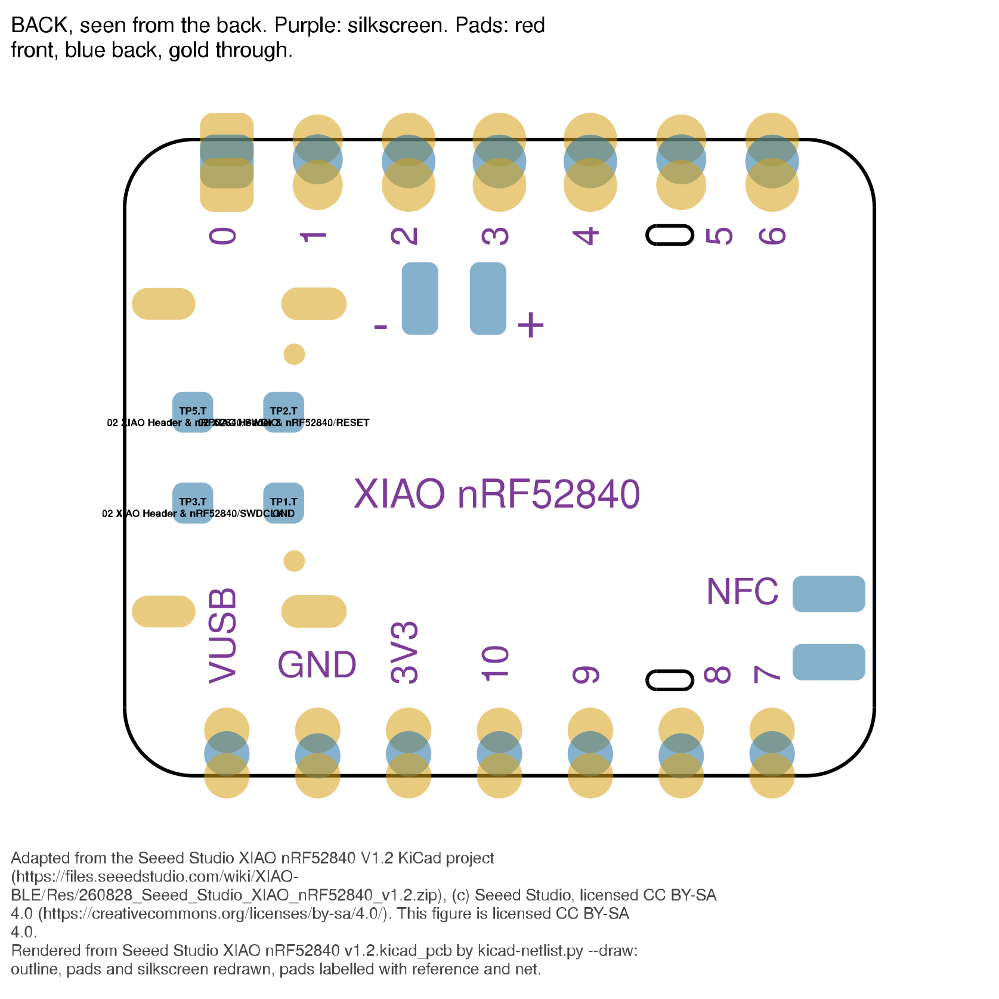
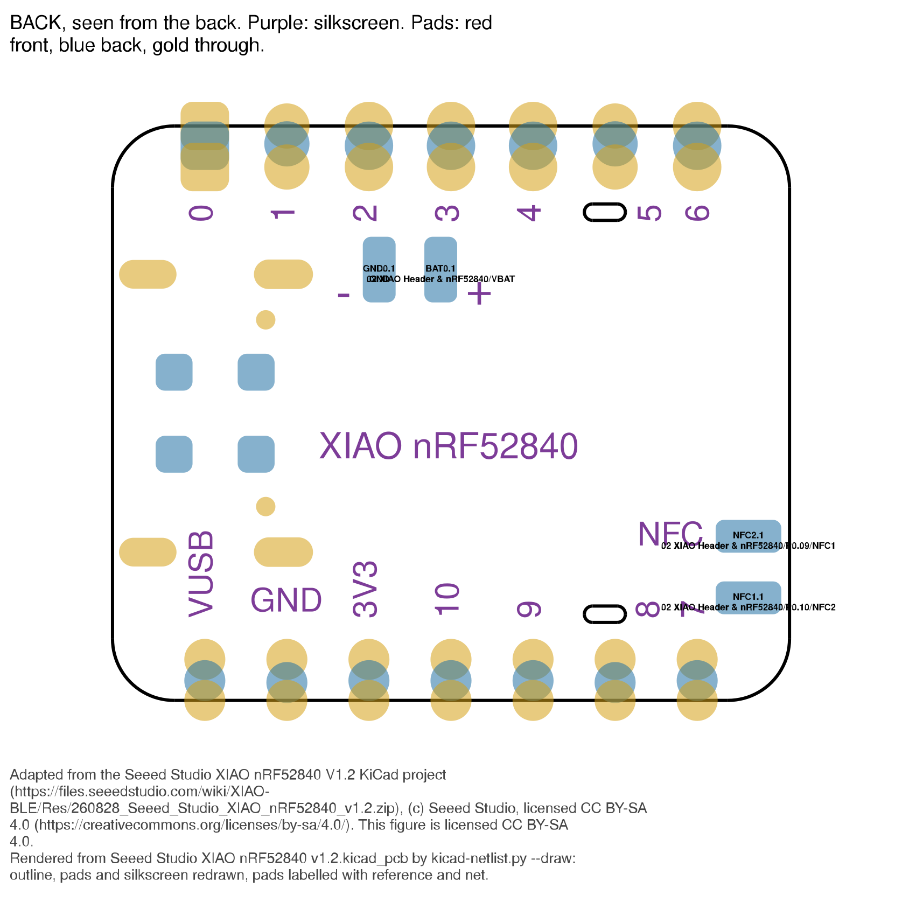
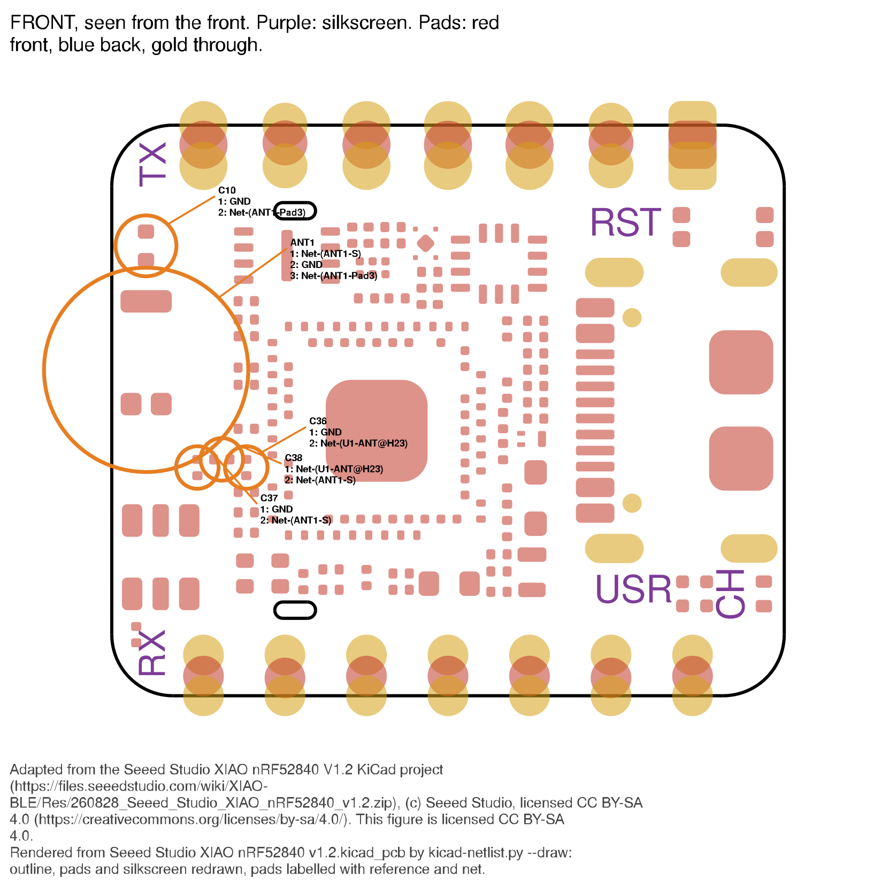
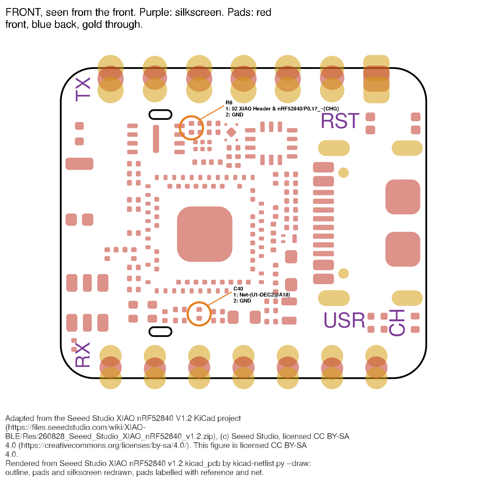
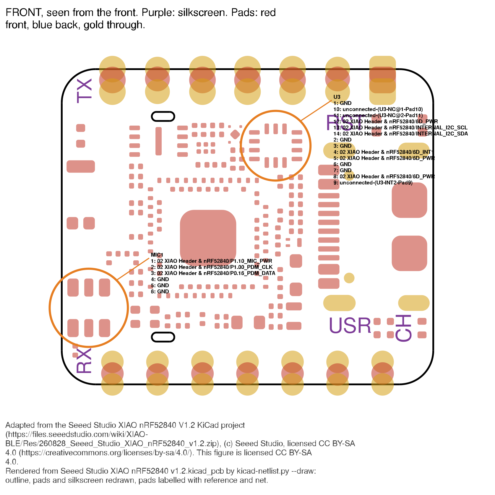

# Design review: Seeed Studio XIAO nRF52840, V1.2 (2026-11-12)

> **Frozen record, committed in #391. It is not edited after the fact.** The
> live record of this board is [../HARDWARE.md](../HARDWARE.md); where the two
> disagree, HARDWARE.md is right. Its findings were checked and merged there in
> #391. Follow-up: #393 (the gateway's battery divider).

## Credits and licence for figures

The figures marked † in this document are adapted from the **Seeed Studio XIAO
nRF52840 V1.2 KiCad project**
(<https://files.seeedstudio.com/wiki/XIAO-BLE/Res/260828_Seeed_Studio_XIAO_nRF52840_v1.2.zip>),
© Seeed Studio, licensed
[CC BY-SA 4.0](https://creativecommons.org/licenses/by-sa/4.0/). The design's
PCB carries `LOGO_CC_BY-SA_4.0` footprints (U5, U8, U9).

How they were changed: each was rendered from the design's `.kicad_pcb` by
`kicad-netlist.py --draw`. The board outline, the pads and the board-level
silkscreen text are redrawn, and the pads of the named parts are labelled with
their reference and net. Nothing else in the design is reproduced.

Covered: Figures 1–5 (†), and only those. They are licensed CC BY-SA 4.0. Each
SVG carries the same credit in its footer and metadata. The rest of this
document is not an adaptation of the design and is not covered by that licence.

## Kind of review

`zephyr/sophon/hw/nrf52840/reviews/` does not exist, so no earlier review of
this design exists: this is a **full review**. `--check-pcb` passed (§ 2), so it
covers the whole schematic.

## 1. Where the authoritative data is

| Source | Revision / identity | SHA-256 |
|---|---|---|
| [KiCad project](https://files.seeedstudio.com/wiki/XIAO-BLE/Res/260828_Seeed_Studio_XIAO_nRF52840_v1.2.zip) (`260828_Seeed_Studio_XIAO_nRF52840_v1.2.zip`) | root sheet + `01 Descriptions` + `02 XIAO Header & nRF52840`, `.kicad_pcb`, KiCad 10.0 | `973a5543514b2a6799fdb658666a803c0694a784f21ef8633debbccd1511ea95` (matches the expected hash) |
| Title block, all three sheets | `XIAO nRF52840`, **rev V1.2**, 2026-08-28. The `.kicad_pcb` has no title block. | — |
| Bundled `260828_XIAO_nRF52840.pdf` | 3 pages, "Microsoft: Print To PDF", **no text layer** (pdftotext returns nothing) | `b2a1921c…4fd1cd7` |

The revision is confirmed by the title blocks, which agree with the archive
name. Sheet 01's revision table (read off the PDF image) gives V1.2's changes
as: "Change U7 value from DNP to 16Mbit SPI Flash; Remove DNP attribute from U7;
Align U7 assembly status with BOM B.2" (V1.1: "Change 32M Crystal; Change
C32, C33 to 15pF").

### Datasheets

All are in `zephyr/sophon/datasheets/` (gitignored).

| Part | Ref | File | Source | SHA-256 | Proxy |
|---|---|---|---|---|---|
| nRF52840 PS v1.1 (4413_417) | U1 | `Nordic_nRF52840_PS_v1.1.pdf` | held; source URL not recorded, not re-fetched | `c619e336b9c0610663273041f057f2537a65fd408ce0c5b8214a26de2aa88422` | no |
| BQ25101, SLUSBV8C | U2 | `TI_BQ25101_SLUSBV8C.pdf` | <https://www.ti.com/lit/ds/symlink/bq25101.pdf> (re-fetched; hash matches the held file) | `085f9e461632bcbaf70cc94a6863728e6797f63877c9c939961e450dce9edba7` | no |
| SGM2040, Rev. B (July 2024) | U6 | `SGMicro_SGM2040.pdf` | <https://www.sg-micro.com/rect/assets/9d7e04e6-7450-4c5c-b94c-fa500b90b628/SGM2040.pdf?access_token=JB0xlRQ-10F_vQg1XXqsnx8zy4iF65LO> (the link on sg-micro.com/product/SGM2040) | `cabd1eb65e9bc1499ff316afeac0355e7764bd990551a23b041ad4980d2f6aca` | no |
| LP0404N3T5G, Rev.O Sep 2016 | Q1 | `LRC_LP0404N3T5G.pdf` | <https://static.chipdip.ru/lib/495/DOC013495051.pdf>: ChipDip's copy of LRC's datasheet | `e09e1836f1fba2d043f54de53c57b5ea2ef31c7fe8fdade2112fda71c3493e87` | no (mirror) |
| SDM20U40, DS30393 Rev. 12-2 | D1 | `Diodes_SDM20U40.pdf` | <https://www.diodes.com/assets/Datasheets/SDM20U40.pdf> | `9eafc8e0addac2fa9a0418c57c10e65913412f79002eeb0b2e93cf3e60c06a28` | no |
| P25Q16H (dated 2019-07-29) | U7 | `Puya_P25Q16H.pdf` | <https://datasheet.lcsc.com/datasheet/pdf/289775256f3b77bc20d79e5cfa8f2f0e.pdf?productCode=C559220>: LCSC's copy, for P25Q16H-UXH-IR | `7b071670e3e0c2ded8929e06892a4914812de5f1d93e366bd42de3c8c12efc14` | **proxy** (§ 3) |
| LSM6DS3TR-C, DocID030071 Rev 3 | U3 | `ST_LSM6DS3TR-C.pdf` | held; st.com URL as recorded in `hw/nrf54lm20a/HARDWARE.md`, not re-fetched | `251737db70e3b6cdc217a5681dd4634a05faffd5288aff6a576078a6464a1b2b` | no |
| MSM261D3526H1CPM | MIC1 | `MEMSensing_MSM261D3526H1CPM.pdf` | held; source URL not recorded | `bf8f9f07ba6a2748f0235c2bcc4d1c11f36f05f2b845427fd6584786a11b9050` | no |
| SX1261/2 Rev 1.2 | off-board (Wio-SX1262) | `Semtech_SX1261-2_datasheet_Rev1.2.pdf` | held | `644b55f38e97309161ea0c952a3a093020d94268ca8276eca53e5aa933ae7068` | no |

Not fetched, because no question below depended on them: the chip antenna
(ANT1), the crystals (X1, X2), the RGB and charge LEDs, the USB-C connector and
the button. ANT1's pad functions therefore rest on the netlist only (§ 8).

## 2. How each fact was established

| Tag | Meaning |
|---|---|
| *netlist* | `kicad-netlist.py` on the root sheet, which passed `--check-pcb` |
| *PCB* | the `.kicad_pcb`: pad nets, footprints, positions, silkscreen, zones, DNP attribute |
| *datasheet* | the part's datasheet, page or table given |
| *PDF text* | not used: the bundled PDF has no text layer. Sheet 01's revision table was read off the page image |
| *Zephyr* | `~/zephyrproject/zephyr` board files and drivers, and Sophon's `boards/` overlay, sources and built `.config` (file named) |

`--check-pcb`:

```
pads compared: 252  (PCB pads with a net: 252, not found in schematic: 0)
PCB nets: 67  split across schematic nets: 0  schematic nets spanning several PCB nets: 0
```

Exit 0, **0 split, 0 merged**: the precondition holds for every net below.

The built image examined is `zephyr/sophon/build-mcuboot/sophon/zephyr/.config`:
`CONFIG_BOARD_TARGET="xiao_ble/nrf52840/sense"`.

## 3. This board

| Ref | Part (Value / footprint) | Role |
|---|---|---|
| U1 | NRF52840_QF / `AQFN50P700X700X85_HS-74N` | nRF52840 aQFN73 SoC |
| U2 | BQ25101YFPT / `DSBGA6-0.4-1.6x0.9x0.5mm` | single-cell Li-ion linear charger, 4.2 V |
| U6 | SGM2040-3.3YUDH4G/TR / `X2SON-4` (symbol library name `TLV733P`) | 3.3 V LDO, 250 mA, the only regulator |
| Q1 | LP0404N3T5G / `PMOS_1.0_0.6_0.35MM` | P-MOSFET, battery-to-load switch |
| D1 | SDM20U40-7 / `SOD-523` | Schottky, VBUS-to-load |
| U7 | *(Value empty)* / `USON2X3_8` (symbol `W25XXC`) | QSPI NOR flash, 16 Mbit per the revision table; part number not in the design |
| U3 | LSM6DS3TR-C / `LGA14-0.5-2.5X3X0.86MM` | 6-axis IMU, **drawn fitted** (see below) |
| MIC1 | MSM261D3526H1CPM / `MIC6P-3.5X2.65X0.94MM` | PDM microphone, **drawn fitted** (see below) |
| U4 | XIAO-nRF52840 / `XIAO-Add-On` | the 14-pin XIAO castellated header |
| USB1 | USB2.0-TYPE-C | USB-C receptacle |
| ANT1 | ANTENNA-AN3216 / `ANT-SMD3P-3.2X1.6X1.04MM` | 2.4 GHz **chip antenna** |
| X1 | 32.768KHz / `X2-SMD-L1.6X1.0X0.5MM` | LF crystal |
| X2 | 32MHz / `4P1612` | HF crystal |
| L3 | 10uH / `L0603` | REG1 DC/DC inductor |
| C38 | 4.7nH / **`L0201`** | RF series **inductor**, despite its C designator |
| RGB6 | RGB / `4P1010` | user RGB LED, common anode on 3V3 |
| CHG0 | RED / `LED-0402` | charge LED |
| K1 | BUTTON-4P | reset button |
| TP1–3, TP5; BAT0, GND0, NFC1, NFC2 | test-point footprints on B.Cu | SWD pads; battery and NFC pads |
| U5, U8, U9 | `LOGO_CC_BY-SA_4.0` | licence logos |

*netlist*, *PCB* (all values and footprints from `--values`; all 73 footprints
in the PCB).

**The design draws the Sense parts as fitted.** U3 and MIC1 have
`dnp no`, `in_bom yes`, `on_board yes` in the schematic, have footprints in the
PCB without the `dnp` attribute, and are on the BOM in the same way as every
other part (*netlist*, *PCB*). Only **R8 and C40** carry the DNP attribute (and
Value `DNP`). This file is titled "XIAO nRF52840", not "Sense", yet nothing in
it marks the IMU or the microphone, or their support parts (C1, R14, R15, C8),
as not fitted. Which of these a plain board carries is therefore **not
established from the design** (§ Not established); Figure 5 shows where to
look.

**U7's part.** The design gives no part number. Zephyr's board file names
`p25q16h`, `jedec-id = [85 60 15]`, 16 Mbit (*Zephyr*,
`boards/seeed/xiao_ble/xiao_ble_common.dtsi`). The Puya P25Q16H datasheet is
used as a **proxy**: its 8-land USON 3×2 mm package matches the footprint, and
its pinout (1 CS#, 2 SO, 3 WP#, 4 GND, 5 SI, 6 SCLK, 7 HOLD#, 8 VCC; p. 6, § 3.2)
matches U7's netlist pins exactly (`~{CS}`, `DO`, `~{WP}`, GND, `DI`, `CLK`,
`~{HOLD}`, `VCC`, plus an exposed pad on GND).

### Pins checked against datasheets

| Part | Check | Result |
|---|---|---|
| U1 nRF52840 aQFN73 | every ball name in the netlist against PS Table 142 (pp. 575–577) | **73 of 73 agree**; the die pad (`G74`, `VSS_PAD`) is the PS's "Die pad, VSS" |
| U2 BQ25101 | all 6 balls against SLUSBV8C p. 3, Pin Functions | agree: A1 OUT, A2 IN, B1 TS, B2 ISET, **C1 /CHG** (the BQ25101's; the BQ25100's C1 is PRE-TERM), C2 VSS |
| U6 SGM2040 | 4 pins against p. 4, UTDFN-1×1-4AL; ordering code `…YUDH4G` = UTDFN-1×1-4AL, p. 2 | agree: 1 OUT, 2 GND, 3 EN, 4 IN. Exposed pad `T` on GND |
| Q1 LP0404N3T5G | the datasheet names pins D, G, S only (p. 1, figure) | names agree (symbol D/G/S); pad numbering not checkable from the datasheet |
| U7 (proxy) | 8 pins, above | agree |
| U3 LSM6DS3TR-C | 14 pins against Table 2 | agree |

## 4. Power

**Rails** (*netlist*):

| Net | Members | Made by |
|---|---|---|
| `VBUS` | USB1 A4/B9, B4/A9; U2.A2 `IN`; D1 anode; **Q1 gate**; R9 100k to GND; U1.AD2 `VBUS`; header U4.14; C9, C25 2.2 µF | USB, or the header's VBUS pin |
| `VBAT` | U2.A1 `OUT`; BAT0 pad; C30 2.2 µF; R16 (divider top); **Q1 drain** | the pack and the charger |
| `VIN` | D1 cathode; **Q1 source**; U6.4 `IN`; **U6.3 `EN`**; C4 2.2 µF | D1 from VBUS, or Q1 from VBAT |
| `3V3` | U6.1 `OUT`; U1 VDD (A22, AD14, AD23, B1, W1) **and VDDH (Y2)**; U7.8 `VCC`; RGB6 `+`; R13 (RESET pull-up); R5 (charge LED); header U4.12; C3, C6, C29, C39, C41 | U6 |
| `DEC4-6` | U1.B5 DEC4, U1.E24 DEC6, L3 (from U1.B3 DCC), C34 100 nF, C42 2.2 µF | the nRF52840's REG1 DC/DC |
| `6D_PWR` | U1.P2 **P1.08**; U3 VDD, VDDIO, CS; R14, R15 (I²C pull-ups); C1 | a GPIO |
| `P1.10_MIC_PWR` | U1.A20 **P1.10**; MIC1 VDD; C8 | a GPIO |

**Load path.** USB and battery meet at `VIN`:

- **USB present:** Q1's gate is at VBUS and its source at VBUS − V_F(D1), so
  V_GS ≈ +V_F and Q1 is off (*netlist*; inference). VIN comes from VBUS through
  D1 (V_F 0.35 V at 10 mA, 0.60 V at 200 mA; I_F 250 mA continuous; *datasheet*
  SDM20U40 pp. 1–2). The charger feeds only VBAT, so the system load never
  passes through VBAT or the charger.
- **USB absent:** R9 holds the gate at GND, V_GS ≈ −V_BAT, and Q1 conducts
  VBAT → VIN (R_DS(on) ≤ 0.67 Ω at V_GS = −2.5 V; *datasheet* LP0404 § 5).
- Q1's body diode (anode at drain = VBAT, cathode at source = VIN; *datasheet*
  p. 1 symbol) is reverse-biased while VIN = VBUS − V_F exceeds VBAT. With a
  weak USB supply below about VBAT + V_F it would conduct, so the pack would
  share the load (inference; § Not established).
- No reverse-polarity protection: VBAT reaches U2 `OUT`, Q1 and R16 directly
  from the BAT0/GND0 pads (*netlist*). BQ25101 `OUT` is rated −0.3 V minimum
  (*datasheet* § 7.1).

**Always-on rails.** U6's `EN` is tied to its `IN` on `VIN` (*netlist*), so
**3V3 is on whenever either source is present**. Nothing can switch it off,
including the header 3V3 pin (U4.12) that powers a plug-in board such as the
Wio-SX1262. U6 is rated 250 mA (*datasheet* SGM2040 p. 1). For comparison, an
SX1262 transmitting at +22 dBm draws 118 mA (*datasheet* Semtech SX1261/2,
IDDTX), within U6's and D1's 250 mA together with the nRF52840 (inference; the
Wio board's own draw is not established).

The nRF52840 runs in **normal voltage mode**: VDD and VDDH are both on 3V3
(*netlist*; *datasheet* PS § 5.3.1, p. 60). `DCCH` (AB2) is unconnected (single
pad, PCB net `unconnected-(U1-DCCH@AB2-PadAB2)`), and `DCC` (B3) reaches
DEC4/DEC6 through L3 10 µH, with no 15 nH in series as in Nordic's reference
configuration 5 (PS Fig. 214, Table 157, pp. 593–594).

## 5. Regulator and charger strapping

| Pin | Strap | Effect at power-up | Firmware |
|---|---|---|---|
| U6 `EN` | tied to `IN` (VIN) | LDO always on; I_Q 1.0 µA typ, 1.5 µA max (*datasheet* SGM2040 p. 5) | none possible |
| U2 `ISET` (B2) | R18 2.7 kΩ to GND; R12 2.7 kΩ in series to **P0.13** (net `P0.13_HICHG`) | P0.13 released: R_ISET = 2.7 kΩ → I_OUT = K_ISET/R = 135/2.7k ≈ **50 mA** (47.8–53.7 mA over K_ISET 129–145). P0.13 low: R18 ∥ R12 = 1.35 kΩ → **100 mA** (95.6–107 mA) (*datasheet* § 7.5, K_ISET) | Sophon never touches P0.13 (*Zephyr*: no reference in `src/`), so 50 mA |
| U2 `TS` (B1) | R20 10 kΩ to GND. The net is labelled **`/CE`** | NTC sensing effectively disabled: the datasheet's prescribed connection "if NTC sensing is not needed" (p. 3). V_TS = I_NTC × 10 kΩ ≈ 0.5 V, inside the 0–45 °C window, so full current, timers and termination stay active (*datasheet* § 7.5, I_NTC-10k 50.5 µA) | none |
| U2 PRE-TERM | absent on the BQ25101 (C1 is /CHG) | termination 10 % and pre-charge 20 % of I_OUT, fixed (*datasheet* § 7.5) | — |
| U2 output voltage | BQ25101 (not "H") | V_O(REG) 4.20 V (4.16–4.23) (*datasheet* § 7.5) | — |

The `/CE` label is misleading: the BQ25101 has no CE pin. Its `TS` doubles as
a disable ("Pulling pin low disables the IC", p. 3), but here it sits on a fixed
10 kΩ, so the charger is always enabled when VBUS is present (*netlist*,
*datasheet*).

No Zephyr devicetree node describes U2 or U6 (*Zephyr*, board files).

## 6. Debug access

| Pad (B.Cu) | Net | Other members | Position, seen from the back (Figure 1) |
|---|---|---|---|
| TP5 | `SWDIO` | U1.AC24 only | upper left of the 2×2 grid |
| TP2 | `RESET` | U1.AC13 P0.18/RESET, K1 (button), R13 10 kΩ to 3V3, C5 100 nF to GND | upper right |
| TP3 | `SWDCLK` | U1.AA24 only | lower left |
| TP1 | `GND` | GND | lower right |

*netlist*, *PCB*. The pads are 45 mil round (`TP-D45MIL`) on a 2.54 mm grid at
board X 154.53/157.07 mm and Y 103.73/106.27 mm. Against the board outline
(X 138.02–158.98, Y 96.11–113.89; *PCB* Edge.Cuts), that is **16.51 mm and
19.05 mm from the outline's low-X edge** (the TX/RX end), and **7.62 mm and
10.16 mm from the D0–D6 edge**.

**No printed labels on this board identify the SWD pads.** The back silkscreen
carries only board-level texts `0`–`10`, `VUSB`, `GND`, `3V3`, `+`, `-`, `NFC`
and `XIAO nRF52840` (*PCB*, every `gr_text` on B.SilkS). There is no `CLK`,
`DIO` or `RST` near the grid. Each TP's footprint reference (`TP1` … `TP5`) is
on B.SilkS at 0.32 mm height, about 1 mm diagonally from its pad. `--draw` does
not render footprint reference text, and the archive has no Gerbers, so whether
those references are actually printed is not established. Identify the pads
**by their position in the grid** (table above, Figure 1), not by a label.

No onboard probe exists: SWD reaches only the MCU and the bare pads. No VTref or
3V3 pad is in the grid; a probe's reference comes from the header's 3V3 pin
(U4.12) (*netlist*).



**Figure 1 †: the SWD pads, seen from the back.** TP5 (SWDIO) upper left, TP2
(RESET) upper right, TP3 (SWDCLK) lower left, TP1 (GND) lower right of the 2×2
grid at the left centre, next to the USB-C's shell slots. The net labels of TP5
and TP2 overlap: read each pad's identity from its `TPn.T` line. No silkscreen
label marks the pads.

## 7. USB

| Connector pin | Net | Reaches |
|---|---|---|
| A6/B6 `DP` | `USB_D+` | R11 33 Ω → U1.AD6 `D+` |
| A7/B7 `DN` | `USB_D-` | R10 33 Ω → U1.AD4 `D-` |
| A5 `CC1`, B5 `CC2` | — | R1, R2 5.1 kΩ to GND each: a sink (UFP) |
| A8, B8 `SBU` | — | unconnected (`unconnected-(USB1-…SBU…)` on the PCB) |
| VBUS pins | `VBUS` | § 4 |

*netlist*, *PCB*. The **nRF52840's own USB is the only USB device**; there is no
bridge chip. U1.AC5 `DECUSB` is decoupled by C22 2.2 µF and U1.AD2 `VBUS` is on
`VBUS` (*netlist*). This is consistent with Sophon's console being USB CDC ACM
(*Zephyr*: `CONFIG_USBD_CDC_ACM_CLASS=y`).

## 8. Header and connector pin map

U4 (`XIAO-Add-On`) against the Zephyr connector `gpio-map`
(*Zephyr*, `seeed_xiao_connector.dtsi`):

| U4 pin | Back silk | Net | MCU pin | Zephyr | Agrees |
|---|---|---|---|---|---|
| 1 | 0 | `P0.02_AIN0_LOW_A0_D0` | P0.02/AIN0 | D0 = gpio0 2 | yes |
| 2 | 1 | `P0.03_AIN1_LOW_A1_D1` | P0.03/AIN1 | D1 = gpio0 3 | yes |
| 3 | 2 | `P0.28_AIN4_LOW_A2_D2` | P0.28/AIN4 | D2 = gpio0 28 | yes |
| 4 | 3 | `P0.29_AIN5_LOW_A3_D3` | P0.29/AIN5 | D3 = gpio0 29 | yes |
| 5 | 4 | `P0.04_AIN2_A4_D4` | P0.04/AIN2 | D4 = gpio0 4; `i2c1` SDA | yes |
| 6 | 5 | `P0.05_AIN3_A5_D5` | P0.05/AIN3 | D5 = gpio0 5; `i2c1` SCL | yes |
| 7 | 6 | `P1.11_TX_D6` | P1.11 | D6 = gpio1 11; `uart0` TX | yes |
| 8 | 7 | `P1.12_RX_D7` | P1.12 | D7 = gpio1 12; `uart0` RX | yes |
| 9 | 8 | `P1.13_SCK_D8` | P1.13 | D8 = gpio1 13; `spi2` SCK | yes |
| 10 | 9 | `P1.14_MISO_D9` | P1.14 | D9 = gpio1 14; `spi2` MISO | yes |
| 11 | 10 | `P1.15_MOSI_D10` | P1.15 | D10 = gpio1 15; `spi2` MOSI | yes |
| 12 | 3V3 | `3V3` | — | — | — |
| 13 | GND | `GND` | — | — | — |
| 14 | VUSB | `VBUS` | — | — | — |

*netlist*, *PCB* (the silkscreen digit sits over its pin; `5` and `8` are about
1.2 mm off-centre, beside the board's slots). The header does **not continue on
pads**: the only other back pads are SWD, BAT0/GND0 and NFC1/NFC2. The battery
divider (P0.31) is not on the header. No difference from the Zephyr board files.

**For the Wio-SX1262** (*Zephyr*, `boards/common/wio-sx1262.dtsi`): NSS D4,
DIO1 D1, RESET D2, BUSY D3, RXEN D5, SPI D8–D10. All are on this header, so the
gateway's radio wiring works on the plain board unchanged.

The nRF52840 PS marks P0.02, P0.03, P0.28, P0.29, P1.11–P1.15 (and P1.10,
P0.30, P0.31) "Standard drive, low frequency I/O only", where low frequency
means up to 10 kHz (*datasheet* PS Table 142 and its note, p. 577). Sophon runs
`spi2` at 8 MHz on P1.13–P1.15 (*Zephyr*, `spi-max-frequency`). That is a
departure from Nordic's recommendation that could affect radio performance; it
is a lead, not a finding (§ Not established).

Unconnected MCU pins (single-pad nets, confirmed `unconnected-(…)` on the PCB):
**P0.08, P0.12, P0.15, P0.19, P1.01–P1.07, P1.09**, and DCCH. These are not
hazards.



**Figure 2 †: the battery and NFC pads, seen from the back.** BAT0 (`VBAT`,
printed `+`) and GND0 (`GND`, printed `-`) sit below the header's `2` and `3`; GND0
is the left one, and its label overlaps BAT0's. NFC2 (upper, net
`P0.09/NFC1`) and NFC1 (lower, net `P0.10/NFC2`) are at the right edge under
`NFC`. Each NFC pad's designator is the **other** NFC pin's name.

## 9. Peripherals

**U7, QSPI flash** (*netlist*): CS# P0.25, SO/IO1 P0.24, WP#/IO2 P0.22,
SI/IO0 P0.20, SCLK P0.21, HOLD#/IO3 P0.23; VCC on 3V3, always powered. No
pull-ups on any line. This matches the board's `qspi` pinctrl exactly (*Zephyr*,
`xiao_ble-pinctrl.dtsi`). Standby 18 µA typ, deep power-down 0.6 µA typ / 3 µA
max (*datasheet* P25Q16H **proxy**, Table 5-2, p. 9).

**U3, LSM6DS3TR-C** (in the design; see § 3 for whether it is fitted):

- Bus: I²C, SDA P0.07 (`INTERNAL_I2C_SDA`), SCL P0.27 (`INTERNAL_I2C_SCL`),
  pulled up by R15 / R14 10 kΩ **to `6D_PWR`**, not to 3V3 (*netlist*).
- Address: SDO/SA0 (pin 1) on GND → **0x6A**. CS (pin 12) on `6D_PWR` → I²C
  mode. SDx/SCx (aux master, pins 2, 3) on GND (*netlist*; *datasheet* Table 2).
- Interrupts: INT1 (pin 4) → P0.11 (`6D_INT1`), **no pull-up**. INT2
  unconnected. INT1 defaults to push-pull, active-high (CTRL3_C `PP_OD` = 0,
  `H_LACTIVE` = 0; *datasheet* register CTRL3_C). With no pull-up there is no
  idle drain.
- Supply: VDD and VDDIO on `6D_PWR`, a GPIO (P1.08) with C1 100 nF. Power-down
  3 µA typ (*datasheet* Table 4).
- Zephyr: `lsm6ds3tr_c` at `reg = <0x6a>`, `irq-gpios` P0.11, on `i2c0` with
  pinctrl P0.07/P0.27 (*Zephyr*, `xiao_ble_nrf52840_sense.dts`), all agreeing.
  The node exists only in the Sense board target.

**MIC1, MSM261D3526H1CPM** (in the design): VDD on P1.10 with C8; CLK P1.00;
DATA P0.16; L/R on GND (*netlist*). Matches `pdm0_default` (P1.00 CLK, P0.16
DIN; *Zephyr*). Sophon does not build the PDM driver (`# CONFIG_AUDIO is not
set`).

**LEDs** (*netlist*): RGB6 common anode on 3V3; red via R7 2.2 kΩ to P0.26,
green via **R4 10 kΩ** to P0.30, blue via R3 2.2 kΩ to P0.06. Active low,
matching `led0`/`led1`/`led2` (*Zephyr*). The charge LED CHG0 (Value `RED`)
runs from 3V3 through R5 2.2 kΩ into `P0.17_~{CHG}`.

## 10. RF

| Step | Part | Net in → out | Kind |
|---|---|---|---|
| U1.H23 `ANT` | — | `Net-(U1-ANT@H23)` | radio pin |
| shunt | C36 0.8 pF | → GND | shunt |
| series | **C38 4.7 nH** (`L0201`, an inductor) | → `Net-(ANT1-S)` | series |
| shunt | C37 0.5 pF | → GND | shunt |
| end | **ANT1 pad 1 `S`** | — | chip antenna feed |
| ANT1 pad 2 | — | GND | |
| ANT1 pad 3 | C10 1 nF → GND | `Net-(ANT1-Pad3)` | |

*netlist*. The values match Nordic's reference network (0.8 pF / 4.7 nH /
0.5 pF; PS Table 157 v1.1 column, p. 594). The last part is ANT1, footprint
`ANT-SMD3P-3.2X1.6X1.04MM`: a **3.2 × 1.6 mm chip antenna, on board**, so no
external antenna is needed (*PCB*).

`--copper` (*PCB*): `Net-(U1-ANT@H23)` reaches C36.2, C38.1 and U1.H23 (9
tracks, 1.90 mm, no zone). `Net-(ANT1-S)` reaches ANT1.1, C37.2 and C38.2 (4
tracks, 2.91 mm, no zone). `Net-(ANT1-Pad3)` reaches ANT1.3 and C10.2 and has
**one small F.Cu zone** (about 1.6 × 1.3 mm, at X 138.29–139.89, Y
100.27–101.59): a copper landing at the antenna's third pad, returned to GND
through 1 nF. The board has no copper graphics without a net, and no keepouts.
The only footprint copper graphics are U6's four. So there is no PCB trace
antenna; the radiator is ANT1. What ANT1's pad 3 does is not established (no
antenna datasheet held).



**Figure 3 †: the RF chain, seen from the front.** ANT1 (the large ring, at the
board's TX end) with its three pads, C10 above it, and C36, C38 and C37 between
ANT1 and the nRF52840. ANT1's ring is large because its pads are far apart; it
overhangs the board edge in the drawing only.

## 11. DNP parts

`--values | grep DNP`: **R8, C40**, both with the KiCad DNP attribute and Value
`DNP` (*netlist*, *PCB*). The test points are not marked DNP; they are bare pads
by footprint.

| Part | Pin 1 | Pin 2 | Fitted, it would… | As built |
|---|---|---|---|---|
| R8 (R0201) | `P0.17_~{CHG}` (U2.C1, P0.17, CHG0 cathode) | GND (shunt) | tie /CHG and P0.17 to GND: the charge LED lit permanently, about 0.7 mA from 3V3 even on battery, and P0.17 always reading low | nothing is disconnected. On a **BQ25100**, ball C1 is PRE-TERM, programmed by a resistor to VSS (*datasheet* p. 3), so R8 looks like that resistor's position, unused with the BQ25101 (inference) |
| C40 (C0201) | `DEC2` (U1.A18) | GND (shunt) | decouple DEC2 | DEC2 undecoupled. Nordic's reference configuration 5 also leaves one DEC capacitor unmounted (C13, "N.C.", PS Table 157); that C13 is on DEC2 is read off Fig. 214, a lead |

Neither DNP part breaks a connection firmware relies on.



**Figure 4 †: the two DNP parts, seen from the front.** R8 (ringed, upper
centre, above the nRF52840 and left of the IMU footprint; its label runs into
the `RST` text: pad 1 `P0.17_~{CHG}`, pad 2 GND) and C40 (ringed,
lower centre, below the nRF52840: pad 1 `DEC2`, pad 2 GND).

## 12. Hazards

1. **The battery divider: P0.14 must be driven low, always.** VBAT → R16
   1 MΩ → P0.31/AIN7 → **R17 510 kΩ** → P0.14 (*netlist*). The nRF52840's I/O
   absolute maximum is VDD + 0.3 V = 3.6 V at VDD 3.3 V (*datasheet* PS
   Table 173, p. 612).
   - P0.14 low: AIN7 = V_BAT × 510/1510 = **1.42 V** at 4.2 V; draws
     2.45–2.78 µA (3.7–4.2 V).
   - P0.14 high: AIN7 = 3.3 + (V_BAT − 3.3) × 510/1510 = **3.604 V** at 4.2 V,
     4 mV **over** the limit with this board's 510 kΩ. It is further over if 3V3
     is low (U6 is ±2.5 % over temperature, *datasheet* p. 5).
   - P0.14 released: nothing holds the node, so R16 pulls AIN7 and P0.14
     toward V_BAT until their ESD clamps conduct (inference).

   Sophon holds P0.14 low for its whole run (*Zephyr*, `src/battery.c`,
   `GPIO_OUTPUT_ACTIVE` on an `ACTIVE_LOW` spec). Between reset and that line,
   the pin is a disconnected input, so the released case applies during boot
   and in MCUboot (inference).
2. **P0.13 must never be driven high.** It reaches ISET through R12, and R18
   goes from ISET to GND. Driven high, it sources 3.3 V / 5.4 kΩ ≈ **0.61 mA**
   continuously through R12 + R18. That draw comes from the battery when on
   battery, and it pushes current into ISET (*netlist*; V/R). Released gives
   50 mA charging, low gives 100 mA. Sophon leaves it released.
3. **P0.17 is the charger's open-drain /CHG**, with the charge LED and R5 to
   3V3. Driving it as a push-pull high output would fight the charger's pull-down
   FET while charging (*netlist*, *datasheet* p. 3). The Zephyr board file puts
   `pwm0`/`pwm_led0` on **P0.17** (*Zephyr*, `xiao_ble-pinctrl.dtsi`,
   `xiao_ble_common.dtsi`). That is a hazard **only for builds with
   `CONFIG_PWM`**. Sophon's has `# CONFIG_PWM is not set` and reads P0.17 as an
   input with pull-up, which is safe.
4. **Back-feed into the Sense rails** (applies only where U3/MIC1 are fitted):
   the IMU's supply and its I²C pull-ups are both on `6D_PWR` (P1.08). Driving
   SDA/SCL (P0.07/P0.27) or P0.11 high with P1.08 low would power the IMU
   through its I/O clamps (*netlist*; inference). Sophon's Sense image holds
   P1.08 high from boot, so this does not arise.
5. **Pins with fitted loads:** P0.00/P0.01 carry X1 with C2/C7 10 pF;
   P0.18 is RESET (R13 10 kΩ pull-up, C5 100 nF, K1, TP2), configured as pin
   reset by `&uicr { gpio-as-nreset; }` (*Zephyr*); P0.20–P0.25 go to U7.
   **P0.09/P0.10 (NFC)** carry only the bare NFC pads, with no tuning
   capacitors (*netlist*), so they are safe as GPIOs once UICR NFCPINS is
   cleared.
6. **No reverse-polarity protection on BAT0/GND0** (§ 4).
7. **Not a hazard:** Zephyr's `&reg0 { status = "okay"; }` makes
   `soc_early_init_hook()` set DCDCEN0 (*Zephyr*, `soc/nordic/nrf52/soc.c`).
   REG0 has no inductor here (DCCH unconnected), and the PS warns against
   enabling a DC/DC without its LC filter. But in normal voltage mode "only the
   REG1 regulator stage is used and the REG0 stage is automatically disabled"
   (*datasheet* PS § 5.3.1.1, pp. 60–61), so the bit has no effect on this board.
   REG1's DC/DC (`&reg1` DCDC) has its 10 µH inductor.

### What the shared Sense image does on this board

Sophon builds one image, for `xiao_ble/nrf52840/sense`, and the plain board runs
it. Pin by pin, against V1.2 (*Zephyr* files named; *netlist*):

| Pin(s) | The image | On V1.2 | Verdict |
|---|---|---|---|
| P1.08 | `lsm6ds3tr-c-en`, `regulator-boot-on`: driven high, high drive, at boot (`regulator_fixed.c` init: `GPIO_OUTPUT_ACTIVE`) | `6D_PWR`: U3 supplies, C1, R14/R15. Nothing else drives it | harmless whether or not those parts are fitted |
| P1.10 | `msm261d3526hicpm-c-en`, not boot-on: configured as an output, **low** (`GPIO_OUTPUT_INACTIVE`) | MIC1 VDD, C8 | harmless; mic unpowered |
| P0.07/P0.27 | `i2c0` TWIM, 400 kHz; `CONFIG_LSM6DSL=y` probes 0x6A | pull-ups to `6D_PWR` (if fitted) | with no IMU the probe fails and `device_is_ready()` is false; a gateway skips the IMU anyway (`src/main.c`) |
| P0.11 | LSM6DSL `irq-gpios` | `6D_INT1`, U3 only | input |
| P1.00/P0.16 | `pdm0` pinctrl, driver not built | MIC1 | unused |
| P0.17 | `charge_status`, input + pull-up | /CHG, LED | correct (§ 12.3) |
| P0.14 | held low | divider low leg | correct (§ 12.1) |
| P0.31 / AIN7 | `vbatt`: `output-ohms = <499000>`, `full-ohms = <1499000>` | **R17 = 510 kΩ** | readings **+1.46 %** high: ×(1499/499)/(1510/510) = 1.0146, **+61 mV at 4.2 V** |
| P0.20–P0.25 | `qspi` + `p25q16h` (`CONFIG_NORDIC_QSPI_NOR=y`), JEDEC check 85 60 15 | U7, part not in design | works only if U7 really is a P25Q16H. No partition lives on it (`hw/nrf52840/mcuboot-partitions.overlay`: all on `flash0`) |
| P0.04/P0.05 | `i2c1` disabled; Wio NSS/RXEN | header D4/D5 | correct |
| P0.13 | untouched | ISET via R12 | correct (50 mA) |
| P0.26/P0.30/P0.06 | `gpio-leds`, active low | RGB6 | correct |

The flash also matters to the budget: `nrf_qspi_nor.c` sends a release from
deep power-down at init and enters DPD only from its PM action, which needs
`CONFIG_PM_DEVICE` (*Zephyr*, `drivers/flash/nrf_qspi_nor.c`). Sophon has
`# CONFIG_PM_DEVICE is not set`, so **U7 idles in standby** for the life of the
image (§ 13).

## 13. Battery quiescent budget

USB absent, Sophon's image, plain board (assuming the Sense parts are absent),
pack 3.7–4.2 V. Each figure is from its datasheet, with its conditions.

| Part | State on battery | Draw | Source |
|---|---|---|---|
| U7 flash (P25Q16H **proxy**) | **standby** (no DPD command ever sent) | **18 µA typ** (I_SB; no max given). In DPD: 0.6 typ / 3.0 max | *datasheet* Table 5-2, p. 9, 2.3–3.6 V; *Zephyr* |
| R16 + R17 divider | P0.14 held low | 2.45–2.78 µA (V/1.51 MΩ) | *netlist* |
| U6 SGM2040 | enabled, no-load I_Q | 1.0 typ / 1.5 max µA | *datasheet* p. 5, V_IN = V_OUT + 1 V |
| Q1 | on, V_GS ≈ −V_BAT; gate leakage flows source → gate → R9 → GND | ≤ 10 µA **max** (I_GSS at ±4.5 V); typical not given | *datasheet* § 5 |
| D1 | reverse-biased at ≈ V_BAT; leakage VIN → VBUS → R9 → GND | ≤ 1 µA **max** (I_R at 10 V, 25 °C) | *datasheet* p. 2 |
| U2 BQ25101 | V_IN = 0, battery on OUT | ≤ 75 nA max (0–125 °C); ≤ 50 nA (0–85 °C) | *datasheet* § 7.5, I_OUT(PDWN) |
| U2 /CHG + CHG0/R5 | /CHG released, P0.17 pull-up | ≤ 1 µA max (I_LEAK at V_CHG = 5 V) | *datasheet* § 7.5 |
| R12/R18 | P0.13 released | 0 (0.61 mA if driven high, § 12.2) | *netlist* |
| R13 RESET pull-up, RGB6 | button up; LEDs off | ≈ 0 | *netlist* |
| U3, MIC1, R14/R15 | Sense only. If fitted: IMU power-down 3 µA typ on P1.08 (held high); mic unpowered | — | *datasheet* LSM6DS3TR-C Table 4 |
| nRF52840 | System ON, idle | not established | — |
| Header 3V3 → Wio-SX1262 | on an always-on rail | off-board, not established | — |

- **Fixed parts, typical:** 18 + 2.8 + 1.0 + 0.08 ≈ **22 µA** at 4.2 V.
- **Upper bound:** add up to 12 µA of max-only leakage (Q1, D1, /CHG).
- **Dominant: the QSPI flash in standby, about 80 % of the typical sum.** It
  needs firmware: a deep power-down command, B9h (*datasheet* proxy, § 10.30, p. 44),
  through `CONFIG_PM_DEVICE` or a direct command, would cut the typical sum to
  about **4.5 µA**.
- Second: the divider, which is the price of hazard 1 and cannot be removed.

For a gateway that keeps the SX1262 receiving, these figures are small beside
the radios. They matter for any battery-powered role.

## 14. Corrections

Each is an earlier statement that this review contradicts, with which side is
right and why. Statements by `zephyr/sophon/hw/nrf52840/HARDWARE.md` (read after
the review, as the skill requires) are quoted with their line.

| # | Statement | Finding | Right | How the error arose |
|---|---|---|---|---|
| C1 | HARDWARE.md l. 157: "`P0.13_HICHG` \| `U2.B2` `ISET` \| `R18` 2.7k, `R12` 2.7k to GND" | `P0.13_HICHG` is **R12.2 and U1.AD8 only**. ISET is a separate unnamed net with R12.1, R18.1 and U2.B2. R12 is **in series** between P0.13 and ISET; only R18 goes to GND (*netlist*, check passed) | this review. HARDWARE.md's own prose (l. 176–178: released → R18 alone, low → R18 ∥ R12) assumes the correct topology, so only the table row is wrong | most likely the earlier single-sheet run, or a reading of the PDF image, merged the two nets across R12 |
| C2 | HARDWARE.md l. 185–186: "U6, a 3.3 V LDO (X2SON-4; the schematic gives `Value = 3.3V` and no part number)", in a section l. 211–212 extends to V1.2 | On V1.2, U6's Value is **`SGM2040-3.3YUDH4G/TR`**, Description `3.3V;250mA`; the symbol library name is `TLV733P` (*netlist*, `lib_id`) | this review, for V1.2. The `3.3V` value may still be right for the Sense Plus v1.1, which this review did not examine | a v1.1 statement carried over to V1.2 |
| C3 | HARDWARE.md l. 371–373: "The vertical offsets weren't measured, because this PCB file's `Edge.Cuts` layer carries drawings beyond the board outline" | In archive `973a5543…`, Edge.Cuts holds only the outline (X 138.02–158.98, Y 96.11–113.89) and the two header slots: 20 items, none outside. The TP grid is 7.62 mm and 10.16 mm from the D0–D6 edge (*PCB*) | this review, for this archive. HARDWARE.md records no hash for its "XIAO nRF52840 v1.2.zip", so it may have read a different file | unrecorded archive identity |
| C4 | HARDWARE.md l. 334–340: the V1.2 findings rest on a one-sheet run of the tool, pre-#384 | Re-run on the root sheet: `--check-pcb` 252 pads / 67 nets, 0 split, 0 merged. Every other V1.2 net HARDWARE.md states agrees (§ For HARDWARE.md, Verified) | this review | the older tool |
| C5 | HARDWARE.md l. 54 (the P0.14-high row): AIN7 "= **3.60 V** at 4.2 V — the limit" | True for 499 kΩ (Sense Plus). On V1.2 (510 kΩ) it is **3.604 V, just over** the 3.6 V absolute maximum (*netlist*; PS Table 173) | both, for their boards. The hazard is marginally worse on V1.2 | the table is written for the Sense Plus only |
| C6 | HARDWARE.md l. 180–181: "Driving it **high** would push current into ISET through R12 and disturb the setting; only low is meaningful" | Also a **continuous 0.61 mA** through R12 + R18 to GND, including on battery (*netlist*, V/R) | both; HARDWARE.md is incomplete | not computed |
| C7 | HARDWARE.md l. 237: "`AIN7` carries only R16, R17, the pin and the header" | On V1.2, AIN7 is **not on the header**: R16.2, R17.1, U1.A8 only (*netlist*). The `U4.20` member (l. 24) belongs to the Sense Plus's longer header | this review, for V1.2 | a Sense Plus fact stated generally |
| C8 | HARDWARE.md l. 351: P1.08 "feeds a capacitor and two pull-ups on idle-high lines"; l. 343–344: "the fitted board has neither" | The design marks C1, R14, R15 (and U3, MIC1) fitted, so whether a plain board carries them is not in the design. The IMU's driver failing shows only that nothing answers at 0x6A, not that the mic is absent | neither is established; the verdict "harmless" stands either way (§ 12) | inference from a boot log |
| C9 | `boards/xiao_ble_nrf52840_sense.overlay`: `output-ohms = <499000>` | V1.2's R17 is **510 kΩ 1 %** (*netlist*). On this board readings are +1.46 % (+61 mV at 4.2 V) | this review, for V1.2; HARDWARE.md l. 377–387 already says so | one image shared by two dividers |
| C10 | Same overlay, ADC comment: "A 4.2 V pack through this divider presents 4.2 * 510/1510 = 1.42 V", beside its 499 kΩ constant | an internal inconsistency in the overlay (1.40 V for 499 kΩ); immaterial to the gain choice | — | edit residue |
| C11 | Overlay and HARDWARE.md l. 149, 156: the charge LED is **green** | V1.2's CHG0 Value is **`RED`** (*netlist*). Green was measured on a Sense Plus (86F0) | not established for V1.2 (§ Not established) | per-board observation generalised |
| C12 | The design's net label `/CE` on U2.B1 | that ball is **TS** (*datasheet* p. 3); the BQ25101 has no CE pin | this review | designer's label |
| C13 | The design's reference designators `C38` and `NFC1`/`NFC2` | C38 is a 4.7 nH **inductor** (`L0201`). Pad `NFC1` is on P0.10/**NFC2** and pad `NFC2` on P0.09/**NFC1** (*netlist*, *PCB*) | the netlist | a reference designator is not a function |
| C14 | Revision table, V1.2: "Change U7 value from DNP to 16Mbit SPI Flash" | U7's Value field is **empty** in the V1.2 schematic (*netlist*) | the netlist; the part number is missing | the change was only half applied |

## 15. Not established

| Question | What would settle it |
|---|---|
| Which of U3, MIC1, C1, C8, R14, R15 are fitted on a plain V1.2 board | look at the board's front at the positions in Figure 5; or Seeed's BOM B.2 |
| U7's actual part, and whether Zephyr's P25Q16H JEDEC check passes on it | the boot log (no QSPI NOR init error), or a JEDEC ID read (9Fh) over SWD; the part's marking |
| Whether the 0.32 mm `TP1`…`TP5` references are printed | look at the board's back |
| The charge LED's colour on V1.2 (Value `RED`) | look at 01A7 while charging |
| Q1's gate leakage and D1's reverse leakage at ~4 V, typical | measure the pack current with the MCU in System OFF |
| The nRF52840's own sleep current under Sophon | measurement |
| Whether ANT1's pad 3 is a ground or a tuning terminal, and the antenna's part | ANT1's datasheet (AN3216), not held |
| Whether a sagging USB supply makes Q1's body diode share the load | measure VIN against VBAT with a weak supply |
| Whether 8 MHz SPI on "low frequency I/O only" pins degrades BLE or LoRa sensitivity | RF measurement, with SPI at 8 MHz and at a low rate |
| Which reference capacitor C13 ("N.C.") is in PS Fig. 214 | a clearer copy of the figure or Nordic's reference layout |
| Whether HARDWARE.md's "XIAO nRF52840 v1.2.zip" is this archive | its hash |
| The Wio-SX1262 carrier's own draw on the always-on 3V3 | measurement, or its schematic |



**Figure 5 †: where the Sense parts would sit, seen from the front.** U3, the
LGA-14 IMU (ringed, upper right of centre, below header pins D2–D3), and MIC1, the
six-pad microphone (ringed, lower left, near `RX`). Each label lists the pads'
nets. On a plain board, empty pads here mean the part is not fitted.

## 16. For HARDWARE.md

To merge into `zephyr/sophon/hw/nrf52840/HARDWARE.md` as its own piece of work,
each citing this report. HARDWARE.md's sources table should gain the V1.2
archive URL and SHA-256 `973a5543…511ea95`.

### Verified (new facts and corrections)

1. V1.2 archive `260828_Seeed_Studio_XIAO_nRF52840_v1.2.zip`, SHA-256
   `973a5543514b2a6799fdb658666a803c0694a784f21ef8633debbccd1511ea95`; title
   blocks rev V1.2, 2026-08-28; `--check-pcb` 252 pads / 67 nets, 0/0
   (*netlist*).
2. **C1:** `P0.13_HICHG` = R12.2 + U1.AD8 only; ISET = R12.1 + R18.1 + U2.B2;
   R12 in series, R18 to GND (*netlist*).
3. **C2:** U6 on V1.2 is **SGM2040-3.3YUDH4G/TR** (UTDFN-1×1-4AL), 250 mA, I_Q
   1.0/1.5 µA; EN tied to IN (*netlist*; *datasheet* pp. 2, 4, 5).
4. Q1 is **LP0404N3T5G** (P-ch, 20 V, R_DS(on) ≤ 0.67 Ω at −2.5 V, I_GSS ≤
   10 µA, V_GS ±6 V); D1 is **SDM20U40-7** (Schottky, 250 mA, I_R ≤ 1 µA at
   10 V) (*netlist*; *datasheets*).
5. **C3:** TP grid at 16.51/19.05 mm from the low-X (TX/RX) edge and
   7.62/10.16 mm from the D0–D6 edge; this archive's Edge.Cuts has nothing
   outside the outline (*PCB*).
6. No silkscreen text names the SWD pads on V1.2; identify them by grid
   position: TP5 SWDIO and TP2 RESET in the row nearer the D0–D6 edge, TP3
   SWDCLK and TP1 GND in the row nearer the D7–D10 edge; TP5/TP3 at the larger
   X (*PCB*).
7. **C5:** with P0.14 high, AIN7 reaches 3.604 V at 4.2 V on V1.2, over the
   3.6 V absolute maximum (*netlist*; PS Table 173).
8. **C6:** P0.13 driven high draws 0.61 mA continuously through R12 + R18
   (*netlist*).
9. **C7:** on V1.2, AIN7 is not on the header (*netlist*).
10. **C12–C14:** the `/CE` label is TS; C38 is an inductor; NFC pad names are
    crossed; U7's Value is empty (*netlist*, *PCB*, *datasheet*).
11. The V1.2 design marks U3, MIC1, C1, C8, R14, R15 **fitted**. Only R8 and C40
    are DNP. R8 = `P0.17_~{CHG}` → GND; C40 = DEC2 → GND (*netlist*, *PCB*).
12. nRF52840 in normal voltage mode (VDDH = VDD = 3V3), DCCH unconnected; REG1
    DC/DC with L3 10 µH. Zephyr's DCDCEN0 is ignored in this mode (*netlist*;
    PS § 5.3.1.1).
13. RF: U1.ANT → C36 0.8 pF shunt → C38 4.7 nH series → C37 0.5 pF shunt →
    ANT1 chip antenna (pad 3 via C10 1 nF to GND); no PCB trace antenna, one
    small F.Cu zone on ANT1's pad-3 net (*netlist*, *PCB* `--copper`).
14. Header map identical to `seeed_xiao_connector.dtsi`; no extra header
    pads; Wio-SX1262 pins all present (*netlist*, *Zephyr*).
15. Unconnected MCU pins: P0.08, P0.12, P0.15, P0.19, P1.01–P1.07, P1.09
    (*PCB*).
16. Battery budget on V1.2 under Sophon: ≈ 22 µA typical excluding the MCU,
    **dominated by U7 in standby (18 µA typ, P25Q16H proxy)**, because
    `CONFIG_PM_DEVICE` is unset and the QSPI driver enters DPD only through PM
    (*datasheet* proxy; *Zephyr*).
17. U1 aQFN73: 73/73 ball names agree with PS Table 142; BQ25101 6/6;
    SGM2040 4/4 (*datasheets*).
18. No reverse-polarity protection on the battery pads (*netlist*).

### Leads (verify before merging, or list under Not established)

1. U7's part number and JEDEC ID; until then P25Q16H is a proxy.
2. Which Sense parts a plain board actually carries (Figure 5).
3. Charge LED colour on V1.2.
4. Sending U7 to deep power-down would save about 17 µA on battery; worth an
   issue if any battery-powered role matters.
5. SPI at 8 MHz on P1.13–P1.15, "low frequency I/O only" per PS Table 142, and
   any effect on radio sensitivity.
6. Q1/D1 leakage and the MCU's own sleep current: measure.
7. Whether C40 (DEC2) matches Nordic's unmounted C13.
8. R8's purpose as the BQ25100's PRE-TERM resistor position (inference).

## Merge notes (#391)

Checked against source before merging into [../HARDWARE.md](../HARDWARE.md),
2026-11-12:

- **Confirmed:**
  - SGM2040 `IQ` 1.0 µA typ / 1.5 max (datasheet);
  - R17 510 kΩ, and the `P0.13_HICHG` and ISET nets;
  - AIN7 not on the header;
  - the charge LED's nets, with Value `RED`;
  - Q1 `LP0404N3T5G`, D1 `SDM20U40-7`, C38 4.7 nH;
  - the `/CE` label on TS;
  - Zephyr's QSPI NOR driver enters deep power-down only through
    `CONFIG_PM_DEVICE` (it exits DPD at init regardless), and Sophon's build
    has no `CONFIG_PM_DEVICE`;
  - the 12 unconnected GPIOs on the PCB.
- **Context, C9:** as a gateway this board serves the *sensor's* relayed battery
  reading, not its own (HARDWARE.md § The battery divider differs), so the
  +1.46 % error matters only if a V1.2 board runs as a direct board on battery.
  Filed as #393.
