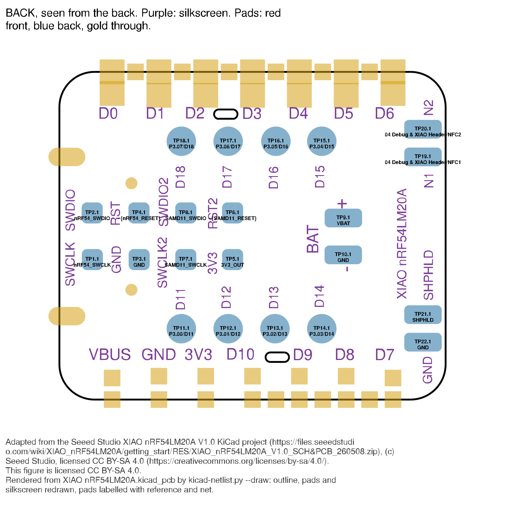
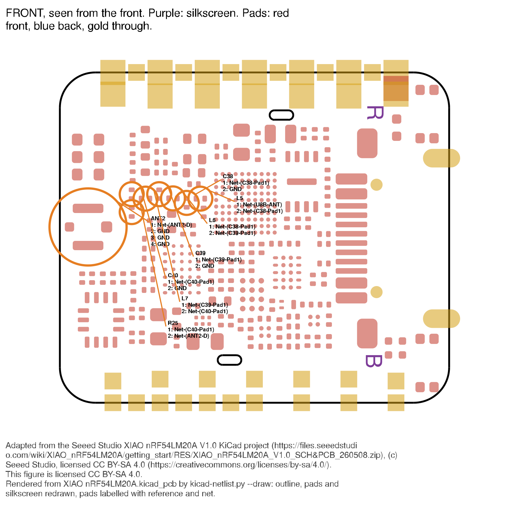
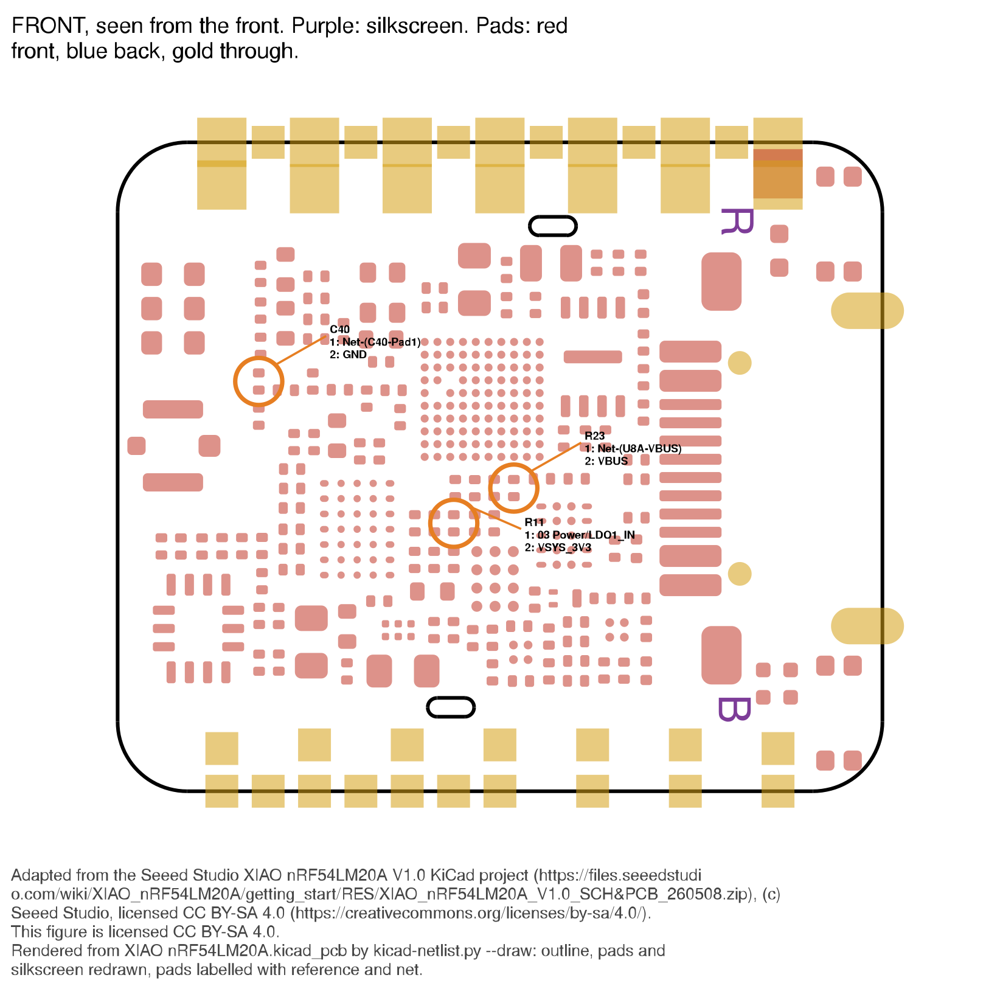

# XIAO nRF54LM20A (Sense) — hardware review for Sophon

> **Frozen record, committed in #389. It is not edited after the fact.** The
> live record of this board is [../HARDWARE.md](../HARDWARE.md); where the two
> disagree, HARDWARE.md is right. § For HARDWARE.md, at the end, records how
> each finding was verified and merged.

Review of the Seeed Studio XIAO nRF54LM20A V1.0 from its KiCad project,
made with the `kicad-design-review` and `kicad-netlist` skills, for Sophon: a
battery-powered BLE motion sensor that streams the IMU to an iPhone and may
carry a Wio-SX1262 on the XIAO header.

## Credits and licence for figures

The figures marked † are adapted from the **Seeed Studio XIAO nRF54LM20A V1.0
KiCad project**
(<https://files.seeedstudio.com/wiki/XIAO_nRF54LM20A/getting_start/RES/XIAO_nRF54LM20A_V1.0_SCH&PCB_260508.zip>),
(c) Seeed Studio, licensed
[CC BY-SA 4.0](https://creativecommons.org/licenses/by-sa/4.0/).

**Changes:** each figure was rendered from `XIAO nRF54LM20A.kicad_pcb` by
`kicad-netlist.py --draw`. The board outline, pads and silkscreen were redrawn,
and selected pads were labelled with their reference and net. Each SVG carries
this credit and change note in its footer and metadata.

**Covered:** only the three figures marked †
(`figures/2026-11-10/XIAO_nRF54LM20A-probe-back.svg`,
`figures/2026-11-10/XIAO_nRF54LM20A-dnp-front.svg`,
`figures/2026-11-10/XIAO_nRF54LM20A-rf-front.svg`) are licensed
CC BY-SA 4.0. The rest of this document is not covered by that licence.

## Where the authoritative data is

**Design**

| Item | Value |
|---|---|
| Source | <https://files.seeedstudio.com/wiki/XIAO_nRF54LM20A/getting_start/RES/XIAO_nRF54LM20A_V1.0_SCH&PCB_260508.zip> |
| Archive SHA-256 | `ca7f509f5716c57dd0d9a3f3098e249d805c3037fc3d80fd5e7d3cf6e4f60ada` (checked) |
| Root sheet / PCB | `XIAO nRF54LM20A.kicad_sch` / `XIAO nRF54LM20A.kicad_pcb` (KiCad 10, format 20260206) |
| Revision | All 7 sheets' title blocks: `XIAO nRF54LM20A`, rev `V1.0`, date 2026-04-09. Agrees with the archive's name (V1.0; `260508` is the packing date). |

**Datasheets** (all in the gitignored `zephyr/sophon/datasheets/`)

| Part | Ref | File | Source URL | SHA-256 | Proxy |
|---|---|---|---|---|---|
| nRF54LM20A/B Datasheet v1.0 | U8 | `Nordic_nRF54LM20A_nRF54LM20B_DS_v1.0.pdf` | User's copy (`~/Downloads/nRF54LM20A_nRF54LM20B_Datasheet_v1.0.pdf`); no download URL recorded. Nordic's site blocks scripted fetches. | `9f8250bfd90f61a8e112827cd0f4c038e89fc6afb7b51c072c0d23800e69df37` | no |
| nPM1300 PS v1.1 | U2 | `Nordic_nPM1300_PS_v1.1.pdf` | held from earlier work; URL not re-verified here | `570eb58d0768692434a804c1d25192c30caf87ce7b2f1743b8784d202272c53d` | no |
| TPS62843 (SLVSFU8C) | U1 | `TI_TPS62843x.pdf` | <https://www.ti.com/lit/ds/symlink/tps62843.pdf> (re-fetched; hash matches) | `1ee02c11c4f55305c60d610ef7d38067beb555af0c75f0fa5c526e3fa0b257fa` | no |
| TPS22916 (SLVSDO5F) | U3, U6 | `TI_TPS22916.pdf` | <https://www.ti.com/lit/ds/symlink/tps22916.pdf> (re-fetched; hash matches) | `a4d81b70556d5564aaee9baf455b7651375a94c629448f3f7e7ced2f5c41b33f` | no |
| UM3204 Rev16 | U4 | `Union_UM3204_Rev16.pdf` | held; URL not re-verified | `72e3e3bc526a8b090e6f927715c9507639cbe40d2a928eff2760b732fe84b903` | part number inferred (see § This board) |
| SAM D11 (42363H) | U5 | `Atmel_SAM-D11_42363H.pdf` | <https://ww1.microchip.com/downloads/en/DeviceDoc/Atmel-42363-SAM-D11_Datasheet.pdf> (re-fetched; hash matches) | `14de77838f9be189d8ecb742aba0682d2491119de6fb010f62df1bdfd4895471` | no |
| LN237N3T5G Rev.D | Q1 | `LRC_LN237N3T5G.pdf` | held; URL not re-verified | `73abb1ffd552048df775947900fb191f46ee22d3fa7d412fc56366f82291ec09` | no |
| PY25Q64HA | U10 | `Puya_PY25Q64HA.pdf` | held; URL not re-verified | `d18f8a4356492b89130cffd2dba5c2b5111ebd8935a7e8fec13326fa10eb6bca` | no |
| LSM6DS3TR-C (DocID030071 Rev 3) | U11 | `ST_LSM6DS3TR-C.pdf` | held; st.com refused a scripted re-fetch | `251737db70e3b6cdc217a5681dd4634a05faffd5288aff6a576078a6464a1b2b` | no |
| MSM261DGT003 | U12 (MSM261DGT006) | `MEMSensing_MSM261DGT003.pdf` | held; URL not re-verified | `30fde83006b7d32ae45d4f281d975dc9bb1be9ff1b097c866dba47db033290b7` | **proxy** (4 × 2 mm, pinout 1 VDD, 2/5 GND, 3 DATA, 4 CLK, 6 L/R, matches the footprint `MIC6P-0.94-4X2X1.1MM` and the netlist) |
| Wio-SX1262 module | (optional add-on) | `Seeed_Wio-SX1262_Module_Datasheet.pdf` | held; URL not re-verified | `031ef8c551211becc38cbfa110e9974af97d18f1c815ebd7fbbd949bee42ab51` | no |

## How each fact was established

| Tag | Meaning |
|---|---|
| *netlist* | `kicad-netlist.py` on the root sheet, a design that passed `--check-pcb` |
| *PCB* | the `.kicad_pcb`: pad nets, footprints, board side, copper, silkscreen via `--draw` |
| *datasheet* | the part's datasheet, with page (PDF page = printed page for every file cited) |
| *Zephyr* | `~/zephyrproject/zephyr/boards/seeed/xiao_nrf54lm20a/` at zephyr `41d10b59730` (2026-10-28), or a driver, file named |

A sentence without a tag is an inference and says so.

**`--check-pcb`:** passed, exit 0. 466 pads compared (all 466 PCB pads with a
net found in the schematic), 117 PCB nets, 0 split, 0 merged. The PCB holds 36
further pads on `unconnected-(…)` nets, which match the schematic's 36
single-pin nets one for one.

**Ball maps checked against datasheets** (each part's exact reference vs the
datasheet's ball table):

| Part | Balls agreeing | Note |
|---|---|---|
| U8 nRF54LM20A, CSP98 | 98 / 98 | *datasheet* Table 81 p1226–1233. The symbol spells J5 `TRXTUNE`; the datasheet calls it `TXRTUNE` (same function, USB). |
| U2 nPM1300, WLCSP35 | 35 / 35 | *datasheet* p152–153 |
| U5 ATSAMD11D14A-UUT, WLCSP20 | 20 / 20 | *datasheet* p9 |
| U4 UM3204H, CSP12 | 12 / 12 | *datasheet* p2 |
| U1 TPS628438YKA, DSBGA6 | 5 / 6 | C1 is `MODE` in the symbol, **`VSET`** in the datasheet (Table 5-1, p4). See § Regulator strapping. |
| U3/U6 TPS22916CNYFP, WLCSP4 | 4 / 4 | symbol `EN` = datasheet `ON` (B2), p3 |

## This board

All components are on the front; every test pad is on the back (*PCB*).

| Ref | Part (from part number and footprint) | Role |
|---|---|---|
| U8 | nRF54LM20A, CSP98 (`CSP98_0.35_3.67x3.85x0.61mm`) | Application MCU, BLE radio |
| U2 | nPM1300-CAAA, WLCSP35 | PMIC: USB input, Li-ion charger, BUCK2 → `VSYS_3V3`, LDO1 → IMU/mic |
| U1 | TPS628438YKAR, DSBGA6 | Buck converter `VSYS` → `3V3_OUT` (header 3V3) |
| U3 | TPS22916CNYFPR, WLCSP4 | Load switch `VSYS_3V3` → `SAMD11_3V3`, on only with VBUS |
| U6 | TPS22916CNYFPR, WLCSP4 | Load switch USB-C `TYPEC_5V` → `VBUS` |
| U5 | ATSAMD11D14A-UUT, WLCSP20 | Onboard USB probe / UART bridge |
| U4 | Value `英联` ("Union"); footprint `csp12-1.9x1.4MM`; pinout matches UM3204H CSP12 1.9×1.4 ball for ball | 4-bit level shifter between the SAMD11 and the nRF54's SWD + UART |
| Q1 | LN237N3T5G, SOT883 (footprint named `PMOS_1.0X0.6X0.35MM`) | **N-channel** MOSFET (*datasheet* p1), pulls nRF54 nRESET low |
| U10 | PY25Q64HA-UXH-IR, USON8 3×2 | 64 Mbit QSPI NOR flash |
| U11 | LSM6DS3TR-C, LGA14 | 6-axis IMU |
| U12 | MSM261DGT006, 4×2 mm | PDM microphone |
| X1 | `32.768KHZ-7PF-20ppm`, 1.6×1.0 | LFXO crystal |
| X2 | `32MHz-8pF-10ppm-70R`, 1.6×1.2 | HFXO crystal |
| ANT2 | ECT818000500, footprint `IPEX-GEN4-SMD-1.7X1.7X1.0MM` | RF connector (IPEX Gen 4), **not an antenna** |
| USB1 | USB 2.0 Type-C receptacle, 16-pin | USB to the SAMD11 and to power |
| U7 | `XIAO-Add-On-PRO` footprint | XIAO header, 14 castellated pins + 9 inner-row holes |
| LED1 | FC-B1010RGBT-HG | User RGB LED, common anode on `VSYS_3V3` |
| D2 | Red LED, 0402 | Charge LED on nPM1300 LED1 |
| D1, D3, D4 | DF2B7ASL | ESD diodes on `TYPEC_5V`, nRESET, USR_KEY |
| K1, K2 | TS-1001S | Reset button, user button |
| FB1–FB4 | 120 Ω beads | FB1/FB2 nRF54 DECD/DECA/DECRF; FB3 → `IMU_VDD`; FB4 → `MIC_VDD` |
| L1 / L2 / L3 | 1 µH / 2.2 µH / 4.7 µH | U1 buck / nPM1300 BUCK2 / nRF54 DC/DC (DCC → DECD) |

## Power

**Rails** (all *netlist*):

| Rail | Made by | Feeds |
|---|---|---|
| `TYPEC_5V` | USB-C VBUS pins | U6 VIN, R41 (U6 ON divider), D1, C5 |
| `VBUS` | U6 VOUT | nPM1300 VBUS (B1/B2), header pin 14, R19 (U3 ON divider), R23 (DNP) |
| `VBAT` | battery pads TP9 (+) / TP10 (−) | nPM1300 VBAT (D1/D2), C11, C12 |
| `VSYS` | nPM1300 VSYS (C1/C2) | nPM1300 PVDD, U1 VIN, R36 (U1 EN), R14 → `LDO1_IN`, R7 → charge LED D2 |
| `VSYS_3V3` | nPM1300 BUCK2 (SW2 → L2) | nRF54 VDD (A3, A4, A9, G10, H1), flash U10, nPM1300 VDDIO, U3 VIN, U4 VCCB, LED1 anode, pull-ups R12, R13, R26, R27, R42–R44 |
| `LDO1_IN` | `VSYS` via R14 0 Ω (alternative R11 from `VSYS_3V3` is DNP) | nPM1300 LSIN1/VINLDO1 |
| `IMU&MIC_3V3` | nPM1300 LSOUT1/VOUTLDO1 | FB3 → `IMU_VDD`, FB4 → `MIC_VDD` |
| `IMU_VDD` | FB3 | U11 VDD + VDDIO, pull-ups R28, R29 (I²C), R37 (CS), R38 (INT1) |
| `MIC_VDD` | FB4 | U12 VDD |
| `3V3_OUT` | U1 TPS628438 (SW → L1, VOS) | header pin 12 (3V3), TP5, C2, C3, C4, C36 |
| `SAMD11_3V3` | U3 VOUT | U5 VDD, U4 VCCA and OE, R18 (SAMD11 reset pull-up), R16 10 kΩ to GND |
| `DECA`/`DECD`/`DECRF`/`DCC` | nRF54 internal regulators | decoupling; `DCC` → L3 → `DECD` |

nPM1300 BUCK1 is unused: VOUT1, SW1 and PVSS1 are `unconnected-(…)` (*PCB*),
and VSET1 is grounded (§ Regulator strapping).

**Load path.** USB power enters at `TYPEC_5V`, passes U6 (ON = R41/R45 100 kΩ
/ 100 kΩ from `TYPEC_5V`, i.e. on whenever USB is present, *netlist*) to
`VBUS`, then the nPM1300's VBUS input. The nPM1300 is the only meeting point
of USB and battery: with USB present its SYSREG supplies `VSYS` from VBUS and
the charger charges `VBAT`; with USB absent `VSYS` comes from the battery
(*datasheet* nPM1300 § 6.1, p20). SYSREG isolates VBUS from VSYS when VBUS is
out of range, preventing current flowing from VSYS to VBUS (*datasheet* p21),
and U6 has always-on reverse-current blocking (*datasheet* TPS22916 p17), so a
battery does not back-power the USB connector or the header's VBUS pin.

**Always-on rails** (on whenever `VSYS` exists, i.e. whenever a battery or USB
is connected):

- **`3V3_OUT`** (header 3V3). U1's EN is pulled to `VSYS` by R36 1 MΩ and
  goes nowhere else (*netlist*). No GPIO can turn it off. At start-up the
  EN pin's internal 425–500 kΩ pull-down (*datasheet* TPS62843 p6) forms a
  divider with R36, giving about VSYS/3 (1.2 V at 3.7 V) against the 0.8 V
  rising threshold; the pull-down is then disconnected (p4, § 7.3.1 p10)
  (arithmetic, inference). **Anything plugged into the header's 3V3 pin,
  e.g. a Wio-SX1262, is powered whenever the battery is connected.**
- **`VSYS_3V3`**. BUCK2 is enabled at power-on by its VSET2 resistor
  (§ Regulator strapping). It can be turned off only through the nPM1300's
  registers or a configured nPM1300 GPIO (*datasheet* p46–47), but it powers
  the nRF54 itself, so in practice it is always on. The Zephyr board marks it
  `regulator-always-on` (*Zephyr* `xiao_nrf54lm20a_nrf54lm20a-common.dtsi`).
- **`IMU&MIC_3V3` is switchable**: LDO1 is off at reset (*datasheet* p72) and
  is switched by the nPM1300 over I²C. The Zephyr board turns it on at boot
  (`regulator-boot-on`, 3.3 V, LDO mode) (*Zephyr* common dtsi).
- **`SAMD11_3V3` is on only with USB**: U3's ON pin is R19 100 kΩ from `VBUS`
  over R15 100 kΩ to GND (*netlist*), so 2.5 V with USB and 0 V on battery
  (arithmetic; VIH = 1 V, *datasheet* TPS22916 p4).

## Regulator and PMIC strapping

| Pin | Strap (*netlist*) | Effect at power-up (*datasheet*) | Firmware later (*Zephyr* common dtsi) |
|---|---|---|---|
| nPM1300 VSET1 (E2) | R9 0 Ω to GND | BUCK1 **off** (grounded, Table 18, p47) | no BUCK1 node |
| nPM1300 VSET2 (E1) | R10 470 kΩ to GND | BUCK2 **on at 3.3 V** (250–500 kΩ, Table 19, p47) | `BUCK2` 3.3 V, always-on |
| nPM1300 NTC (D3) | R6 10 kΩ to GND (a fixed resistor, no thermistor) | Charger reads a constant 25 °C if the 10 kΩ NTC type is selected (the reset default, `ADCNTCRSEL` = 10K, p104); the datasheet requires NTC to be disabled when no thermistor is fitted (p29) | `thermistor-ohms = <10000>`, beta 3380: battery temperature is **not** monitored, the charger always sees 25 °C (inference) |
| nPM1300 CC1 (D5) / CC2 (B3) | both to GND | No Type-C detection; VBUS current limit stays at the 100 mA default until the host raises it (p20–21) | `vbus-limit-microamp = <500000>` (needs the charger driver built) |
| nPM1300 SHPHLD (D4) | TP21 only, no button | Ship/Hibernate exit needs SHPHLD low ≥ 96 ms (default) **or** VBUS > VBUSPOR (p117–118); internal 50 kΩ pull-up (p118) | none |
| nPM1300 LED0 / LED1 / LED2 | LED0, LED2 unconnected; LED1 → D2 red, R7 10 kΩ to `VSYS` | LED1 reset mode = **charging indicator** (`LEDDRV1MODESEL` reset 0x01, p82) | `nordic,led1-mode = "host"`: the charge LED stops indicating charge when the nPM1300 LED driver is built |
| nPM1300 LDO1 mode | — | `LDSW1LDOSEL` reset = **load switch** (p79), off (p72) | `regulator-initial-mode = <NPM13XX_LDSW_MODE_LDO>`, 3.3 V |
| nPM1300 GPIO0 / GPIO1 | → nRF54 P1.25 / P1.26 | inputs by default | not used by the board files (no `host-int-gpios`) |
| TPS628438 **VSET** (C1; symbol says `MODE`) | R3 249 kΩ to GND | `3V3_OUT` = **3.3 V** (Table 7-1, "249.0k or larger", p11) | no node: not software-controlled |
| TPS628438 EN (C2) | R36 1 MΩ to `VSYS` | always enabled | — |
| TPS22916CN U3 ON | R19/R15 from `VBUS` | on with USB only | — |
| TPS22916CN U6 ON | R41/R45 from `TYPEC_5V` | on with USB only | — |
| nRF54 DC/DC | L3 4.7 µH DCC → DECD fitted | DC/DC usable | `&vregmain` `NRF5X_REG_MODE_DCDC` |

The nPM1300's I²C reaches the nRF54 on P1.18 (SDA) / P1.17 (SCL), pull-ups R12,
R13 4.7 kΩ to `VSYS_3V3` (*netlist*). Zephyr drives it as a bit-banged
`gpio-i2c` bus, PMIC at 0x6b (*Zephyr* common dtsi).

Nordic's one-buck reference (Configuration 2, *datasheet* p158–159) grounds
the unused buck's PVSS and ties its VOUT to VSYS. This board leaves BUCK1's
VOUT1, SW1 **and PVSS1** unconnected (*PCB*). Whether a floating PVSS1 matters
with BUCK1 off is not established.

## Debug access

**The nRF54's SWD** (*netlist*): `nRF54_SWDIO` = U8 G2 [SWDIO] – TP2 – U4 B1;
`nRF54_SWCLK` = U8 G1 [SWDCLK] – TP1 – U4 B2. Reset: `~{nRF54_RESET}` = U8 F2
[nRESET] – TP4 – K1 – Q1 drain – R26 100 kΩ to `VSYS_3V3` – C47 100 nF – D3.
The SWD pins have internal pulls, SWDIO up and SWDCLK down, 14 kΩ (*datasheet*
nRF54 p1174, p1278).

**The SAMD11's own SWD**: PA31 (SWDIO) → TP8, PA30 (SWCLK) → TP7, reset PA28 →
TP6 with R18 to `SAMD11_3V3` (*netlist*).

**Probe pads** (all on the back, *PCB*; labels read off the drawing †):

*Figure 1 †: back of the board, as held to probe it. Every test pad is ringed
with its reference and net; the purple text is the board's silkscreen.*

| Label | Pad | Net |
|---|---|---|
| SWDIO | TP2 | `nRF54_SWDIO` |
| SWCLK | TP1 | `nRF54_SWCLK` |
| RST | TP4 | `~{nRF54_RESET}` |
| GND | TP3 | GND |
| SWDIO2 | TP8 | `SAMD11_SWDIO` |
| SWCLK2 | TP7 | `SAMD11_SWCLK` |
| RST2 | TP6 | `~{SAMD11_RESET}` |
| 3V3 | TP5 | `3V3_OUT` |
| BAT + / − | TP9 / TP10 | `VBAT` / GND |
| N1 / N2 | TP19 / TP20 | NFC1 / NFC2 (antenna side of R39/R40) |
| SHPHLD | TP21 | `SHPHLD` |
| GND | TP22 | GND |
| D11–D18 | TP11–TP18 | P3.00–P3.07 |

The pattern: the eight debug pads form a 4 × 2 block, each label printed
vertically, reading upward, immediately to the **left** of its pad. The nRF54's
pads are the left column pair (SWDIO/RST over SWCLK/GND), the SAMD11's the
right pair (SWDIO2/RST2 over SWCLK2/3V3). Labels D11–D18 sit on the inner
side of their round pads; N1/N2 and SHPHLD/GND are to the right of their pads.
**TP5 "3V3" is `3V3_OUT`** (U1's always-on rail), not the nRF54's supply
`VSYS_3V3`, which has no test pad (*PCB*). A probe that senses target voltage
from TP5 sees 3.3 V whichever rail the nRF54 is on, which is correct only
because both rails are 3.3 V (inference).

**The onboard probe (U5, SAMD11)** drives the nRF54's SWD from PA02/PA03 on nets
`SWDIO`/`SWCLK`, through U4's A1/A2 → B1/B2 (*netlist*), and its UART from
PA05/PA08 (`SAMD11_RX`/`SAMD11_TX`) through U4 A3/A4 → B3/B4 to nRF54 P1.11 and
P1.10. The Zephyr board's console `uart20` uses TX P1.11 / RX P1.10 (*Zephyr*
pinctrl), so **the console reaches USB through the SAMD11**.

- **Powered** from `SAMD11_3V3`, i.e. only with USB present (§ Power). It does
  not draw from the battery, except U3's off-state leakage (§ Budget).
- **Isolated when off.** U4's OE is tied to its VCCA, `SAMD11_3V3` (*netlist*),
  so OE is low whenever the SAMD11 is unpowered. With OE low the ports are
  Hi-Z (*datasheet* UM3204 p11), with IOZ ±2 µA max (p6), and the device
  "disables all output ports when either VCC is switched off" (p11). Each
  port has an internal 10 kΩ pull-up to its VCC (p11–12): on the B side, to
  `VSYS_3V3`. Whether those pull-ups stay connected with VCCA = 0 is not
  stated (see § Not established).
- **Able to hold reset?** It drives `nRF54_RST_CTL` from PA04 into Q1's gate.
  Q1 is N-channel (*datasheet* p1), source on GND, drain on nRESET; R17
  100 kΩ pulls the gate to GND (*netlist*). **So an unpowered SAMD11 cannot
  assert the nRF54's reset.**

## USB

- USB-C D+ (A6/B6 → `DP`) → R5 22 Ω → SAMD11 PA25; D− (A7/B7 → `DN`) → R4 22 Ω
  → SAMD11 PA24 (*netlist*). **The connector's data lines reach only the
  SAMD11.**
- CC1/CC2: R2/R1 5.1 kΩ to GND (sink Rd) (*netlist*). The nPM1300's own CC pins
  are on GND (§ Strapping).
- SBU1/SBU2: unconnected (*PCB*).
- **The nRF54's own USB is not wired:** U8 K4 [D−] and K5 [D+] are
  `unconnected-(U8B-D±…)` (*PCB*); its VBUS ball K7 reaches only C34 and the
  **DNP** R23 0 Ω to `VBUS` (*netlist*); DECUSB has C54; TXRTUNE has R24 200 Ω
  to GND, the value the datasheet requires (p790). As built, the nRF54's USBHS
  peripheral cannot enumerate. The Zephyr board nevertheless enables it
  (`zephyr_udc0: &usbhs { status = "okay"; }`, *Zephyr*
  `nrf54lm20a_cpuapp_common.dtsi`). **Sophon's nRF52840 habit of a USB CDC
  ACM console does not carry over**; the console is `uart20` via the SAMD11.

## Header and connector pin map

U7 (footprint `XIAO-Add-On-PRO`): pins 1–14 are the castellated XIAO pins;
pins 15–23 are a second, inner row of 0.9 mm holes between them (*PCB*). D11–D18
are bottom pads TP11–TP18, not U7 pins (*netlist*, *PCB*). All nets *netlist*;
the Zephyr column is `seeed_xiao_connector.dtsi` `gpio-map` and the pinctrl.

| Pin | XIAO | MCU pin (ball) | Net | Zephyr |
|---|---|---|---|---|
| U7.1 | D0 / A0 | P1.00 / AIN0 (K8) | `P1.00/A0/D0` | D0 → gpio1 0 ✓ |
| U7.2 | D1 / A1 | P1.31 / AIN1 (K9) | | D1 → gpio1 31 ✓ |
| U7.3 | D2 / A2 | P1.30 / AIN2 (J10) | | D2 → gpio1 30 ✓ |
| U7.4 | D3 / A3 | P1.29 / AIN3 (H10) | | D3 → gpio1 29 ✓ |
| U7.5 | D4 / SDA | P1.03 / AIN7 (H9) | | D4 → gpio1 3 ✓; `i2c22` SDA ✓ |
| U7.6 | D5 / SCL | P1.07 / EXTREF (G8) | | D5 → gpio1 7 ✓; `i2c22` SCL ✓ |
| U7.7 | D6 / TX | P1.08 (F8) | | D6 → gpio1 8 ✓; `uart21` TX ✓ |
| U7.8 | D7 / RX | P1.09 (E8) | | D7 → gpio1 9 ✓; `uart21` RX ✓ |
| U7.9 | D8 / SCK | P1.04 / AIN6 (J9) | | D8 → gpio1 4 ✓; `spi23` SCK ✓ |
| U7.10 | D9 / MISO | P1.05 / AIN5 (H8) | | D9 → gpio1 5 ✓; `spi23` MISO ✓ |
| U7.11 | D10 / MOSI | P1.06 / AIN4 (J8) | | D10 → gpio1 6 ✓; `spi23` MOSI ✓ |
| U7.12 | 3V3 | — | `3V3_OUT` (U1, always on) | — |
| U7.13 | GND | — | GND | — |
| U7.14 | 5V | — | `VBUS` (after U6) | — |
| TP11–TP18 | D11–D18 | P3.00–P3.07 (H7, H6, H5, H4, J4, G7, G6, G5) | `P3.0x/D1x` | D11–D18 → gpio3 0–7 ✓ |
| U7.15–20 | D19–D24 | P0.00–P0.05 (K3, K2, J3, J2, J1, H3) | `P0.0x/D19…D24` | D19–D24 → gpio0 0–5 ✓ |
| U7.21–23 | D25–D27 | P3.09–P3.11 (F7, F4, E4) | `P3.09…P3.11/D25…D27` | D25–D27 → gpio3 9–11 ✓ |

All 28 GPIO entries in the board's `gpio-map` agree with the netlist. No
difference found.

**Wio-SX1262 on this header** (inference from Sophon's
`boards/common/wio-sx1262.dtsi` pin roles, which still name nRF52840 pins):
NSS = D4 and RXEN = D5 are `i2c22`'s pins, which the nRF54 board enables
(`&i2c22 { status = "okay"; }`). On the nRF52840 Sophon disables `i2c1` for
the same reason; the nRF54 port must disable `i2c22` (*Zephyr*). The module's
supply would come from pin 12, `3V3_OUT`, which firmware cannot switch off
(§ Power).

## Peripherals

**IMU U11 (LSM6DS3TR-C)** (*netlist* unless tagged)

- Bus: I²C, SDA P0.08 (F3), SCL P0.07 (G3), pull-ups R28/R29 4.7 kΩ to
  `IMU_VDD`. Zephyr: `i2c30`, SDA P0.08 / SCL P0.07 ✓ (*Zephyr* pinctrl).
- Address: SDO/SA0 on GND → 0x6A (*datasheet* p39). Zephyr `reg = <0x6a>` ✓.
- Mode: CS → P3.12 (D4) with R37 100 kΩ to `IMU_VDD`; CS high selects I²C
  (*datasheet* p47); CS also has an internal pull-up (p47). SDx/SCx on GND
  (p20: "connect to VDDIO or GND").
- Interrupts: **INT1 → P0.06 (H2), R38 100 kΩ pull-up to `IMU_VDD`**. INT2
  unconnected (*PCB*). Zephyr `irq-gpios = <&gpio0 6 GPIO_ACTIVE_HIGH>` ✓.
  **What INT1 drives at idle:** push-pull (`PP_OD` = 0) and active-high
  (`H_LACTIVE` = 0) by default (*datasheet* CTRL3_C, p63), and "output forced
  to ground" by default (Table 18, p47). So INT1 idles **low against R38**,
  drawing 3.3 V / 100 kΩ = **33 µA** whenever `IMU_VDD` is on. The Zephyr
  `lsm6dsl` driver (the board's compatible is `st,lsm6dsl`) writes only BDU,
  BLE and IF_INC in CTRL3_C (*Zephyr* `drivers/sensor/st/lsm6dsl/lsm6dsl.c`
  l.778–784), so it leaves INT1 push-pull active-high. Setting `H_LACTIVE` = 1
  (idle high) or `PP_OD` = 1 (open-drain, idles released) removes the drain;
  the GPIO's polarity must change to match for `H_LACTIVE`. (#389)
- Supply: VDD and VDDIO on `IMU_VDD` = LDO1 3.3 V through FB3. Range 1.71–3.6 V
  (*datasheet* p24) ✓; absolute maximum 4.8 V (p29).

**Microphone U12 (MSM261DGT006)**: CLK P1.13 (C3), DATA P1.14 (C2), L/R on
GND (*netlist*). Zephyr `pdm20` CLK P1.13 / DIN P1.14 ✓. Supply `MIC_VDD` =
LDO1 via FB4; proxy range 1.6–3.6 V, absolute maximum 4.0 V (*datasheet*
DGT003 proxy p3).

**NOR flash U10 (PY25Q64HA)**: CS P2.05 (G9, R42 100 kΩ pull-up), CLK P2.01,
IO0 P2.02, IO1 P2.04, WP# P2.03 (R43 pull-up), HOLD# P2.00 (R44 pull-up), all
pull-ups to `VSYS_3V3`; VCC on `VSYS_3V3` (*netlist*). Pinout matches the
USON8 table (*datasheet* p4). Zephyr: `spi00` with `cs-gpios` P2.05, pins
P2.01/P2.02/P2.04 ✓, `hold-gpios` P2.00 ✓, `wp-gpios` P2.03 ✓, `has-dpd`, but
the node is **`status = "disabled"`** (*Zephyr* cpuapp common dtsi). Supply
2.3–3.6 V (*datasheet* p8) ✓.

**nPM1300**: § Strapping. Battery voltage: there is **no resistor divider from
`VBAT` to any GPIO** (*netlist*: `VBAT` reaches only U2, C11, C12, TP9). VBAT
can be read only through the nPM1300's ADC over I²C. Sophon's `src/battery.c`
(nRF52840 ADC divider) does not carry over (inference).

**User I/O** (*netlist*; Zephyr *common dtsi*): RGB LED cathodes via 2 kΩ to
P1.22 (red), P1.24 (green), P1.23 (blue), anode `VSYS_3V3`, active low ✓.
Button K2 on P0.09 with R27 100 kΩ to `VSYS_3V3`, C48, D4 ✓ (`button0`,
active low with pull-up). Reset button K1 on nRESET.

## RF

*Figure 2 †: front of the board. The radio's matching chain L5, C38, L6, C39,
L7, C40 (DNP) and R25 is ringed with each pad's net, and ANT2 (the large ring,
left) is the IPEX connector. The parts are 0201s packed beside the MCU, so the
labels are crowded; the table below is the readable form.*

Walk from the radio pin (*netlist*; values *netlist* `--values`):

| Step | Part | Value | Placement |
|---|---|---|---|
| U8 E1 [ANT] → | L5 | 3.6 nH | series |
| node `Net-(C38-Pad1)` | C38 | 1.2 pF | shunt to GND |
| → | L6 | 4.7 nH | series |
| node `Net-(C39-Pad1)` | C39 | 1.2 pF | shunt to GND |
| → | L7 | 2.2 nH | series |
| node `Net-(C40-Pad1)` | C40 | 1.2 pF, **DNP** | shunt to GND (not fitted) |
| → | R25 | 0 Ω | series |
| `Net-(ANT2-D)` | ANT2 pin 1 | ECT818000500 | footprint `IPEX-GEN4-SMD-1.7X1.7X1.0MM` |

`--copper` on every net of the chain: pads only (`L5.1, U8.E1`; `C38.1, L5.2,
L6.1`; `C39.1, L6.2, L7.1`; `C40.1, L7.2, R25.1`; `ANT2.1, R25.2`), no zones;
the whole board has **no copper graphics** (0 with no net, 0 in footprints)
and 2 keepout areas (*PCB*). **There is no on-board antenna: the radio ends at
an IPEX Gen 4 connector, and the board needs an external antenna fitted to
ANT2.**

## DNP parts

DNP parts other than test points (*netlist* `--values`; each pin queried):

| Ref | Value | Pin 1 | Pin 2 | Fitting it would… | As built |
|---|---|---|---|---|---|
| R23 | 0 Ω | nRF54 VBUS ball K7 (with C34) | `VBUS` | power the nRF54's USB VBUS detection | **nRF54 USB unpowered** (and D+/D− are unconnected anyway, § USB) |
| R11 | 0 Ω | `LDO1_IN` | `VSYS_3V3` | feed LDO1 from BUCK2's 3.3 V instead of (or as well as) `VSYS`; R14 0 Ω from `VSYS` is fitted, so both must not be fitted together (inference) | LDO1 runs from `VSYS` (battery or 5 V USB) |
| C40 | 1.2 pF | RF node between L7 and R25 | GND | add a third shunt to the matching network | network ends L7 → R25 → ANT2 |

The 22 test points TP1–TP22 are DNP as a matter of course (bare pads,
§ Debug access).

*Figure 3 †: front of the board; the three not-fitted parts are ringed and
labelled with their pads' nets: C40 at the left of the MCU in the RF chain,
R23 and R11 just below the MCU toward the PMIC. The net
labels show KiCad's sheet path for hierarchical labels, e.g.
`03 Power/LDO1_IN` is `LDO1_IN`.*

## Hazards

1. **LDO1 in load-switch mode would over-voltage the IMU and mic.** LDO1's
   input is `VSYS` (R14), and its reset mode is load switch (*datasheet*
   nPM1300 p79). Turned on as a switch, it passes `VSYS` (battery up to
   4.45 V, *datasheet* p18; VBUS 5 V with USB, p20) to U11 (abs. max 4.8 V,
   *datasheet* p29) and U12 (proxy abs. max 4.0 V). Firmware must select
   LDO mode before enabling it. The Zephyr board does
   (`regulator-initial-mode` / `regulator-allowed-modes` = LDO, *Zephyr*);
   the hazard is for any code that writes the nPM1300 directly, or a board
   overlay that drops those properties.
2. **Back-feed into the IMU and mic.** The I²C pull-ups R28/R29, CS pull-up
   R37 and INT1 pull-up R38 go to `IMU_VDD`, so turning LDO1 off makes them
   pulls to an unpowered rail. If the nRF54 drives P0.07/P0.08/P3.12 high, or
   PDM CLK P1.13 runs, with LDO1 off, it powers U11/U12 through their I/O
   (inference: standard clamp behaviour; not stated in the datasheets read).
   Set those pins to disconnected inputs before switching LDO1 off. The board's
   `i2c30` / `pdm20` sleep states use `low-power-enable` (*Zephyr* pinctrl);
   P3.12 (IMU CS) is not in any pinctrl group.
3. **Pins with fitted loads.**
   - NFC1/NFC2 (P1.01/P1.02) have R39/R40 0 Ω to C25/C26 300 pF to GND and
     pads TP19/TP20 (*netlist*); NFC is enabled at reset and must be disabled
     in `PADCONFIG` to use them as GPIO (*datasheet* nRF54 p293); the board
     enables `nfct` (*Zephyr*). As GPIO they would carry 300 pF.
   - P1.20/P1.21 carry X1; the board uses LFXO (*Zephyr* `&lfxo`). XC1/XC2
     carry X2.
   - P0.06 (IMU INT1) has R38 to `IMU_VDD` (§ Peripherals).
4. **Header 3V3 is not switchable** (§ Power): a peripheral on pin 12 stays
   powered on battery and must be put to sleep by firmware.
5. **No battery divider** on any GPIO, so no ADC-pin hazard (*netlist*).
6. **Unconnected GPIOs** (not hazards; *PCB*): P1.12, P1.15, P1.16, P1.19,
   P1.27, P1.28, P2.06–P2.10, P3.08; nRF54 D+/D−. SAMD11 PA06, PA07, PA09,
   PA14, PA15, PA16, PA22, PA23. nPM1300 GPIO2, GPIO3, LED0, LED2, LSIN2,
   LSOUT2.

## Battery quiescent budget

State: on battery, USB absent, MCU asleep, Sophon's intended configuration
(BUCK2 on, LDO1 on at 3.3 V for the IMU, IMU in power-down, mic unclocked).
Figures typical unless marked; conditions as the datasheet states them.

| Part | Rail | State on battery | Current | Source |
|---|---|---|---|---|
| **R38 INT1 pull-up vs U11 INT1** | `IMU_VDD` 3.3 V | INT1 push-pull, active-high default → idles low | **33 µA** (3.3 V / 100 kΩ) | *datasheet* LSM6DS3TR-C p47, p63; *Zephyr* driver; (#389) |
| U10 flash | `VSYS_3V3` | **standby** unless sent DP (B9h); board node disabled | 15 µA typ, 30 max (DPD: 1 µA typ, 3 max) | *datasheet* PY25Q64HA p8, p74 |
| U11 IMU | `IMU_VDD` | power-down | 3 µA | *datasheet* p24 |
| U2 nPM1300 | `VBAT` | battery operation, VBUS absent, "no BUCK load" | 0.8 µA | *datasheet* p16 |
| U1 TPS628438 | `VSYS` | enabled, no load | 0.275 µA (1.5 max) IQ + 0.275 µA (0.45 max) VOS leakage at 3.3 V | *datasheet* p6 |
| U4 UM3204 | `VSYS_3V3` (VCCB), VCCA = 0 | disabled | ≤ 1 µA max ICCB (no typ.) | *datasheet* p6 |
| U12 mic | `MIC_VDD` | sleep (fCLOCK ≤ 50 kHz) | 1 µA (typ., at 1.8 V) | *datasheet* DGT003 **proxy** p3 |
| Q1 | nRESET (`VSYS_3V3` via R26) | off, gate held low by R17 | ≤ 1 µA max IDSS (at 30 V) | *datasheet* p2 |
| U3 TPS22916CN | `VSYS_3V3` | off | 0.01 µA (0.1 max) | *datasheet* p5 |
| U6 TPS22916CN | `TYPEC_5V` = 0 V | off, unpowered | 0 | *netlist* |
| U5 SAMD11 | `SAMD11_3V3` = 0 V | unpowered | 0 | *netlist* |
| Pull-ups R12, R13, R26, R27, R28, R29, R37, R42, R43, R44 | various | lines idle high or Hi-Z | 0 | inference from idle states |
| R36 → U1 EN | `VSYS` | EN pull-down disconnected after start-up | ≤ 25 nA | *datasheet* TPS62843 p6 |
| R7 + D2 charge LED | `VSYS` → nPM1300 LED1 | not charging → LED driver off | ~0 | *datasheet* p82 |
| R16 10 kΩ | `SAMD11_3V3` | rail off | 0 | *netlist* |

**Sum of the fixed parts, typical: about 53 µA** (33 + 15 + 3 + 1 + 0.8 +
0.55 + 0.01), plus up to 2 µA more from the max-only rows (U4, Q1). The IMU's
and mic's figures are at 1.8 V; the board runs them at 3.3 V. **The
dominant term is the IMU's INT1 pull-up, 33 µA, then the flash in standby,
15 µA.** Both need firmware:

- configure INT1 open-drain or active-low (CTRL3_C) → −33 µA;
- put the flash in deep power-down → −14 µA typical; with the board's flash
  node disabled, nothing does this unless Sophon enables the node (the
  `jedec,spi-nor` driver with `has-dpd`) or sends B9h itself.

With both fixed, the board's fixed draw is about **6.4 µA typical**
(IMU 3, flash 1, mic 1, nPM1300 0.8, U1 0.55), plus the MCU. With LDO1 also
off (IMU and mic unpowered), about 2.4 µA.

A Wio-SX1262 on the header adds its sleep current from `3V3_OUT`: 1.62 µA
(*datasheet* Wio-SX1262 p6), only if firmware puts the SX1262 to sleep.

`VSYS_3V3` loads are supplied through BUCK2; their battery current is lower by
the 3.3 V / VBAT ratio and higher by the buck's light-load losses, neither
counted here (§ Not established). The nRF54's own System ON / OFF current is
not included.

## Corrections

Against `zephyr/sophon/hw/nrf54lm20a/HARDWARE.md` (read only after the review
above was written). Everything else in it agrees with this review: the rails,
the load path, the SAMD11's power and reset isolation, the back-pad labels, the
header map, the RF chain and IPEX connector, the DNP parts, the NTC, the
charge-LED mode, and the flash's standby. Its datasheet table also records
source URLs for the files marked "URL not re-verified" above.

1. **"The NOR flash dominates. The fixed parts sum to about 1.1–2.1 µA; the
   NOR's standby alone is 15 µA"** (§ Battery quiescent draw). **This review is
   right: the IMU's INT1 pull-up dominates, about 33 µA**, twice the flash.
   INT1 resets push-pull, active-high and "forced to ground" (*datasheet*
   LSM6DS3TR-C p47, p63), so it idles low against R38 100 kΩ to the 3.3 V
   `IMU_VDD` (*netlist*), and Zephyr's driver never changes that (*Zephyr*
   `lsm6dsl.c` l.778–784). HARDWARE.md lists INT1 only as "the data-ready
   interrupt" with an R38 pull-up and never asks what INT1 drives at idle.
   Confirms the first item of **#389**.
2. **"R3 (249 K) sits on its MODE pin to GND"** (§ Rails). **This review is
   right: C1 is VSET**, per TI's Table 5-1 (*datasheet* TPS62843 p4); the
   TPS62843 family has no MODE pin. 249 kΩ selects 3.3 V (Table 7-1, p11).
   The error came from the Seeed symbol's pin name (`[MODE]` in the netlist),
   which HARDWARE.md took as the pin's function without checking the pinout.
   Confirms the second item of **#389**.
3. **"The fixed parts sum to about 1.1–2.1 µA"** also leaves out rows of its
   own table: the IMU's 3 µA and the mic's 1 µA (present in the table, absent
   from the sum), and U1's 275 nA VOS input current at 3.3 V (*datasheet* p6).
   With them the non-flash, non-INT1 parts are about 5.4 µA typical. The
   nPM1300 row's state "BUCK2 + LDO1 on" is also wider than the datasheet's
   condition for `IQBAT`, "no BUCK load, VBUS disconnected" (*datasheet* p16).
   Arithmetic and omission; part of the #389 budget fix.
4. **"No GPIO has to be in a particular state for the board to be safe … The
   only caution is the IMU back-feed above"** (§ Unconnected pins and hazards).
   **Incomplete.** No GPIO state is required (this review agrees), but there is
   a second firmware must-do: LDO1 resets in **load-switch** mode
   (*datasheet* nPM1300 p79) with `VSYS` on its input (R14, *netlist*). Enabled
   as a switch, it would put the battery voltage, or 5 V with USB, on the IMU
   (abs. max 4.8 V) and mic (proxy abs. max 4.0 V). Zephyr's board file avoids
   it by forcing LDO mode. HARDWARE.md mentions LDO mode only as a fact about
   v4.5.0, not as a requirement.
5. **"14 GPIOs are unconnected, P1.12 among them."** **12** GPIOs are
   unconnected (P1.12, P1.15, P1.16, P1.19, P1.27, P1.28, P2.06–P2.10, P3.08);
   the other two of the 14 unconnected U8 pads are the dedicated USB pins
   D+ and D−, which are not GPIOs (*PCB* `unconnected-(…)` nets; *datasheet*
   nRF54 p790, "not available as standard GPIO pins"). A count of pads,
   labelled as GPIOs.
6. **"U4 `OE` | to `SAMD11_3V3`, R16 to GND"** (§ The SAMD11). Misleading:
   OE is **on the `SAMD11_3V3` rail itself**, and R16 (10 kΩ) is a load on that
   rail, alongside U5's VDD and U4's VCCA (*netlist*); it is not a pull-down
   particular to OE. Its likely job is to discharge `SAMD11_3V3` after USB is
   removed, since U3 is the TPS22916**CN**, the variant without quick output
   discharge (*datasheet* TPS22916 p1) (inference). The table's
   "TPS22916C" for U3/U6 is the same omission: the fitted part is
   TPS22916CNYFPR (*netlist*).
7. **"With USB disconnected, U4's B side is high-impedance … the bridge does not
   load `uart20`."** **Overstated.** The datasheet supports high impedance with
   OE low (IOZ ±2 µA, *datasheet* UM3204 p6; ports disabled when either VCC is
   off, p11), but IOZ is specified only for VCCA ≥ 1.65 V, and the B ports'
   internal 10 kΩ pull-ups to VCCB (p11–12) are not said to disconnect at
   VCCA = 0. If they stay, `nRF54_SWCLK` draws about 140 µA through the
   nRF54's 14 kΩ pull-down. Moved to § Not established; the conclusion is
   probably right but rests on an unstated datasheet condition.

## Not established

- **The nRF54LM20A's sleep current** on this board: measure (PPK2 on TP9/TP10
  with USB absent).
- **The nPM1300's LDO1 quiescent current** and BUCK2's light-load efficiency:
  no figure found in the PS v1.1; measure.
- **U4's B-port 10 kΩ pull-ups with VCCA = 0.** The UM3204 datasheet gives IOZ
  only for VCCA ≥ 1.65 V. If the B-side pull-ups stayed connected with the
  SAMD11 unpowered, `nRF54_SWCLK` (14 kΩ internal pull-down, *datasheet*
  p1278) would draw about 3.3 V / 24 kΩ ≈ 140 µA (arithmetic). Settle by
  measuring the battery current with SWD idle, or a scope/meter on TP1
  (expect ~0 V if the pull-up is off).
- **Whether a floating PVSS1** (BUCK1 unused) is acceptable; Nordic's
  one-buck reference grounds the unused PVSS (*datasheet* p158–159).
- **X1 load capacitance.** X1's Value says 7 pF; the board sets the LFXO's
  internal capacitors to 17 pF (`load-capacitance-femtofarad = <17000>`,
  *Zephyr*), which Zephyr uses as CINT per pin (*Zephyr*
  `soc/nordic/nrf54l/soc.c` l.88–107). With CL = (CINT + Cpcb)/2
  (*datasheet* p97), that is ≥ 8.5 pF against 7 pF (arithmetic), which would
  pull the 32 kHz clock slow. The crystal's datasheet is not held. Settle by
  measuring LFCLK accuracy, or with the crystal's datasheet. (HFXO: 15 pF
  internal vs X2's 8 pF, giving ≥ 7.5 pF, close.)
- **ANT2 connector datasheet** (ECT818000500): LCSC's copies return HTML to
  scripted fetches; the connector type rests on the footprint name (*PCB*).
- **U4's exact part number**: the design gives only the maker (`英联`); the
  package and pinout match UM3204H, the datasheet used.
- **Leakage of D1/D3/D4 (DF2B7ASL)** on `TYPEC_5V`, nRESET and USR_KEY: no
  datasheet held; expected small (inference).
- **The SAMD11's firmware** (CMSIS-DAP and UART bridge) is not in the design.
- **A Sophon build for this board**: none exists (`scripts/common.sh`
  `sophon_mcu` accepts only `xiao_ble/nrf52840*`), so every "when the driver is
  built" statement above (nPM1300 LED mode, charger VBUS limit, flash DPD,
  `i2c22` vs the Wio's NSS/RXEN, `usbhs`) is conditional on the eventual
  `build/zephyr/.config`.

## For HARDWARE.md

Each finding was checked against its source after the review (2026-11-11,
#389) before being merged into [../HARDWARE.md](../HARDWARE.md).

### Verified, merged

| Finding | Checked against |
|---|---|
| INT1 idles low against R38: ~33 µA, the largest sleep term (§ Peripherals, § Budget) | LSM6DS3TR-C p47 ("Output forced to ground"), Table 57 p63 (`H_LACTIVE`, `PP_OD` = 0); `lsm6dsl.c` writes only BDU, BLE, IF_INC |
| R3 is on the TPS628438's VSET, not MODE; 249 kΩ = 3.3 V | TPS62843 Table 5-1 p4, Table 7-1 p11 |
| Budget arithmetic: the old sum omitted rows; U1's VOS leakage 275 nA (450 max) at 3.3 V; IQ 275 nA (1.5 µA max); nPM1300 `IQBAT` 800 nA is for "no BUCK load, VBUS disconnected" | TPS62843 p6; nPM1300 p16 |
| LDO1 resets as a load switch, and off; enabled as a switch it would pass VSYS to the IMU (abs. max 4.8 V on any pin) and mic (proxy 4.0 V) | nPM1300 p79 (`LDSW1LDOSEL` reset 0 = load switch), p72 ("load switches are OFF by default"); LSM6DS3TR-C p29; DGT003 p3 |
| NTC: with no thermistor the PS requires the NTC function disabled; Zephyr's driver does that for `thermistor-ohms = <0>` | nPM1300 p29; `npm13xx_charger.c` l.658–659, binding enum includes 0 |
| CC1/CC2 grounded: VBUS limit stays 100 mA until the host raises it | nPM1300 p21 |
| 12 unconnected GPIOs, not 14: the other two are D+/D−, not GPIO | PCB: 14 `unconnected-(U8…)` pads; nRF54LM20A DS p790 |
| R16 is a load on `SAMD11_3V3` (with OE, VCCA, U5 VDD), not an OE pull-down; U3/U6 are TPS22916**CN**, without quick output discharge | netlist; TPS22916 p1 |
| U4 with OE low: IOZ ±2 µA is specified only for VCCA 1.65–3.6 V; B ports have 10 kΩ pull-ups to VCCB; "disables all output ports when either VCC is switched off" says nothing of the pull-ups | UM3204 p6, p11–12 |
| nRF54 SWD pulls are 14 kΩ | nRF54LM20A DS p1278 |
| X1 load mismatch: the board sets the LFXO to 17 pF; X1's Value is 7 pF | `nrf54lm20a_cpuapp_common.dtsi` l.41; `soc.c` (the nRF54L PS formula, "desired capacitor value"); binding calls it "load capacitance"; DS p97 |
| BUCK1 unused with VOUT1, SW1 and PVSS1 floating; Nordic's one-buck reference ties the unused VOUT to VSYS and PVSS to GND | PCB; nPM1300 Figure 57 p159 |
| Zephyr enables `usbhs`, `nfct` and `i2c22` | `nrf54lm20a_cpuapp_common.dtsi` l.67, 129, 169 |
| Flash standby 15 µA (30 max), DPD 1.0 µA (3 max); Wio-SX1262 sleep 1.62 µA; TPS62843 EN pull-down 425–500 kΩ | PY25Q64HA p8; Wio-SX1262 p6; TPS62843 p6 |

### Leads, still open (in HARDWARE.md § Not established)

- Whether U4's B-port pull-ups stay connected with VCCA = 0 (~140 µA on
  `nRF54_SWCLK` if they do): measure.
- How far X1's clock is pulled by the 17 pF setting: X1's datasheet, or measure
  LFCLK accuracy.
- Whether the floating PVSS1 matters with BUCK1 off.
- The nRF54's own sleep current, LDO1's quiescent current and BUCK2's
  light-load efficiency: measure.
- The ANT2 connector's datasheet.
