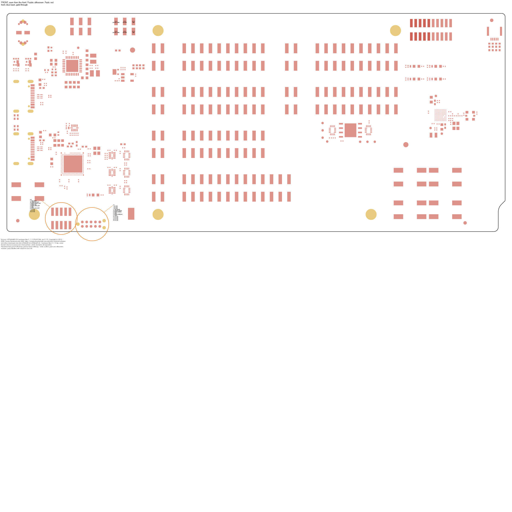
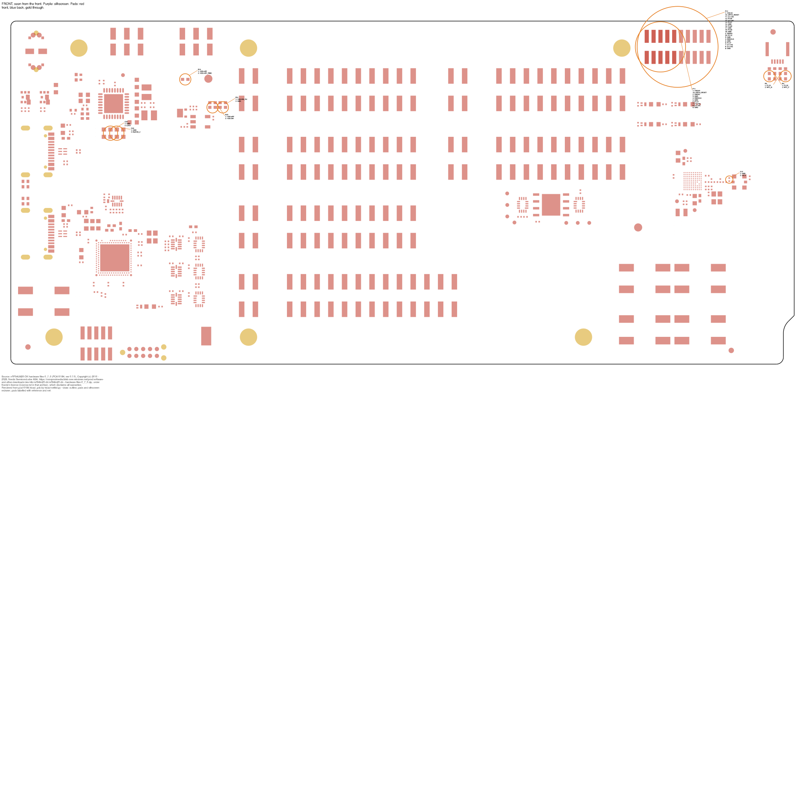

# nRF54LM20-DK (PCA10184) rev 0.7.0 — hardware design review, 2026-11-15

> **Nordic's reference board, not Sophon's.** The nRF54LM20-DK carries the same
> nRF54LM20A as Sophon's XIAO nRF54LM20A, so this review is kept beside the
> XIAO's as a reference for how Nordic wires the chip (#397). It was the test
> run of `hardware-design-review` on an Altium project (#395). Its § For
> HARDWARE.md is not merged into [HARDWARE.md](../HARDWARE.md), which
> describes the XIAO; only facts about the chip itself went there.

> **Board mode.** `altium-netlist.py prepare` warned that KiCad's import
> won't keep this design's harnesses (7 `.Harness` documents, 94 harness
> ports and sheet entries) or its hidden non-power pins (U4.9, X1.2, X1.4,
> X3.2, X3.4), and `--check-pcb` split 121 of 241 board nets accordingly. So
> every connection below comes from the board (`--pcb-nets`), with pin names
> from the schematic. The one merge is **C12**, the 1.5 pF shunt in the RF
> match: the board has it from the L3/L4 node (`ant:3`) to GND; the imported
> schematic has its pin 1 on GND and its pin 2 on nothing. The board's
> connection is the one used here (§ 8).

## Credits and licence for figures

Figures marked † are adapted from the **nRF54LM20-DK hardware files 0_7_0
(PCA10184, rev 0.7.0)**, Copyright (c) 2010 - 2026, Nordic Semiconductor ASA,
<https://nsscprodmedia.blob.core.windows.net/prod/software-and-other-downloads/dev-kits/nrf54lm20-dk/nrf54lm20-dk---hardware-files-0_7_0.zip>,
under Nordic's licence in that archive (`License.txt`, SHA-256
`e0549c22…1a47e86b9`), which requires the copyright notice and its disclaimer
to be kept, limits use to Nordic ICs, and disclaims all warranties. Changes:
the Altium design was imported into KiCad 10.0 and the board redrawn by
`kicad-netlist.py --draw` (outline, pads, silkscreen; pads labelled with
reference and net). Only the † figures are under that licence.

## 1. Where the authoritative data is

| Item | Value |
|---|---|
| Source | the user's copy of Nordic's zip (URL above), folder `PCA10184-nRF54LM20 Development Kit 0_7_0`; its `.PrjPcb` matches the zip fetched on 2026-11-13 (zip `a98c467b…d403b5`) |
| `.PrjPcb` SHA-256 | `9766e9fe7993a37bb23f506d2c495893ed0c5ef64e5508cd71ea6bdb0649bcd1` |
| `.PcbDoc` (`400861.PcbDoc`) | `8ed56fbb…b654419` |
| Sheets | 9 `.SchDoc` (top level, nRF54LM20, debugger MCU, level shifters, misc, power supply, QSPI switching, connectors, mechanical) and 7 `.Harness` |
| Revision | **0.7.0** on every title block (`=PCARevision`); project parameter `PCBRevision=0242GETR` |
| Imported with | KiCad 10.0 (root sheet `generator_version "10.0"`), from a scratchpad copy made by `altium-netlist.py prepare`; `pca10184.OutJob` and `pca10184_assembly.PCBDwf` listed but absent |
| Import messages | none reported this time (an earlier import of the same project showed "Blanket / Parameter Set not currently supported": design directives, no connections) |

The DK folder also holds `Import To KiCad/`, an earlier KiCad import made into
the original folder outside this process; it was not used.

**Datasheets.**

| Part | Ref | Document | Source | SHA-256 | Proxy |
|---|---|---|---|---|---|
| nRF54LM20 (CSP98, PAAA) | U1 | nRF54LM20A/B DS v1.0 (4539_001) | this repo's copy (`zephyr/sophon/datasheets/`), the user's; Nordic refuses scripted downloads | `9f8250bf…69df37` | no |
| nPM1300 | U3 | nPM1300 PS v1.1 | this repo's copy, from [mikroe's mirror](https://download.mikroe.com/documents/datasheets/nPM1300_datasheet.pdf) | `570eb58d…2272c53d` | no |
| TXB0104 | U8, U12–U14 | SCES650K (Mar 2025) | <https://www.ti.com/lit/ds/symlink/txb0104.pdf> | `9a852f7b…71e400` | no |
| TMUX1574 | U15, U16 | TI datasheet | <https://www.ti.com/lit/ds/symlink/tmux1574.pdf> | `9caaeb16…87a28` | no |
| TMUX1511 | U5–U7 | TI datasheet | <https://www.ti.com/lit/ds/symlink/tmux1511.pdf> | `04291b41…c7b1e9f` | no |
| TLV271 | U9 | TI datasheet | <https://www.ti.com/lit/ds/symlink/tlv271.pdf> | `08d1cc5a…b21` | no |

**Not held:** nRF5340 PS (U2; Nordic refuses scripted downloads),
MX25R6435F (U4), PBSS4330PA (Q8; Nexperia returned 403), MCM2301 (Q2, Q3),
RV2C010UN (Q1, Q4–Q7, Q9; ROHM's URL 404), PRTR5V0U2F (D1, D2), Murata
MM8130-2600 (J1), DLM0NSM900 (L8, L9), the crystals, and the slide switch
JS102011JAQN (SW5). Q8's polarity is taken from the design's own Description
field and Nexperia's datasheet title as indexed (§ 2).

## 2. How each fact was established

| Tag | Meaning here |
|---|---|
| *PCB* | a connection, from `kicad-netlist.py --pcb-nets` on the imported board (board mode), or a pad/track/footprint read from it |
| *netlist* | a pin name, value, footprint or field, from the imported schematic |
| *datasheet* | the part's datasheet, with page or table |
| *Zephyr* | `~/zephyrproject/zephyr/boards/nordic/nrf54lm20dk/` at `f44423d2612` (2026-09-19) |

`--check-pcb`: 999 pads, 241 board nets, 121 split, 1 merged (top banner).
`check-variants`: one variant, **`pca10184 - Main`**; Altium and KiCad agree
on its 10 unfitted parts (§ 9). **U1's 98 balls all match** the datasheet's
CSP98 table (Table 81) (*netlist*, *datasheet* p. 1226 ff.).

## 3. This board

| Ref | Part | Role |
|---|---|---|
| U1 | nRF54LM20, CSP98 | the target MCU and radio |
| U2 | nRF5340-QKAA, aQFN94 | the on-board debugger (interface MCU) |
| U3 | nPM1300-QEAA | PMIC: VBUS in, two bucks, two LDO/load switches; **no battery** |
| U9 + Q8 | TLV271 op-amp + PBSS4330PA (NPN) | tracking regulator: VDD:IO follows the nRF54's VDD |
| U4 | MX25R6435F, 64 Mbit | external QSPI flash, on VDD:IO |
| U15, U16 | TMUX1574 (2:1, 4-ch) | QSPI bus: flash (default) or headers P4/P17 |
| U5, U6, U7 | TMUX1511 (4× SPST) | nRF54 UART0, UART1, SWD to the debugger |
| U12–U14, U8 | TXB0104 | level shifters: debugger ↔ VDD:IO (U12–U14), debugger ↔ external target (U8) |
| Q2, Q3 | MCM2301 dual P-MOSFET | back-to-back power switches into VBUS |
| SW5 | JS102011JAQN slide switch | power on/off |
| J3 / J4 | USB-C | nRF54's own USB / debugger's USB |
| J1 | Murata MM8130-2600 | RF switch connector between the match and the antenna |
| J2 | TC2050-IDC footprint | Tag-Connect: programs the debugger (U2) |
| P13 | 2×5 1.27 mm | debug out (SWD to an external target) |
| P11, P12 | 2×5, 2×10 1.27 mm | debug in / trace for the nRF54 — **not fitted** |
| P1–P5, P17 | 2×10 ×5, 2×13 | GPIO headers |
| P14 + JP1 | 1×3 header + shunt | nRF54 supply jumper / current measurement |
| SW1–SW4, SW6 | push buttons | four user buttons (SW6 not traced) |
| LD1–LD4, LD5 | green LEDs | four user LEDs via N-MOSFETs Q4–Q7; LD5 via Q1 (`DBGR_LED`) |

## 4. Power

**Sources (*PCB*).**
- J4 (debugger USB) VBUS → FB4 → `VBUS:DBGR` → Q2 → **VBUS**.
- J3 (nRF54 USB) VBUS → FB3 → `VBUS:nRF` → (a) R1 2.2 Ω → `VBUS_5V0` → U1
  VBUS (K7); (b) SB6 (closed) → Q3 → **VBUS**.
- `5V0:CONN` (pin 1 of P6–P10 and P18) → SB31 (closed) → **VBUS**; P16 pin 1,
  and J2 pin 5, sit on VBUS directly.

**SW5 is the power switch, and the debugger's USB has priority (*PCB*,
inference from the switch wiring).** Q2 and Q3 are each a back-to-back P-MOSFET
pair ("Dual P-Channel MOSFET", *netlist* Description). In one position, SW5
ties each pair's gates to its own source (Q2 via R21 to `VBUS:DBGR`, Q3 via R22
to its source): both stay off and VBUS is dead. In the other, Q2's gates go to
Q3's drain node (R23 100 k to GND) and Q3's gates to `VBUS:DBGR` through R21:
with J4 powered, Q3 is off and Q2 on; without it, Q3 passes J3's VBUS. VBUS
fed at P16, P6–P10, P18 or J2 pin 5 bypasses SW5.

**Rails (*PCB*; default voltages from the VSET resistors, *datasheet*
nPM1300 Tables 18–19):**

| Rail | Made by | Feeds |
|---|---|---|
| VBUS | the sources above | U3 VBUS (via R14 0 Ω); SB17 (open) |
| VSYS | U3 VSYS/PVDD (from its VBUS; VBAT unconnected) | SB18 (closed) → R16 0 Ω → **P5V0** |
| P5V0 | VSYS | U2 VBUS + VDDH (via FB5, R11 2.2 Ω); U9 VDD; Q8 collector; U3 LSIN1/LSIN2 (SB28, SB29 closed) |
| VDD:nRF_PMIC | U3 BUCK1, **1.8 V** (R17 47 k) | P14 pin 1; SB20, SB27, SB30 (open) |
| VDD:nRF | P14 pin 2 (shunt JP1 to pin 1) | **U1 VDD** (A3, A4, A9, G10, H1); R55 → U9 IN+; SB19, SB24 (open); R43 (not fitted) |
| VOUT2 | U3 BUCK2, **1.8 V** (R18 4.7 k) | SB21 (open) only — unused as built |
| VDD:IO | Q8 emitter (R52 0 Ω), tracking VDD:nRF | headers P1–P5, P17 VDD pins; U12–U14 VCCB; flash U4 (SB23 closed); VDD:SW (R42 0 Ω) |
| VDD:SW | VDD:IO | TMUX VDDs (U5–U7, U15, U16); VDD:SW_PU (R44 0 Ω) → the switches' select pull-ups |
| VDD:DBGR | U2's own regulator (VDDH → VDD) | U2 VDD, U12–U14 and U8 VCCA, U3 VDDIO, J2 pin 1 |
| P5V0:LED | U3 LSOUT2 (load switch 2, from P5V0) | LD1–LD4 via 220 Ω |
| LDO1 | U3 LSOUT1 | nothing but C33 (not fitted) |

- **VDD:IO is a tracking supply.** U9 (TLV271: 3 IN+, 4 IN−, 1 OUT, 5 VDD,
  *datasheet*) compares VDD:nRF (via R55 33 k, C60 100 nF) with VDD:IO (via
  R54 0 Ω) and drives Q8's base; Q8's collector is on P5V0 and its emitter on
  VDD:IO (*PCB*). Q8 is NPN — the design's Description field reads "30V, 3A,
  2.1W, G=270, NPN Transistor" (*netlist*), and Nexperia titles the
  PBSS4330PA "30 V, 3 A NPN low VCEsat (BISS) transistor" — so this is an
  emitter follower in a negative-feedback loop: VDD:IO ≈ VDD:nRF.
- **The nRF54's supply goes through a removable shunt.** VDD:nRF reaches U1
  only through P14 pins 1–2 and the shunt JP1; R15 (10 Ω, the measurement
  bypass) is not fitted (*PCB*, variant). Without JP1, U1 is unpowered — and
  VDD:IO follows it down.
- **No battery.** U3's VBAT, NTC, SHPHLD, GPIO2–4 and LED0–2 are on no net
  (*PCB*); SHPHLD has an internal 50 kΩ pull-up (*datasheet* nPM1300,
  RSHPHLD).
- **The PMIC is the debugger's.** U3's TWI goes to U2 (P1.02/P1.03), its
  GPIO1 to U2 P1.13 (`LED_PWR_CTRL`), its VDDIO to VDD:DBGR; GPIO0
  (`LDO1_CTRL`) goes only to TP35 (*PCB*).
- **U1's own regulators:** DC/DC fitted (L1 4.7 µH from DCC to DECD); DECA
  via FB1/FB2; DECRF via L5 1.0 nH and C8; DECUSB C10 2.2 µF (*PCB*).

## 5. Strapping at power-up

- U3: BUCK1 on at 1.8 V, BUCK2 on at 1.8 V (*datasheet* Tables 18–19: VSET
  pins read only at power-on; a resistor enables the buck).
- TMUX1574 (U15, U16): ~EN on GND (always on); SEL pulled high by R56 100 k
  → **S*x*B: the flash** (*datasheet* Table 1). The debugger can drive SEL
  low through SB5 (closed) from U2 P1.15 (`QSPI_CTRL`) to route the bus to
  P4/P17.
- TMUX1511 (U5, U6, U7): SEL high = conducting (*datasheet* Table 7-1);
  every SEL is pulled up to VDD:SW_PU (R19, R36–R38, R40, 100 k) and driven by
  the debugger (`UART0_CTRL` P1.10, `UART0_HWFC` P0.20, `UART1_CTRL` P0.22,
  `UART1_HWFC`, `SWD3_CTRL` P0.06) → **UARTs and SWD connected to the
  debugger by default**. R51 (not fitted) would ground VDD:SW_PU.
- U14 (debugger → nRF54 SWD): OE on VDD:DBGR → always enabled. U8 (debug
  out): OE pulled up by R39 100 k, pulled low by Q9 when `SWD0_SEL` is high
  (§ 6).

## 6. Debug access

- **The nRF54's SWD comes from the debugger:** U2 → U14 (TXB0104) → U7
  (TMUX1511) → U1 SWDIO (G2), SWDCLK (G1), nRESET (F2) and P2.07 (C9) (*PCB*).
- **Debug in (P11, P12) is not fitted** in the `Main` variant (*netlist*,
  `check-variants`). Their pads follow the standard 10-pin Cortex layout
  (P11: 1 VDD:IO, 2 SWDIO, 3/5/9 GND, 4 SWDCLK, 6 P2.07, 10 nRESET); P12 adds
  P2.06–P2.10 for trace (*PCB*).
- **Debug out, P13**, through U8 (TXB0104, VCCA VDD:DBGR, VCCB `VDD:SWD0` =
  P13 pin 1, the target's VTref). Followed by channel (TXB0104 RUT pin table,
  *datasheet*):

  | P13 pin | Net name on the board | U8 channel ← debugger signal |
  |---|---|---|
  | 1 | VDD:SWD0 | VCCB (target VTref) |
  | 2 | `SWD0_RESET_EXT` | B1 ← A1 ← `SWD0_IO` (U2 P1.14) |
  | 3 | `SWD0_SEL` | U2 P0.30, Q9 gate |
  | 4 | `SWD0_SWO_EXT` | B2 ← A2 ← `SWD0_CLK` (U2 P1.12) |
  | 5 | GND | |
  | 6 | `SWD0_CLK_EXT` | B3 ← A3 ← `SWD0_SWO` (U2 P1.11) |
  | 10 | `SWD0_IO_EXT` | B4 ← A4 ← `SWD0_RESET` (U2 P0.31) |

  By signal, P13 is the standard layout (SWDIO 2, SWCLK 4, SWO 6, nRESET 10);
  **the four `_EXT` net names are in reverse order** — a naming slip with no
  electrical effect. Pin 3, ground on a standard target, is `SWD0_SEL`: a
  connected target pulls it low, turning Q9 off and enabling U8 via R39
  (inference from the wiring).
- **J2 (Tag-Connect) programs the debugger itself:** 1 VDD:DBGR, 2
  `DBGR_SWDIO`, 3 GND, 4 `DBGR_SWDCLK`, **5 VBUS**, 10 `DBGR_RESET` (*PCB*).
- Test pads on the debugger's SWD: TP8 `DBGR_SWDIO`, TP10 `DBGR_SWDCLK`, TP9
  `DBGR_RESET`, TP7 VDD:DBGR (*PCB*).

*† Front view: J2, P13, P14 and the debugger's SWD test pads TP7–TP10.*

## 7. USB

- **J3 → nRF54:** D+/D− via D1 (PRTR5V0U2F ESD) and L8 (common-mode choke) to
  U1 D+ (K5) / D− (K4); VBUS via FB3 and R1 2.2 Ω to U1 VBUS (K7); CC1/CC2
  via R46/R45 to GND (*PCB*).
- **J4 → debugger:** D+/D− via D2 and L9 to U2 D+ (B2) / D− (B4); CC1/CC2 to
  **U3's CC pins** (the PMIC's USB-C current detection) (*PCB*).

## 8. Headers and pin map

Each header's pins 1 and 20 are VDD:IO, 2 and 19 GND (*PCB*). Every GPIO pin
reaches its own U1 ball, except where noted:

| Header | Pins 3–18 (net = U1 ball) |
|---|---|
| P1 | P0.00–P0.09 (K3, K2, J3, J2, J1, H3, H2, G3, F3, E3); P0.06–P0.09 also via U5 to the debugger (UART0) |
| P2 | P1.00–P1.15; **P1.01/P1.02 (pins 4–5) reach U1 only through R3/R4, not fitted** — as built they are NFC pins on J5 |
| P3 | P1.16–P1.31; **P1.20/P1.21 (pins 7–8) reach U1 only through SB3/SB4, open** — U1's pins carry the 32 kHz crystal (SB1/SB2 closed) |
| P4 | `P2.00_A`–`P2.05_A` (through U15/U16, routed to the flash by default), P2.06–P2.10 |
| P5 | P3.00–P3.12 |
| P17 (2×13) | a mix of the above, plus `P2.00_A`–`P2.05_A` |

**Zephyr agrees** (*Zephyr* `nrf54lm20dk_common.dtsi`,
`nrf54lm20dk_nrf54lm20_a_b-pinctrl.dtsi`, `nrf54lm20_a_b_cpuapp_common.dtsi`):
LEDs P1.22, P1.25, P1.27, P1.28 (the N-MOSFET gates of LD1–LD4, *PCB*); buttons
P1.26, P1.09, P1.08, P0.05 (SW1, SW2, SW3, SW4 to GND, *PCB*; pull-up,
active-low); UART20 P1.16–P1.19 and UART30 P0.06–P0.09 (U6 and U5); flash on
`spi00` SCK P2.01, MOSI P2.02, MISO P2.04, CS P2.05 — the board's U15/U16 B
sides to U4 SCLK, SI, SO and CS (*PCB*). The flash node is `status =
"disabled"` in the board files.

## 9. Peripherals

- **U4 MX25R6435F** on P2.00–P2.05 through U15/U16: P2.00 → SIO3/RESET, P2.01
  → SCLK, P2.02 → SI, P2.03 → SIO2/WP, P2.04 → SO, P2.05 → CS (*PCB*). VCC on
  VDD:IO via SB23 (closed); SB24 (open) would move it to VDD:nRF.
- **No other peripheral IC on the nRF54.** The PMIC is on the debugger's TWI.
- LEDs LD1–LD4 are switched by N-MOSFETs whose gates have R29–R32 to GND, so
  they are off at reset (*PCB*); their anode supply, P5V0:LED, is U3's load
  switch 2, under the debugger's control.

## 10. RF

- **Chain** (*PCB*): U1 ANT (E1) → L2 3.6 nH series → C3 1.2 pF shunt → L3
  4.7 nH series → **C12 1.5 pF shunt** → L4 3.3 nH series → C13 0.3 pF shunt
  (**not fitted**) → J1 MM8130-2600 IN (pin 1) → J1 OUT (pin 3) → net `ANT`.
- **The antenna is printed:** `ANT` is 5 tracks, 21.27 mm, 1.27 mm wide on
  F.Cu, ending at (219.5, 118.1) in a copper rectangle with no net, 1.3 ×
  4.2 mm; C76 1.0 pF from `ANT` to GND at the feed; no zone (*PCB*,
  `--copper` and the board's graphics). J1 is a switch connector: a probe
  inserted there takes the RF out and, by Murata's design, disconnects the
  antenna (datasheet not held: § Not established).
- C12 is connected on the board but not in the imported schematic (top
  banner). Where the two differ, the board is what is built.

## 11. DNP parts and variants

The default lists none; **`pca10184 - Main`** leaves 10 parts off, and
`check-variants` finds Altium and KiCad in agreement (*netlist*):

| Part | Would connect | As built |
|---|---|---|
| P11, P12 | debug in / trace for U1 | no external debug-in to the nRF54 (debug through the on-board debugger, or fit them) |
| R3, R4 (0 Ω) | U1 P1.01/P1.02 (NFC_N/NFC_P) → P2 pins 4–5 | P2 pins 4–5 unconnected; U1's NFC pins go to J5 |
| R15 (10 Ω) | VDD:nRF_PMIC → VDD:nRF | the shunt JP1 on P14 carries U1's supply |
| R43 (0 Ω) | VDD:nRF → VDD:SW | VDD:SW comes from VDD:IO (R42) |
| R51 (0 Ω) | VDD:SW_PU → GND | the switch pull-ups are live |
| C13 (0.3 pF) | RF shunt at J1's input | not in the match |
| C33, C50 (10 µF) | LDO1 output; LSIN2 input | — |

*† Front view: the ten not-fitted parts, ringed with their pads' nets.*

## 12. Hazards

1. **TXB0104 supply order.** TI requires **VCCA ≤ VCCB** (*datasheet*
   SCES650K Table 4-1). U12–U14 have VCCA on VDD:DBGR and VCCB on VDD:IO; U8
   has VCCA on VDD:DBGR and VCCB on the external target's VTref (P13 pin 1).
   VDD:IO follows the nRF54's VDD (default 1.8 V), and the debugger reaches the
   PMIC's TWI, so it can presumably change BUCK1 (inference). So VDD:DBGR must stay at or below both the nRF54's VDD and
   any target's VTref. VDD:DBGR's value is set by U2 (nRF5340 PS not held):
   § Not established.
2. **VBUS inputs that bypass the power switch.** P16, P6–P10, P18 (through
   SB31) and J2 pin 5 sit on VBUS downstream of Q2/Q3, so 5 V fed there powers
   the board whatever SW5 says (*PCB*). J2 pin 5 carries VBUS on the debugger's
   programming connector.
3. **The nRF54's supply depends on JP1.** Without the P14 shunt (R15 not
   fitted), U1 is unpowered and VDD:IO tracks down to it (§ 4).
4. **Crystal pins on header P3.** P1.20/P1.21 carry the 32.768 kHz crystal
   through SB1/SB2 (closed); closing SB3/SB4 to use P3 pins 7–8 without
   opening SB1/SB2 would load the crystal with the header's wiring (inference).
5. **NFC pins with fitted loads.** P1.01/P1.02 go to J5 through R33/R34 (0 Ω)
   with C56/C57 300 pF (*PCB*). They are NFC pins from reset; using them as
   GPIO needs NFCT `PADCONFIG` set to Disabled (*datasheet* p. 293, p. 391),
   R3/R4 fitted, and R33/R34 removed (inference).

## 13. Battery quiescent budget

**Not applicable: the DK has no battery input** (U3's VBAT unconnected, § 4).
It runs from USB or 5 V. For the nRF54's own current, P14 measures VDD:nRF
only: U1 plus U9's input (R55 33 k into IN+). Everything on VDD:IO — the flash,
the level shifters' B sides, the switches and their pull-ups — draws from P5V0
through Q8, outside that measurement (*PCB*).

## 14. Corrections

- **`altium-netlist` § 4 (this repo, #395, before it merged)** called the DK's `GND`/`ant:3`
  merge "a net tie: the schematic puts the antenna pad on GND, and the board
  keeps it on its own net". It is C12: the board has it as a shunt from
  `ant:3` to GND; the imported schematic has one pin on GND and the other on
  nothing (*PCB*, *netlist*). The error came from reading the merge without
  naming its pad. Corrected in #395.
- **The board's `SWD0_*_EXT` net names** are in reverse order to the signals
  they carry (§ 6) — a design-file naming slip.

## 15. Not established

- **VDD:DBGR's voltage** (nRF5340 REGOUT0 / UICR, set by the debugger's
  firmware) — the TXB0104 rule depends on it. Measure TP7, or read the nRF5340
  PS and the J-Link OB firmware's settings.
- **The MM8130-2600's switching** and the antenna's match: Murata's datasheet,
  and a VNA or radiated test.
- **Why the imported schematic loses C12's second pin** (Altium's schematic or
  KiCad's import): open the `.SchDoc` in Altium.
- **The TC2050 cable's pinout on J2** (pin 5 is VBUS): Tag-Connect's TC2050
  pinout.
- **MX25R6435F, PBSS4330PA, MCM2301, RV2C010UN, PRTR5V0U2F, DLM0NSM900**:
  datasheets not held; nothing above depends on more than their pin names,
  the design's Description fields, or (Q8) Nexperia's indexed title.
- **SW6's function** and the remaining debugger-side nets: not traced.

## For HARDWARE.md

This repo keeps no HARDWARE.md for the DK, so these are not merged as board
facts. Two facts about the chip itself went into the XIAO's
[HARDWARE.md](../HARDWARE.md) (#397): U1's 98 balls agreeing with the
datasheet (§ 2), and the NFC pins' `PADCONFIG` (§ 12.5).

- **Verified:** the power tree and SW5 priority (§ 4); BUCK1/BUCK2 defaults
  1.8 V; VDD:IO tracking; JP1 dependency; header and Zephyr pin maps (§ 8);
  switch defaults (§ 5); P13 signal order (§ 6); RF chain and printed antenna
  (§ 10); the ten not-fitted parts (§ 11).
- **Leads:** VDD:DBGR vs VDD:IO (§ 12.1); J1's switching; C12's schematic
  connection.
